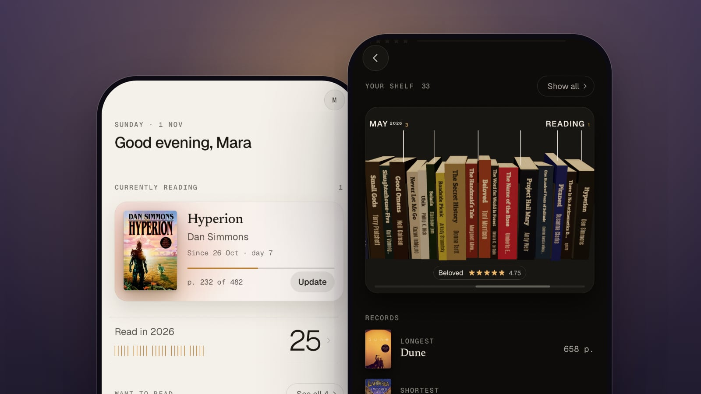

<picture>
  <source media="(prefers-color-scheme: dark)" srcset="docs/images/lockup-stacked-dark.svg">
  
</picture>

A calm, mobile-first book tracker you install from the home screen: search a book → **Want to read** → **Currently reading** → **Finished**, with the date, a quarter-star rating and a few words. One operator runs it as a private, invite-only instance for a few friends: no ads, no trackers.



## What it does

- **Find a book fast.** One field asks Apple Books, Open Library and the instance's own Catalogue at once and shows one merged list; a barcode scan or an ISBN goes straight to the edition.
- **Every read counts.** Start and finish dates, a quarter-star rating, a review, re-reads and books you put down are reading sessions of their own, editable afterwards.
- **Progress** in pages or percent with a day-by-day chart, and **Collections**, your own shelves, in your order.
- **Bring your history**: a Goodreads or Hardcover export (CSV, or Hardcover's zip) is told apart by its header; its shelves, lists, reads, ratings and reviews come along.
- **Friends, by choice.** Your switches decide what followers see, your account is private until you let them in, and you can hide a single book or block someone.
- **Offline and installed**: the Library stays on the device, changes wait in an outbox, and the PWA runs full screen in light and dark.

## Privacy

- **No trackers, no ads.** The app sets no cookies; Cloudflare Web Analytics counts page loads without storing anything on your device (docs/HOSTING.md).
- **Your data is yours.** Row-level security means a member only ever reads her own Library, reviews, Collections and Book links; the people she follows see what they chose to show, through functions that check the follow and their switches, and private is the default.
- **Sharing is opt-in.** A reading page is off until she turns it on, shows only the sections she picks (never her email, notes, highlights or a review she did not share), sits at an unguessable link out of search engines and dies when she turns it off; a cover that came with a Hardcover export shows inside the app only. The waitlist is the only address a visitor can leave: kept to send an invite, readable only by the owner, deleted on request.
- **Delete is in the app**: Profile → Account → Delete account removes your account and everything of yours at once; the encrypted nightly backups forget it when they expire, within 35 days. An export of your data is planned; until then the app only imports.
- **Search and the reader stay plain.** The browser asks Apple Books and Open Library directly for the words you type, the Goodreads rating is looked up by the server (so Goodreads never sees you), and *Translate* and *Define* send only the words you select (MyMemory, Wiktionary); the book itself never leaves your device.
- **Errors** (message, stack, screen, app version; never a book, note or search) go to a table in the instance's own Supabase, kept 30 days, and — when the owner turns them on — to Sentry (EU, 30 days, no account, IP or content).

**Where your data lives** (details in [docs/THIRD-PARTY.md](docs/THIRD-PARTY.md)):

| Service | What it holds or does |
| --- | --- |
| [Supabase](https://supabase.com), `eu-central-1` | The database, sign-in, profile photos and the edge functions: everything you save, your email address, the waitlist and the error log |
| [Cloudflare Pages](https://pages.cloudflare.com) | Serves the app and the link previews of a shared reading page; its Web Analytics counts page loads |
| [Cloudflare R2](https://developers.cloudflare.com/r2/) | Two private buckets: the nightly backup, encrypted before upload with a key only the owner holds and deleted after 35 days; and the covers of books in members' Libraries, under hashed names, deleted 30 days after no Library holds the book |
| Resend (an email provider, over SMTP) | Sends the sign-in codes and the waitlist invites, so it sees the address it mails |
| [Sentry](https://sentry.io), EU region (Frankfurt) | Error reports and performance measurements, only when the instance sets `NUXT_PUBLIC_SENTRY_DSN`: message and stack, app version, browser and device family, the screen as a route pattern, the last taps, freeze length. No account, name, email, IP, content or replay; kept 30 days |
| [GitHub](https://github.com) | The code and its CI. None of your data: the backup job encrypts the dump as it streams and keeps no artifact |

## Tech stack

- **App**: [Nuxt 4](https://nuxt.com) as a single-page app (`ssr: false`), Vue 3, TypeScript, Pinia, Tailwind CSS v4 on generated design tokens; static files on Cloudflare Pages.
- **Backend**: [Supabase](https://supabase.com): Postgres with the rules in the database (constraints, triggers, RPC, RLS), Auth by email code, ten Deno edge functions.
- **Tests**: pgTAP for the database, Vitest against a real local stack, Playwright flows in WebKit at iPhone size.

## Quick start

Needs this repository, Docker, Node 24, pnpm and the [Supabase CLI](https://supabase.com/docs/guides/local-development/cli/getting-started).

```sh
git clone https://github.com/fabkho/libellus && cd libellus
supabase start                 # Postgres, Auth, Studio and a mail catcher on ports 55320–55329
cd web
cp .env.example .env           # paste the anon key `supabase start` printed
pnpm install
pnpm dev                       # http://localhost:3020, best in a phone-sized viewport
```

Sign in as `dev@libellus.local` (the code lands in the local mailbox at http://127.0.0.1:55324), or sign up with any address and the invite code `LIBELLUS-DEV`.

## Documentation

- [docs/SETUP.md](docs/SETUP.md) — set up an instance: every variable and secret.
- [docs/DEVELOPMENT.md](docs/DEVELOPMENT.md) — run, test and change it locally; [docs/TESTING.md](docs/TESTING.md) the suites and CI.
- [docs/HOSTING.md](docs/HOSTING.md) — Cloudflare, domains, the build; [docs/OPERATIONS.md](docs/OPERATIONS.md) releases, monitoring, backups, own covers.
- [docs/DESIGN.md](docs/DESIGN.md), [docs/MOTION.md](docs/MOTION.md) — the design system and its motion; [docs/parity.md](docs/parity.md) per-screen behaviour, for a native port.
- [docs/THIRD-PARTY.md](docs/THIRD-PARTY.md) — what each external service gets; [SPEC.md](SPEC.md), [CONTEXT.md](CONTEXT.md) the spec sheet and the domain words.

## Contributing, security, license

Issues and pull requests are welcome ([CONTRIBUTING.md](CONTRIBUTING.md)); please report security problems privately ([SECURITY.md](SECURITY.md)). **License: [MIT](LICENSE).** The 3D shelf (Regal) is a separate layer in its own repository and not part of this license; BetterReads builds and runs without it.
