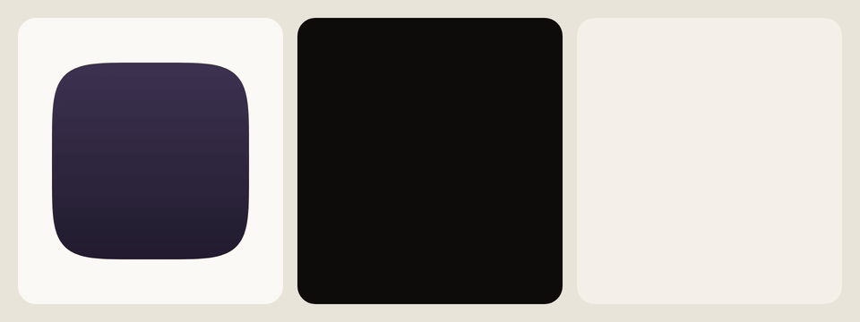

# BetterReads: logo options

Directions for a mark that fits the new name. Nothing here is used by the app yet: the current
icons (`design/icons/app/`, Two ribbons), `web/public/`, the manifest and the emails are untouched.
Once one is picked, its `icon.svg`, `monochrome.svg` and `favicon.svg` replace the three sources in
`design/icons/app/` and `web/scripts/render-icons.mjs` renders the PNGs as today.

**Decision:** option 6, Lamp over the page, is the new mark. 1 and 25 stay here as a backlog for
later; every other option of the nine rounds was dropped. The numbers are the ones used throughout.

| # | Option | Idea | Room | Status |
| --- | --- | --- | --- | --- |
| 6 | [Lamp over the page](6-lamp-over-page/sheet.png) | The lamp rising behind an open book like the sun | dusk plum (shift) | **chosen** |
| 1 | [Bookmark B](1-bookmark-b/sheet.png) | A capital B whose stem is today's ribbon, swallowtail and all | leather red (today's, no shift) | backlog |
| 25 | [Night window](25-night-window/sheet.png) | A window lit at night, books on the sill as silhouettes | ink-teal night (shift) | backlog |

`overview.html` is the same overview as a standalone page (light and dark), shared as an Orca
artifact.

## Motion (option 6)

`6-lamp-over-page/motion/` holds the mark in motion, made only of the motion tokens
([MOTION.md](../../docs/MOTION.md)): the pages arrive over `gentle` on `standard`, the lamp rises
behind them over `wave` on `standard`, its glow swells over `wave` on `wave`, and everything ends on
the static icon (with Reduce Motion it shows that last frame at once).

| File | What it is |
| --- | --- |
| `icon-animated.svg` | the app icon, animated (108 dp canvas, plays once) |
| `mark-animated-{dark,light}.svg` | the bare mark, animated, for a page in either theme (the way in) |
| `reveal.{mp4,gif}` | a recording of the three |
| `handover.{mp4,gif}` | the Android launch: the system's static splash, the page taking over with the same frame, the app |
| `index.html` | all of it on one page, with the answer to "can Android's splash animate?" (no; the page can take over from it) |

`animate.mjs` writes this folder (after `build.mjs`, same dependencies plus ffmpeg).

Each option's sheet has the rationale, the palette, the icon on iOS and Android home screens (and
as a themed icon), every mask, the favicon in a browser tab and at its real pixels, the monochrome
mark as a notification badge, and the lock-ups in the light and the dark theme.

## Files per option

| File | What it is |
| --- | --- |
| `icon.svg` | Android adaptive / `maskable`: 108 dp canvas, full-bleed room, the mark inside the 66 dp safe zone |
| `icon-ios.svg` | iOS / `any`: the same room, the mark at about 60 % of the tile (iOS rounds the corners itself) |
| `favicon.svg` | 32 × 32 rounded square, the mark simplified and enlarged for 32 and 16 px |
| `monochrome.svg` | the mark as one alpha shape (themed icons, notification badge) |
| `wordmark-{light,dark}.svg` | lock-up, mark and name side by side, in the theme's ink and accent |
| `wordmark-stacked-{light,dark}.svg` | lock-up, name under the mark |
| `sheet.png` | the contact sheet |

At the top: `overview.png` (all options side by side) and `overview.html` (the same as a page).

All lettering is outlined (Geist and Newsreader, the app's faces, both OFL); no SVG loads a font or an
image. Colours are the tokens' (`surface`, `ink`, `accent`, `cloth*`, `clothInk`); where an option
moves the room off today's leather red, its sheet says so.

## Rebuilding

`marks.mjs` holds each mark's geometry (a 100 × 100 box) and copy; `build.mjs` fits the marks into
every canvas, outlines the lettering and renders the sheets in Chromium. Its dependencies are not
part of the repo; the header of `build.mjs` says how to install them.
