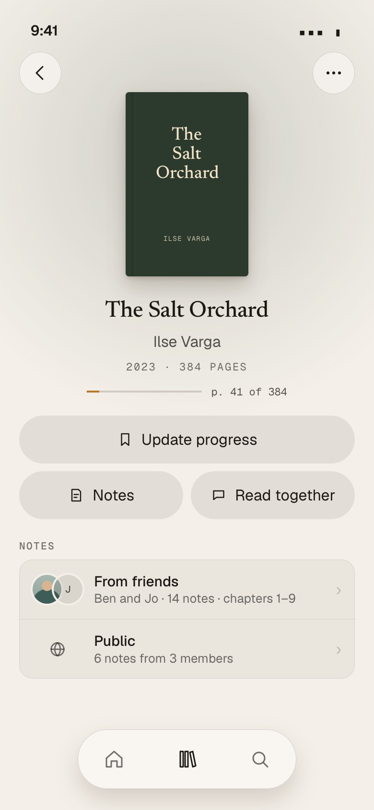
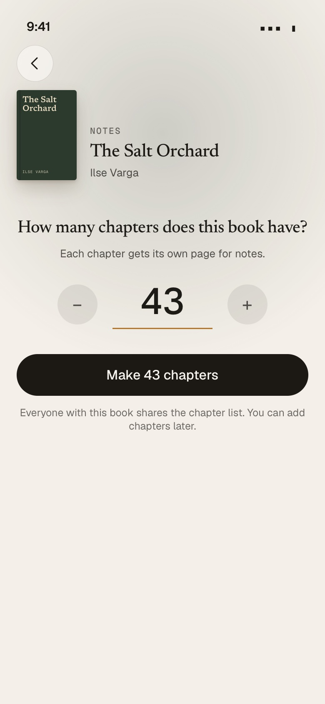
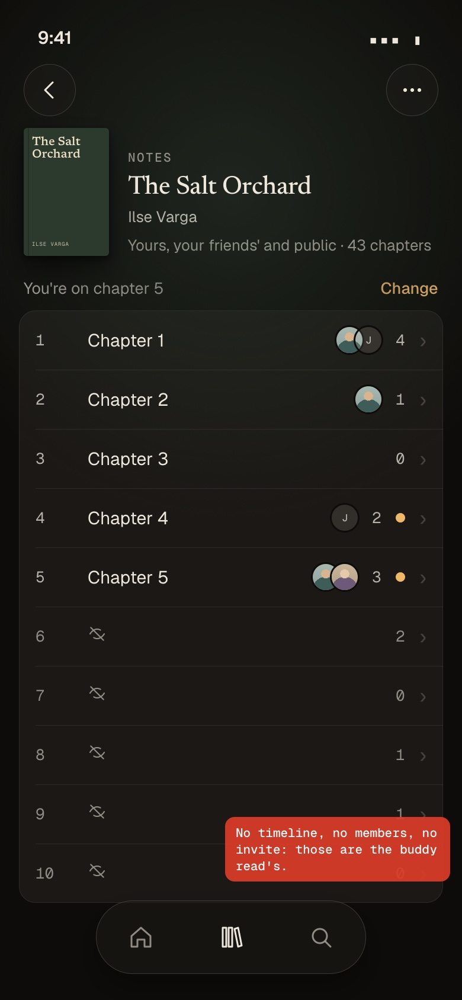
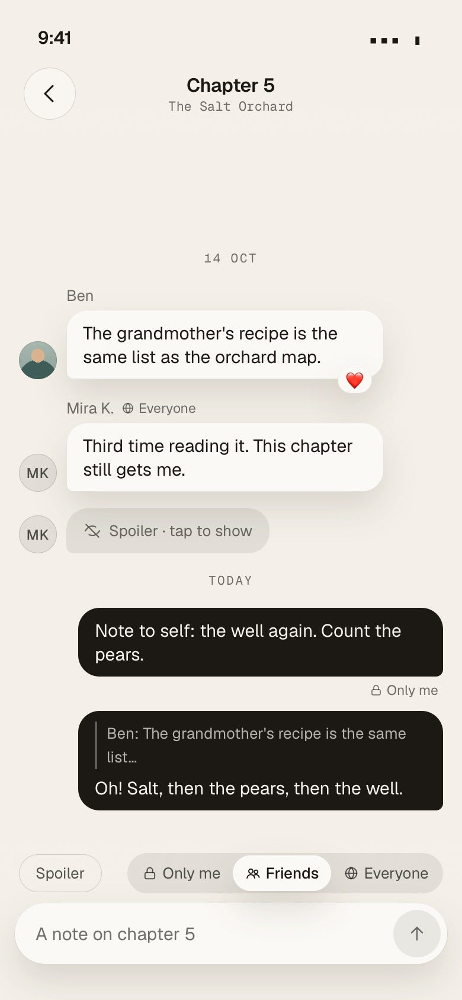
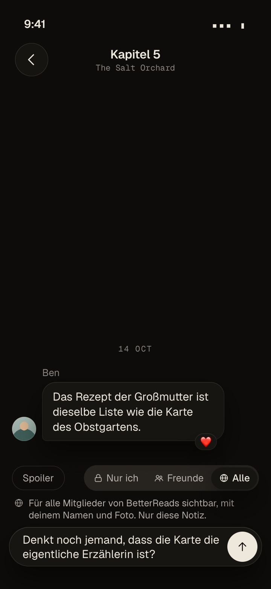
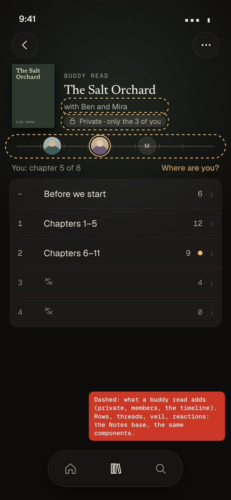

# Notes on a Book as the base, buddy reads on top

**Status: approved by the owner; all open questions decided (part 8); build briefs ready in
[`docs/plans/book-notes/briefs/`](book-notes/briefs/README.md).** Third version, 6 November 2026, against `origin/main`
`ee6893ce` (1.40.0). Production measured read-only, counts only (Appendix C). Mock-ups: `docs/prototypes/book-notes/` (static
HTML on the app's tokens, copied from `web/app/assets/css/tokens.generated.css`), shots in `docs/images/book-notes/`.

**How this document is merged.** It is the reference the build PRs point at, so it lands first: the coordinator drops "DO NOT
MERGE" from PR #518's title, marks it ready and merges it as a docs-only change (plan, briefs, mock-ups, shots; no code, no
migration) before N1's PR opens. Later changes to a decision are edits to part 8 in the PR that makes them.

**The owner's case:** "I am reading a book, he has not read it; I take notes per chapter so he can react later when he reads
it." On the design: "We have notes, and buddy reads add functionality: being private is the most important one, and the
progress tracking, the timeline with the avatar icons." On visibility: "Friends only as default and then a switch to make it
public. Each message needs the switch inside the notes … private, shared with friends, and public." Then: "We can build it
directly."

## What the owner decided

| Decision | Where |
|---|---|
| **Notes is the base; a buddy read is Notes plus a private audience, members and the timeline** | part 1 |
| **No join sheet, no pop-ups, no banners, no push**: a quiet *Notes* section on the Book page | part 5 |
| **Notes and buddy reads are started separately**; the Notes page asks only for the number of chapters | parts 2, 5 |
| **Chapters belong to the Book**, "when not already set by someone else" | part 2 |
| **Every note has its own visibility: Only me, Friends (default), Everyone** (every signed-in member; never the web) | part 2.3 |
| Notes now, no public rooms (forum for strangers) now | Appendix B |
| The open questions are delegated: decided in part 8, each can be overturned | part 8 |

## In ten lines

1. **Notes** = a Book's chapters, a thread per chapter, notes, replies, reactions, spoiler marks and the veil by the reader's
   own chapter. **Buddy read** = the same machinery plus a **private** audience (only the invited), members and invitations,
   the **timeline** of where everybody is, and live updates.
2. **Two room kinds on one machinery**: a notes room per Book (Work), a buddy read its own room; shared tables for chapters,
   messages, reactions and cursors, shared thread components.
3. **Chapters belong to the Book**: whoever opens Notes first types "43", the 43 threads exist for everybody. Chapters can be
   added at the end, never deleted once used; numbers only.
4. **Every note and reply carries a visibility**: **Only me** (her notebook), **Friends** (members she follows who follow her
   back; the default), **Everyone** (every signed-in member of BetterReads, never readable signed out). One server function,
   `can_see_note(viewer, note)`, decides it for every read; a block cuts every level both ways.
5. **Replies** default to the note they answer and can be narrower, never wider; a quote of a note the reader cannot see reads
   "A note you can't see". **Narrowing** a note is immediate and narrows its wider replies; **widening** is allowed (to the
   parent's level), with one quiet line under the control when *Everyone* is picked.
6. **A server-side switch** `notes_public_enabled` (on now) lets the owner hide *Everyone* without a release: public notes then
   count as friends' notes. To be turned off before open sign-up unless moderation has grown.
7. **The veil works by the reader's own chapter** at every visibility; her chapter comes from her progress or her hand, and
   nobody sees it in Notes. Every count (chapters, unread, the Book page) counts only notes the reader may see.
8. **Moderation minimum for Everyone**: report (the owner's inbox), block from a note, the owner removes a note (logged);
   rate limits; the photo of a public note's author becomes visible to its readers.
9. **Build: N1 database (Opus), N2 Notes page and Book page (Sonnet): about a week, then the owner uses it.** N3 re-bases the
   live buddy reads (1 read, 2 messages, 1 recording) on the shared tables; N4 polishes. Briefs for N1 and N2 are written.
10. **Not in v1**: chapter names, voice in Notes, push, live updates in Notes, a forum for strangers outside the app's members,
    direct messages (never).

## The recommendation

**Build now: N1 + N2 in one week, then N3 while production holds one buddy read.** Merge this plan first (docs only).

## What exists today (measured, production, 6 Nov 2026)

| Thing | Count |
|---|---|
| Members (accounts) | **2** (invite codes: 8, used 4 times; waitlist: 3) |
| Accepted follows / pairs who follow each other | 2 / **1** |
| Library entries | 843 (finished 538, reading 6, want to read 299); 28 on Manual books |
| Works both members have | **7**; **4** with one ahead (finished vs want to read 3, reading vs want to read 1); both finished 3 |
| Reading entries with progress set | 5 of 6 (pages on 9 sessions, percent on none) |
| **Buddy reads** (what N3 moves) | **1** read (active), **2** members, **23** Sections (22 equal parts by count + *The whole book*; no chapter labels), **2** messages (1 text, 1 voice), **1** stored recording in `buddy-voice`, 0 reactions, 0 read cursors, 0 removals |
| Catalogue Books with a page count | 671 of 869; 699 of 869 tied to a Work by Open Library or ISBN |
| Works with 2+ editions | 48; page counts differ by 13 % (median), up to 40 % |
| Reports / blocks / feedback | 0 / 0 / 0 |
| Database | 43 MB of the Free plan's 500 MB |

## 1. The layering

### 1.1 What becomes the base, what stays buddy-only (from the live code)

| Piece today | Where | Becomes |
|---|---|---|
| Sections (a Book's parts, *The whole book* last, fractions) | `buddy_read_sections`, `private.buddy_sections_parse` | **base** (`room_sections`); for Notes they are the Book's chapters |
| Messages: text, voice, quote (`reply_to`), spoiler mark, tombstone, delete | `buddy_messages`, `post_buddy_message`, `delete_buddy_message`, `send_buddy_voice` | **base** (`room_messages`), plus a `visibility` a message: `private`, `friends`, `public` in Notes, `members` in a buddy read |
| Reactions (the six emoji, one per member and message) | `buddy_reactions`, `react_to_buddy_message` | **base** |
| Read cursors and unread counts that skip veiled Sections | `buddy_section_cursors`, `buddy_read_members.last_read_at`, `private.buddy_unread`, `buddy_counts` | **base** (`room_cursors`; the room thread's cursor moves there too) |
| Report to the owner's inbox | `report_buddy_message` → `feedback` (`kind = 'report'`) | **base** |
| Blocks hide messages between two members | `private.buddy_hidden`, `public.blocks` | **base** |
| The veil and *Show anyway* (peeks kept on the device) | `utils/buddyThread.ts`, `components/together/ShowAnyway.vue` | **base** |
| Rate limits (30 a minute, 600 a day; reactions 60 a minute) | `post_buddy_message`, `private.buddy_rate_window` | **base** |
| Voice storage and the sweep | bucket `buddy-voice`, `private.buddy_voice_trash`, `buddy-voice-sweep` | **base machinery**, used by buddy reads; Notes later (N4) |
| A position: auto from progress plus a hand | `buddy_read_members.auto_through/hand_through/read_through`, `private.buddy_fraction`, `set_buddy_hand` | **split**: the base asks "which chapters are open for her"; the buddy read stores it per member for the timeline, Notes works it out per reader (part 2.5) |
| Host, members, invitations, link, removal, leave, finish, archive, the 12 cap, the 10-active cap | `buddy_reads`, `buddy_read_members`, `private.buddy_invite`, `join_buddy_read`, … | **buddy only** |
| The timeline (avatars in their Section) and *where everybody is* | `private.buddy_where`, `components/together/Track.vue` | **buddy only** |
| Live updates (a private Realtime topic per member) | `20261113040000_buddy_read_realtime.sql`, `data/buddyLive.ts` | **buddy only** (Notes is read when opened) |
| Thread screen | `pages/together/[id]/[section].vue` (571 lines: `UiChatThread`, `UiBubble`, `UiComposer`, `ReportSheet`, `ShowAnyway`) | **base** component `components/room/Thread.vue`, used by both pages |
| Room screen | `pages/together/[id]/index.vue` (272 lines: hero, `Track`, `UiThreadRow` rows, `MarkerSheet`, `RoomMenu`, `MembersSheet`, `InviteSheet`) | rows and position line **base** (`components/room/SectionRows.vue`); hero, track, menu, members, invite **buddy only** |
| Store and data | `stores/buddyRead.ts` (998 lines), `data/buddyReads.ts` (649) | thread half (open, page, send queue, react, delete, report, peeks) **base** (`stores/room.ts`, `data/rooms.ts`) behind one adapter per kind; reads, members, live **buddy only** |
| Setup, invitations, entry picker, Home card, Book page action | `components/together/{SetupSheet,InviteSheet,Picker,Link,EntryPicker,Invitations,InvitationRow,BookRow}.vue`, `components/home/Together.vue` | **buddy only** |

The chat package (`@fabkho/chat`: send queue, threads and chapters, veil helpers, behind an adapter) is already the base on the
client side; Notes adds a second adapter, not a second chat.

### 1.2 A buddy read: its own room on the same machinery (A), or an overlay on the notes room (B)

| | **A. Two room kinds, one machinery** (recommended) | B. A buddy read as an overlay on the Book's notes room |
|---|---|---|
| What it is | `rooms.kind` is `notes` (one per Book; each note at its own visibility) or `buddy` (one per read, audience: its members). Same tables for Sections, messages, reactions, cursors; same thread components | One room per Book. A buddy read adds a member list on top, and its members' messages are marked private |
| Private | by construction: a buddy room's messages are read only through membership | a rule per message ("private to read X") in a shared thread; one wrong filter and a private message shows on the friends' Notes page |
| Chapters | a buddy read has its own Sections (the host's choice, as today), and can copy the Book's chapters at setup (N4) | forced to the Book's chapters; today's reads by count or pages would not fit |
| Migration of the live read | copy into the shared tables, ids kept (N3) | merge it into a notes room of its Book: its 23 Sections against the Book's chapter list, which does not exist yet |
| Code | every function knows its kind; the buddy functions keep their gates | every read of a notes thread must also filter buddy-private messages: the riskiest place to add a condition |

**A.** Privacy is the buddy read's most important feature, and A gets it from the structure instead of from a filter.

### 1.3 The tables, and how to get there in small safe steps

Target (all `public`, RLS on with no policies, `revoke all` from `anon`/`authenticated`, reached only through
`security definer` functions as today):

- `rooms` (`id`, `kind` notes|buddy, `book_id` the edition it was started on, `work_key`, `created_at`); unique
  `(work_key) where kind = 'notes'`.
- `room_sections` (today's `buddy_read_sections` with `room_id`; `to_fraction` nullable: a notes chapter's band is worked out
  from the chapter count, part 2.5).
- `room_messages` (today's `buddy_messages` with `room_id` and `visibility`), `room_reactions`, `room_cursors`.
- `private.notes_settings` (one row: `public_enabled`), `private.note_moderation_log` (the owner's removals).
- `note_positions` (`room_id`, `member_id`, `hand_chapter`): a reader's own chapter when she set it. Nothing else of hers.
- **Buddy only**: `buddy_reads` keeps its name and its buddy columns (host, status, link, start date, how the Sections were
  made) and its `id` becomes a reference to `rooms.id`; `buddy_read_members`, `private.buddy_read_removed`, `private.buddy_calls`
  stay as they are.

Steps:

1. **N1 adds the shared tables and Notes on them. Buddy tables untouched.** Zero risk to what is live.
2. **N3 moves buddy reads onto them**, in one migration: insert a `rooms` row per buddy read **with the same id**, copy its
   Sections, messages, reactions and cursors **with their ids**, point `buddy_reads.id` and the members at `rooms`, replace the
   40 functions that read the moved tables (77 buddy functions in all; the list is in the schema snapshot), move the Realtime
   triggers to `room_messages` (`kind = 'buddy'` only), and rename the old tables `*_retired`. The migration counts rows before
   and after and stops if they differ. Every public function keeps its name and arguments (installed apps call them), so the
   web app needs no change on the day. The recording stays where it is: its path is `<read id>/<author>/<client id>.m4a`, and
   the read id is kept.
3. **N3b, one release later, drops the `*_retired` tables.** Forward-only as `AGENTS.md` requires; a mistake in N3 is
   corrected by the next migration, with the old rows still there to copy from.

Why not rename the buddy tables in place first: a rename breaks every function body that names the table (plpgsql bodies are
text), all in one step, before anything new exists. Copy-and-switch puts the new tables next to the old and switches readers
over in one transaction, with a count check.

## 2. Who owns the chapters, and who sees a note

### 2.1 Shared chapters with per-note visibility (i), or per-author rooms sharing the chapter list (ii)

| | **(i) One notes room per Book (Work), shared chapters, each note at its own visibility** (decided) | (ii) One notes room per author, chapter list shared from the Book |
|---|---|---|
| The owner's flow ("open Notes, set 43 chapters if nobody did, go to chapter 5, write") | exactly: one Notes page per Book | a page per author: "your notes" vs "Ben's notes", a switcher |
| A friend's reply to my note | lives in the chapter thread at its own visibility | lives in my room; seen by my audience, not his choice |
| Two friends with notes on one Book | one thread per chapter shows both | two rooms to open |
| Public notes (*Everyone*) | the same thread, one more level | a third kind of room |

**(i).** The first version's "one room per author per Book" came from building on the buddy read's host and members; with
Notes as a base that has neither, the author and the audience belong on the note, and the room belongs to the Book.

### 2.2 Chapter rules

- **One chapter list per Work**, stored once as the notes room's Sections: chapters 1 to N, then *The whole book* (for what can
  only be said at the end; it opens when she has finished). "Before you start" is not in Notes (it is a buddy read's room).
- **Setting it**: any member with the Book in her Library (any edition, any status) may set the count while none is set.
  The Notes page asks one question, "How many chapters does this book have?" (mock-up 2), and makes them.
- **Two at the same instant**: the room is created under a lock on its Work; the second gets `chapters_already_set` with the
  list, and her page simply shows it (her count is not used).
- **Adding**: anyone with the Book may add chapters at the end (a wrong count is usually too low). Existing chapters keep
  their ids and their notes.
- **Removing**: only chapters at the end that hold no note from anyone (a typo of 430 is fixable; a used chapter is never
  deleted). `buddy_sections_locked` does not apply to Notes; buddy reads keep it.
- **Names**: none in v1. Chapters are numbers, worded in the reader's language ("Chapter 5", "Kapitel 5"). A shared name is
  text anyone with the Book could write and everyone with the Book would read; a title can also spoil (today's veil hides a
  veiled Section's title for that reason). "Name my chapters" is later (decision 8).
- **Prologue, epilogue, interludes**: the Notes page says "count them too"; editions that number differently are corrected by
  the reader's own chapter (2.5).
- **Manual books**: no Notes (they are hers alone; nobody else can open them).

### 2.3 Who sees a note: three visibilities

**The levels.** Every note and every reply has exactly one, chosen by its author:

| Level (EN / DE) | Value | Who sees it | Mark in the thread |
|---|---|---|---|
| **Only me** / *Nur ich* | `private` | the author alone: her notebook per chapter | a small lock and "Only me" under her bubble |
| **Friends** / *Freunde* (default) | `friends` | the author and the members she follows **and** who follow her, both accepted | none (the usual case) |
| **Everyone** / *Alle* | `public` | every signed-in member of BetterReads. Never readable signed out: there is no public web page, no share link, no search engine | a small globe and "Everyone" by the name |

**One function decides, everywhere.** `private.can_see_note(p_viewer uuid, p_note uuid) returns boolean`, `SECURITY DEFINER`,
`set search_path = ''` (fully qualified names), `STABLE`. Every read path calls it or the set-returning twin
`private.visible_notes(p_viewer, p_room)` built on the same predicate: the thread, the chapter counts, the unread counts, the
faces, the Book page lines, quotes, reactions, reports, the photo rule. In order:

1. no viewer (signed out) → no;
2. the note is not in a `notes` room → no (buddy messages keep their own gate, `members`);
3. the viewer is the author → yes (all levels, her tombstones too);
4. either has blocked the other (`private.blocked_either`) → no, **at every level, public included**;
5. the effective level: `public` counts as `friends` while the switch `notes_public_enabled` is off (2.3.4);
6. `private` → no; `friends` → `private.mutual_friends(viewer, author)` (both follows accepted); `public` → yes.

The veil is separate and applies on top at every level: a public note in chapter 20 sits in a veiled chapter for a reader on
chapter 5 (2.5).

#### 2.3.1 Counts never count what the reader cannot see

Every number is computed per reader from `visible_notes(viewer, room)`, live (no stored counter that could include hidden
notes):

- **chapter rows**: the count of live (not deleted) visible notes in the chapter, shown on veiled rows too (a number says nothing
  of content, as in buddy reads); faces only on open rows;
- **unread**: visible notes by others newer than her cursor in that chapter, only on chapters open to her;
- **the Book page**: line *From friends* = visible notes whose authors are her mutual friends (friends or public level), with
  up to three faces; line *Public* = public notes by members who are not her friends (shown only while the switch is on);
  her own notes are not counted there. A member with no friends still sees the *Public* line. No line when its count is 0.

A reaction is counted on a note she can see, from anyone not blocked with her; reactions never show names, so a count of
three hearts says nothing about who. Indexes: `room_messages (room_id, section_id, created_at desc) where deleted_at is null`,
`(author_id, created_at)`, `(reply_to)`; the follows table's existing keys answer the friends test.

#### 2.3.2 Replies

- A reply is a note: it has its own author and its own level, and the same function decides who sees it.
- **Default**: the level of the note it answers. **Narrower is allowed, wider never** (order: Only me < Friends < Everyone).
  A reply usually restates its parent ("you're right that the mother lies"), so a public reply to a friends-only note would
  carry the friends-only context to everyone. The composer greys the wider levels while a reply is quoted, with "Can't be wider
  than the note you answer." / "Kann nicht weiter sichtbar sein als die Notiz, auf die du antwortest."
- **The quote** is filled by the server per reader: the parent's excerpt and author only when `can_see_note(viewer, parent)`;
  otherwise `{"hidden": true}`, shown as **"A note you can't see"** / *"Eine Notiz, die du nicht sehen kannst"*, never its
  words or author.
- **The thread split is accepted.** Anna (friends with Ben and Jo; Ben and Jo are not friends) writes a friends note; Ben replies
  at Friends; Jo sees Anna's note and not Ben's reply; when Anna answers Ben at Friends, Jo sees Anna's answer with the quote
  "A note you can't see". Each reader sees her own conversation.

| In chapter 5 | Anna | Ben | Jo | Mira (a member, no friend of anyone) |
|---|---|---|---|---|
| Anna's note, Friends | ✓ | ✓ | ✓ | – |
| Ben's reply, Friends | ✓ | ✓ | – | – |
| Anna's answer to Ben, Friends | ✓ | ✓ | ✓, quote hidden | – |
| Mira's note, Everyone | ✓ | ✓ | ✓ | ✓ |
| Jo's note, Only me | – | – | ✓ | – |
| Mira's note, if Anna blocked Mira | – | ✓ | ✓ | ✓ (Anna's notes gone for her) |

#### 2.3.3 Changing a note's level after posting

- Her own note's action bar (long press, as for reactions) has **Who can see this** with the three levels.
- **Narrowing is immediate.** Replies to it (and replies to those) that are now wider are narrowed to the new level, whoever
  wrote them: the never-wider rule holds over time, and narrowing only ever hides. Reactions stay (counts, no names).
- **Widening** is allowed up to the parent's level (for a reply) and to *Everyone* only while the switch is on; replies are not
  widened with it. The same quiet line as in the composer shows under *Everyone* before she confirms with **Make visible to
  everyone**; no sheet, no dialog.
- A tombstone keeps the level the note had.

#### 2.3.4 The master switch for *Everyone*

`private.notes_settings` (one row, `id boolean primary key default true check (id)`, `public_enabled boolean not null default
true`, `updated_at`), read by `private.notes_public_enabled()` (the setting the plan calls `notes_public_enabled`), the same singleton pattern as `private.cover_store_settings` and `private.cover_gc_enabled()`.
`public.notes_config()` returns `{"publicEnabled": bool}` to signed-in members; `public.owner_set_notes_public(boolean)`,
guarded by `private.is_instance_owner()`, flips it (or one `update` in the SQL editor; `docs/OPERATIONS.md` gets the line).

- **On (now)**: 2 members, invite-only.
- **Off**: the composer and the action bar show *Only me* and *Friends* only; posting or widening to `public` is refused
  (`notes_public_off`); every existing public note counts as a friends note for every reader; the *Public* line leaves the Book
  page; the author still sees her note's globe, with "Everyone is paused, friends see it" in its action bar. Turning it on
  again restores them. **Turn it off before open sign-up (#331)** unless the moderation of part 5.1 has grown by then.

There is no "friends of friends" level and no `audience` column on rooms: a buddy read's audience is fixed (its members), and
its messages carry `members`.

#### 2.3.5 Defaults in the composer

- A new note: **Friends**.
- The device remembers her last **non-public** choice (`libellus.notes.visibility`: `private` or `friends`). **Everyone is
  chosen per note**: after a public note is sent the control returns to the remembered level. No "keep my notes public"
  setting in v1. A public note should be a decision every time; the safe default wins.
- A reply: the narrower of the parent's level and her remembered level. Answering a public note at *Everyone* is one tap
  more, in keeping with "Everyone is chosen per note"; she can never go wider than the parent.
- While *Everyone* is selected, one quiet line under the control: **"Visible to all members of BetterReads, with your name and
  photo. Just this note."** / *"Für alle Mitglieder von BetterReads sichtbar, mit deinem Namen und Foto. Nur diese Notiz."*
  (shown every time it is selected: it describes the state, it does not nag).

### 2.4 Editions and the Work

The room's key is one function, `private.book_work_key(book)`: the Work (`book_works.work_id`) when the Book is tied to it by
Open Library or ISBN (699 of 869 Catalogue Books), else the Book itself (a room for that edition). Title-matched ties (70) are
not trusted for this, because two books can share a title. The buddy read's own rule for "the same Book" (`link_buddy_entry`:
the same `openlibrary_work_key`) moves onto the same function in N3, so both layers agree; 13 Books are tied differently by the
two rules today. Chapters, not pages, are what editions share, so a chapter list made from one edition serves all.

### 2.5 Her chapter, and the veil

- **From her progress**: her furthest point in the Book across her entries of the Work, as a fraction (page over her edition's
  page count, or the percent; a finished read at any time is the whole Book). With N chapters and no chapter sizes known, she is
  **on chapter `floor(fraction × N)`, at least 1 once she has started** (equal-sized chapters, rounded down, so a guess that is
  off is more often behind than ahead).
- **By hand**: "You're on chapter 5 · Change" at the top of the Notes page. A hand choice **wins in both directions** (an
  estimate can be wrong either way) until she picks *Automatic* again. Stored in `note_positions`.
- **What is open**: chapters 1 to her chapter (the one she is on included: that is where she writes), *The whole book* once she
  has finished. Not started (or not in her Library): nothing open; every chapter can still be opened with *Show anyway*.
- **A friend behind**: Anna writes in chapter 5. Ben is on chapter 2, so on his Notes page chapter 5 is a veiled row (its
  number and a count, no faces, no new-dot); when his reading or his hand reaches 5, it opens, with its count of new notes
  waiting. A note marked *Spoiler* stays veiled inside an open chapter until he taps it, as today.
- **Nobody sees her chapter.** In Notes no one sees anyone's position, not even friends; posting in chapter 5 says only that
  she wrote about chapter 5. The timeline of who is where is the buddy read's (part 1).
- **The veil stays the app's**, as in buddy reads: the database answers a chapter's notes to whoever may see them, and the app
  does not ask for a veiled chapter before *Show anyway*. A courtesy between readers, not a secret.
- **Buddy reads keep their own rule** ("read through" Sections, the hand only opens more, positions shown on the timeline).

## 3. What is missing today, under the new model

| # | Gap in the first version | Now |
|---|---|---|
| G1 | Friends cannot open her notes without an invitation | **gone**: Notes has no invitation; each note's level decides |
| G2 | No chapter can be added once a note exists (`buddy_sections_locked`) | **changed**: Notes adds at the end and removes unused chapters at the end; buddy reads keep the lock |
| G3 | *Finish* stops new joins | **gone** for Notes (no host, no finish); unchanged for buddy reads |
| G4 | A friend who finished before joining is "not set" (`buddy_fraction`) | **gone** for Notes: the furthest read at any time counts; unchanged for buddy reads |
| G5 | Notes rooms eat the cap of 10 active reads | **gone**: Notes has no membership |
| G6 | His copy is linked by hand | **gone** for Notes: worked out from all his entries of the Work |
| G7 | No entry points | **N2**: *Notes* on the Book page, the *Notes* section (From friends, Public) |
| G8 | No notification | **by design** in v1: no push, no pop-ups; new-dots on the Notes page, counts on the Book page |
| G9 | Buddy words for notes | **gone**: separate pages |
| G10 | Who owns a notes room when its author leaves | **gone**: the room is the Book's; she deletes her own notes |
| new | One rule for "the same Work" across both layers | N1 (`private.book_work_key`); buddy reads move onto it in N3 |
| new | Per-note visibility, `can_see_note`, counts per reader, the master switch | N1 |
| new | Moderation minimum for *Everyone* (report, block from a note, owner removal) | N1 (rules), N2 (screens) |
| new | Her chapter from progress (bands) and by hand | N1 |
| new | Shared thread components between the two pages | N2 (client), N3 (data) |

## 4. Privacy

- **Names and photos.** Friends already see both. A **public** note shows its author's name and photo to every member who can
  see it: `private.can_see_photo(viewer, owner)` gains one clause, "the owner has a public note the viewer can see" (the avatars
  bucket's read policy uses it). A private note shows nothing to anyone else.
- **Her position** is never shown in Notes, to anyone. Seeing where friends are is the buddy read's.
- **A note says she has the Book.** When the Book is hidden from followers (`library_entries.hidden`), the Notes page says in one
  line "Your friends see your notes on this book, and everyone sees your public ones." Her switches are not changed.
- **The chapter count** is shared with every member who has the Book, without her name (who set it is kept only to limit abuse,
  and goes with her account).
- **Blocks** cut every level both ways, including public notes and their reactions and quotes.
- **Deletion**: her notes, replies and reactions go with her account (`delete_my_account` cascades). A note she deletes leaves
  "Note removed" (as in buddy reads). A note the owner removes after a report leaves "Removed by the moderator"; its text is kept
  in `private.note_moderation_log` for 12 months (to answer a complaint), then deleted by a monthly job.
- **Buddy reads** are unchanged: private to the invited.
- **The privacy notice** (`web/app/legal/privacy.ts`, both languages, the version line; ships with N2):
  - EN, a new bullet beside *Buddy reads*: "**Notes on books (only if you write one).** Notes you leave on a chapter of a Book,
    your replies and your reactions. Each note has an audience you choose and can change: *Only me* (nobody else), *Friends*
    (members you follow who follow you back) or *Everyone* (every signed-in member of BetterReads; never anyone outside the app).
    Others see a note with your name and profile photo; reactions are shown as counts, without names. Which chapter you are on
    is worked out from your reading progress (or set by you) and used only to keep later chapters closed for you: nobody else
    sees it. If you set how many chapters a Book has, that number is shared with every member who has the Book, without your
    name. Your notes stay until you delete them or your account. If I remove a note after a report, I keep its text, the reason
    and the date for 12 months."
  - DE: "**Notizen zu Büchern (nur wenn du eine schreibst).** Notizen, die du zu einem Kapitel eines Buchs hinterlässt, deine
    Antworten und deine Reaktionen. Jede Notiz hat ein Publikum, das du wählst und ändern kannst: *Nur ich* (niemand sonst),
    *Freunde* (Mitglieder, denen du folgst und die dir folgen) oder *Alle* (alle angemeldeten Mitglieder von BetterReads; nie
    jemand außerhalb der App). Andere sehen eine Notiz mit deinem Namen und Profilfoto; Reaktionen werden als Zahl gezeigt, ohne
    Namen. Bei welchem Kapitel du bist, wird aus deinem Lesefortschritt berechnet (oder von dir gesetzt) und nur genutzt, um
    spätere Kapitel für dich geschlossen zu halten: niemand sonst sieht es. Wenn du festlegst, wie viele Kapitel ein Buch hat,
    wird diese Zahl ohne deinen Namen mit allen Mitgliedern geteilt, die das Buch haben. Deine Notizen bleiben, bis du sie oder
    dein Konto löschst. Entferne ich eine Notiz nach einer Meldung, bewahre ich ihren Text, den Grund und das Datum 12 Monate auf."
  - The legal-basis line "What you show to others (…)" gains "a note for friends or everyone"; the photo bullet ("shown only to
    people who may see your profile and to the members of a buddy read") gains "and to the readers of your public notes"; the
    retention list gains the 12-month moderation record. `docs/legal-checklist.md`: a *Notes* line beside *Buddy reads*.

## 5. The experience

| Screen | What | Mock-up |
|---|---|---|
| **Book page** | Two quiet buttons under *Update progress*: **Notes** and **Read together** (the buddy read, as today). Below them the section **Notes**, only when there is something: **From friends** (faces, "Ben and Jo · 14 notes · chapters 1–9") and **Public** (a globe, "6 notes from 3 members"), each a row to the Notes page. No pop-up, no banner, no count on the buttons | 1 |
| **Notes page, no chapters yet** | "How many chapters does this book have?", a number with − and +, **Make 43 chapters**, one line that the list is shared and can grow | 2 |
| **Notes page** | Hero (cover, "Notes", title, "Yours, your friends' and public · 43 chapters"), "You're on chapter 5 · Change", the chapters as the buddy room's rows (number, "Chapter k", faces of visible authors, count, new-dot), veiled rows after her chapter; ⋯ holds *Add chapters* | 3 |
| **A chapter** | The buddy read's thread screen: bubbles with name and face; a globe and "Everyone" by the name of a public note, a lock and "Only me" under her private one; quotes ("A note you can't see" when hidden); *Spoiler* veil; the composer's chip row holds *Spoiler* and the three-way control **Only me · Friends · Everyone** (icons and a word, the app's segmented pattern, 44 px targets) | 4 |
| **Choosing Everyone** | The control on *Everyone* and one quiet line under it: "Visible to all members of BetterReads, with your name and photo. Just this note." | 4b |
| **Buddy read** | The same rows and threads, plus what it adds: "with Ben and Mira", **Private · only the 3 of you**, the timeline, *Where are you?*, members and invite in ⋯. No visibility control (a buddy read is private) | 5 |








German, dark and 360 px variants are in the same folder.

**Words.** EN *Only me · Friends · Everyone*, DE *Nur ich · Freunde · Alle*; *Who can see this* / *Wer das sehen kann*; *A note
you can't see* / *Eine Notiz, die du nicht sehen kannst*; *Removed by the moderator* / *Von der Moderation entfernt*. Informal
*du* throughout, as the app's German.

**Reading, not live.** The Notes page and a chapter are read when opened, when the app comes back to the front and on pull to
refresh; no Realtime. Buddy reads stay live.

**Empty states.** No chapters: mock-up 2. A chapter without notes: "No notes on chapter 5 yet." over the composer. Nothing to
show: no *Notes* section on the Book page.

### 5.1 Moderation, the minimum for *Everyone*

- **Report** on any note not hers, every level, with the buddy read's sheet (four reasons, a note); it lands in the owner's
  Feedback inbox as `kind = 'report'` with the context `{room, chapter, note, author, visibility, excerpt}` (5 an hour, 20 a day,
  one row per reporter and note, as `report_buddy_message`).
- **Block** from a note's action bar ("Block Mira K."), also for a member who is not a friend: `public.block()` accepts a member
  whose note the caller can see. Its effect is the existing one: silent, both ways, everywhere.
- **Owner removal**: on a report in the Feedback inbox, **Remove note** (`public.owner_remove_note(note, reason)`, guarded by
  `private.is_instance_owner()`): a tombstone "Removed by the moderator" for everyone, the text moved to
  `private.note_moderation_log` (12 months). The author sees the tombstone on her note.
- **Limits**: 30 notes a minute and 300 a day a member across all Books; 30 public notes a day; 20 chapter changes a day;
  reactions 60 a minute (as buddy reads); text up to 2000 characters, no link previews (bubbles are plain text).
- **When sign-up opens** (#331): turn *Everyone* off first (2.3.4), unless an owner alert on reports, name rules (WP-26) and a
  notice to the author with the reason exist by then (Appendix B).

## 6. Build plan

Every PR follows `CONTRIBUTING.md` (conventional title, pgTAP for every rule, `pnpm schema:snapshot`, a parity entry, EN and DE
copy). Briefs: [`docs/plans/book-notes/briefs/`](book-notes/briefs/README.md). Sizes in one worker's days (M ≈ 1, L ≈ 2–3).

| # | PR | Size | Model | After | Touches shipped code? |
|---|---|---|---|---|---|
| **N1** | **Notes base, database** ([brief](book-notes/briefs/N1-database.md)): `rooms`, `room_sections`, `room_messages` (with `visibility`), `room_reactions`, `room_cursors`, `note_positions`, `private.notes_settings`, `private.note_moderation_log`; `book_work_key`, `mutual_friends`, `can_see_note`, `visible_notes`; the chapter, position, message, visibility, report and owner functions; the switch; limits; indexes; the pgTAP matrix (viewer × level × block × switch × veil data) | L | Opus, high | – | additively: `public.block()` (eligibility), `private.can_see_photo` (public-note clause), the `feedback` context (no schema change). Buddy tables untouched |
| **N2** | **Notes page, chapter thread, Book page** ([brief](book-notes/briefs/N2-notes-page.md)): the chapter-count prompt, chapter list, thread with the three-way control and marks, change-level in the action bar, report and block, the Book page section, **Remove note** in the owner's inbox, privacy notice EN and DE, parity, e2e | L | Sonnet, high | N1 | yes, client: `ShowAnyway`, `ReportSheet` and the veil helpers move to shared places; the 7 buddy flows guard it |
| N3 | Buddy reads re-based on the shared tables (part 1.3): copy-and-switch with counts checked, ids kept, 40 functions rewritten, Realtime triggers moved, public function names kept, `visibility = 'members'` | L | Opus, high | N1, a week of N2 in use | yes, database: the riskiest PR; 6 buddy pgTAP files, 7 flows, a restored-copy rehearsal |
| N3c | Buddy pages on the shared store | M | normal | N3 | yes, client |
| N3b | Drop the `*_retired` tables, one release after N3 | S | normal | N3 released | no |
| N4 | Voice in Notes (the bucket's read rule through `can_see_note`; Opus review), buddy setup offers "the Book's chapters (43)", `CONTEXT.md` words | M | normal | N2, N3 | small |

**About 11 worker-days; N1 and N2 in one week**, N2 starting on N1's branch once N1 has fixed its function signatures (day 1,
in the brief). Then the owner uses Notes; N3 the week after. No feature switch: buddy reads are on for everybody, and the only
switch is the server-side one for *Everyone*.

**Not in v1**: chapter names, voice in Notes, push, Realtime in Notes, a Home card for Notes, a profile row of her notes,
editing a note's text, friends of friends, a forum outside the members, direct messages (never).

## 7. Risks

| Risk | Likelihood | Effect | Mitigation |
|---|---|---|---|
| A note reaches someone its level excludes | low | trust | one function for every read; Opus on N1; the pgTAP matrix; the coordinator's independent security review |
| A count or a face reveals a hidden note | low | small leak | counts from `visible_notes` only, tested per viewer |
| A public note is abusive, nobody is alerted | low at 2 members | members hurt | report → inbox, owner removal, block; turn *Everyone* off before open sign-up |
| A member posts at *Everyone* by mistake | medium | an unwanted audience | Friends default, Everyone per note, the line under the control, narrowing is instant |
| Narrowing a note hides other members' replies | medium | surprise | it only ever hides; the never-wider rule keeps quotes safe |
| N3 breaks the live buddy read | medium | the one read stops working | copy-and-switch with count check, ids kept, old tables kept a release, rehearsal, pgTAP and flows |
| N2's moves change buddy-read behaviour | medium | a regression in a live screen | pure moves first, 7 flows `@full` |
| The equal-band estimate opens a chapter too early | medium | a small spoiler | rounded down; "You're on chapter k · Change"; spoiler marks; the hand wins |
| Editions number chapters differently | medium | a note one chapter off | the reader's own chapter by hand; "count prologue and epilogue" |

## 8. Decisions

The owner delegated the open questions. Each is **decided (coordinator, delegated; can be overturned)**; overturning one is an
edit here in the PR that changes it.

| # | Decision | Status |
|---|---|---|
| 1 | Two room kinds on one machinery (A), not a buddy read laid over the notes room | decided (coordinator, delegated; can be overturned) |
| 2 | The chapter list belongs to the Work, shared by every edition | decided (coordinator, delegated; can be overturned) |
| 3 | Anyone with the Book (any status) sets the count when none is set and adds at the end; only unused chapters at the end can be removed; two at once: the first wins | decided (coordinator, delegated; can be overturned) |
| 4 | A reply has its own level, never wider than its parent; a hidden parent's quote reads "A note you can't see" | decided (coordinator, delegated; can be overturned) |
| 5 | "Friends" = both follow each other (accepted), checked on every read | decided (coordinator, delegated; can be overturned) |
| 6 | Her chapter: equal bands, rounded down, from her furthest progress; her hand wins both ways; nobody sees it | decided (coordinator, delegated; can be overturned) |
| 7 | "You're on chapter 5" opens chapters 1 to 5 | decided (coordinator, delegated; can be overturned) |
| 8 | No chapter names in v1; *The whole book* last, open once she has finished | decided (coordinator, delegated; can be overturned) |
| 9 | Any member may read notes visible to her without the Book; setting chapters and writing need the Book in her Library | decided (coordinator, delegated; can be overturned) |
| 10 | Text only in v1; voice in N4 | decided (coordinator, delegated; can be overturned) |
| 11 | No push, no Realtime, no Home card for Notes in v1 | decided (coordinator, delegated; can be overturned) |
| 12 | A Book hidden from followers still allows notes, with one line on the Notes page | decided (coordinator, delegated; can be overturned) |
| 13 | Re-base the live buddy reads in N3 (copy-and-switch, ids and public function names kept) | decided (coordinator, delegated; can be overturned) |
| 14 | The buddy setup offers the Book's chapters (N4) | decided (coordinator, delegated; can be overturned) |
| 15 | No Notes on Manual books | decided (coordinator, delegated; can be overturned) |
| 16 | No feature switch for Notes; only the server-side switch for *Everyone* | decided (coordinator, delegated; can be overturned) |
| 17 | Three levels, Only me / Friends / Everyone; Friends is the default | owner's decision |
| 18 | The device remembers the last non-public level; Everyone is chosen per note; no "keep public" setting | decided (coordinator, delegated; can be overturned) |
| 19 | A reply starts at the narrower of its parent's level and her remembered level | decided (coordinator, delegated; can be overturned) |
| 20 | Narrowing a note narrows its wider replies; widening never widens replies | decided (coordinator, delegated; can be overturned) |
| 21 | `notes_public_enabled` is on now; off before open sign-up unless moderation grew | decided (coordinator, delegated; can be overturned) |
| 22 | A public note shows its author's name and photo to every member who sees it | decided (coordinator, delegated; can be overturned) |
| 23 | The line under *Everyone* shows whenever it is selected; no sheet | decided (coordinator, delegated; can be overturned) |
| 24 | The Book page shows *From friends* and *Public* as two quiet rows; her own notes are not counted there | decided (coordinator, delegated; can be overturned) |
| 25 | Moderation minimum: report at every level, block from a note, owner removal with a 12-month record | decided (coordinator, delegated; can be overturned) |
| 26 | Limits: 30 notes a minute, 300 a day, 30 public a day, 20 chapter changes a day | decided (coordinator, delegated; can be overturned) |
| 27 | A deleted note leaves "Note removed" (as in buddy reads) | decided (coordinator, delegated; can be overturned) |

**Most worth the owner's later look:** 22 (his photo goes to every member on a public note), 21 (Everyone on now, and the rule
for open sign-up), 6 and 7 (the chapter estimate and that the hand wins both ways), 13 (re-basing the live buddy read), 4, 19
and 20 (how replies follow their parent), 9 (public notes readable by members without the Book).

---

## Appendix A: until it is built

The owner's case runs today on a buddy read, with care: *Read together*, Sections **by a list** with every chapter (adding is
not possible once a note exists), invite the friend whenever he starts, never press *Finish*, and a friend who read it before
sets *Where are you? → I've read it*.

## Appendix B: later, beyond the members (kept short)

*Everyone* reaches every signed-in member, which is the public room of the first version inside the app. What a wider audience
(open sign-up, #331) would add:

1. **Numbers.** Today 2 members and no Work held by 3. Public notes become a conversation at about 100 readers of one Book, a
   few thousand members. Revisit when sign-up is open and at least 10 Works have 30 or more members reading or finished
   (Appendix C).
2. **Before opening sign-up with Everyone on**: an alert to the owner on a report, name rules (#331 WP-26), a notice to the
   author with the reason for a removal, and the age line at sign-up (WP-24).
3. **Law (a lawyer's question, not advice)**: whether the EU Digital Services Act applies to a free, members-only app; if so,
   notice and action (Art. 16), statement of reasons (Art. 17), a contact point (Art. 12), rules in terms (Art. 14), and the
   small-provider exemptions. The imprint (`IMPRINT_ENABLED = false`) likely returns.
4. **Never**: a page readable signed out, a member directory grown out of public notes, direct messages.

| Risk once sign-up is open | Likelihood | Effect | Mitigation |
|---|---|---|---|
| Harassment or spam at *Everyone* | medium | members hurt, legal exposure | switch off first; owner alert and tools |
| Illegal content noticed late | low–medium | liability once known | alert, removal within a day, the record |
| Strangers learn who reads what | medium | privacy | Friends default, Everyone per note, no positions |
| Minors meet strangers | low | serious | the age line (WP-24) first |

Mock-ups kept from the first version for that phase: [first use](../images/book-notes/later-1-first-use-light-en.jpg),
[the mini card](../images/book-notes/later-2-member-dark-en.jpg), [the report sheet](../images/book-notes/later-3-report-light-de.jpg).

## Appendix C: method, queries, what I could not verify

`supabase db query --linked` from the main checkout against production (`ltedflcewdcqtqzcjeyr`), read-only, counts only; no
member id, name or title printed.

```sql
-- Pairs who follow each other, and the Books both have, by Work (book_works, else the Open Library work key, else the Book)
with f as (select follower_id a, followee_id b from public.follows where accepted_at is not null),
mutual as (select f1.a, f1.b from f f1 join f f2 on f2.a = f1.b and f2.b = f1.a where f1.a < f1.b),
e as (select le.member_id m, le.status::text st,
             coalesce(bw.work_id::text, b.openlibrary_work_key, 'b:' || b.id::text) wk
        from public.library_entries le join public.books b on b.id = le.book_id
        left join public.book_works bw on bw.book_id = b.id
       where b.owner_id is null)
select (select count(*) from mutual) mutual_pairs,
       count(*) shared, count(*) filter (where ea.st <> eb.st) one_ahead
  from mutual p join e ea on ea.m = p.a join e eb on eb.m = p.b and eb.wk = ea.wk;

-- What N3 moves
select (select count(*) from public.buddy_reads) reads, (select count(*) from public.buddy_read_members) members,
       (select count(*) from public.buddy_read_sections) sections, (select count(*) from public.buddy_messages) messages,
       (select count(*) from public.buddy_reactions) reactions, (select count(*) from public.buddy_section_cursors) cursors,
       (select count(*) from storage.objects where bucket_id = 'buddy-voice') recordings;

-- The public-room trigger (Appendix B): Works with at least 30 members reading or finished
select count(*) from (
  select coalesce(bw.work_id::text, 'b:' || b.id::text) wk
    from public.library_entries le join public.books b on b.id = le.book_id
    left join public.book_works bw on bw.book_id = b.id
   where b.owner_id is null and le.status in ('reading', 'finished')
   group by 1 having count(distinct le.member_id) >= 30) x;
```

Function counts are from `supabase/schema-snapshot/functions/` (77 named `buddy*`; 40 read `buddy_reads`, `buddy_read_sections`,
`buddy_messages`, `buddy_reactions` or `buddy_section_cursors`). **Not verified**: how often the equal-band estimate lands in
the right chapter on real books (no chapter data exists to test it against); whether `UiThreadRow` takes 43 rows without a
performance cost on a slow phone (the buddy room has drawn at most 23); the copy-and-switch migration is designed here, not
rehearsed.
