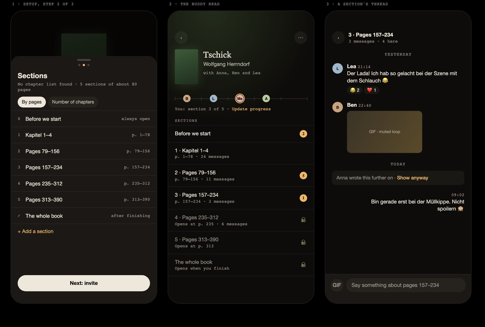

# Buddy reads: reading one Book together, with a chat per Section

**Status: a plan for the owner's review. No feature code.** Measured and read on 12 October 2026 against
`origin/main` at `438b0d9f` (after 1.16.0). The latest migration on main is
`20261027010000_fill_book_covers.sql`; every migration below sorts after it, and gets renumbered if main moves on
before it merges.

In short:

- **No book API gives chapters** for in-copyright books, and none at all for German ones (part D, with real
  calls). Chapters therefore come from four places, in this order: a list already saved for this Book by an
  earlier buddy read, the member's own ebook in the built-in reader, Open Library's rare `table_of_contents`,
  and as the default, **Sections by page ranges** that the host can rename. LovelyBooks' *Leserunden* split
  their books the same way (3 to 5 *Leseabschnitte* of 70 to 120 pages, each labelled with chapters and pages),
  and so do Fable's automatic "milestones" (from the book's length).
- **Recommended: option B** (part F). A buddy read of 2 to 12 Members, one chat thread per Section plus
  *Before we start* and *The whole book*, spoiler gating from each member's own reading progress, emoji
  reactions, GIFs, and live updates. It ships in 7 PRs; the first 4 are already a usable feature.
- **From Trappist** (part E): the message RPC (idempotency, rate limit, clock ordering), the reactions table,
  the Realtime wrapper with its reconnect fixes, the GIF edge function, the photo resizer with its EXIF fix, and
  the chat components. Trappist's UI layer *is* Libellus' design system (`docs/ui-layer-plan.md` there), so the
  components fit. The data model must be new: Trappist's chat is strictly 1:1.

---

## A. What exists today

### Social (v1, v2a)

- **Friends = the Members she follows.** The follow is one-directional; a Private account (the default) turns a
  follow into a Follow request. There is no mutual-friend concept and no `friends` table (`CONTEXT.md`).
  - The database functions still say "circle": `circle_reading`, `circle_want`, `circle_of`.
  - Tables: `social_settings`, `follows` and `blocks` (`20261017010000_social_settings.sql`), `activity`
    (`20261017030000_social_activity.sql`), `likes`, and `reading_sessions.review_spoilers`
    (`20261025010000_social_v2a.sql`).
- **The pattern** this plan keeps:
  - RLS is on everywhere, with `revoke all from anon, authenticated`.
  - Every read and write goes through `security definer` RPCs with a pinned `search_path`, and helpers sit in
    the closed `private` schema: `blocked_either`, `reachable`, `visible`, `member_card`, `can_see_photo`.
  - Refusals are stable SQLSTATEs: `not_signed_in` 42501, `not_found` P0002, `rate_limited` 54000.
  - Rate limits live in `private.*_calls` tables, for example `private.follow_calls`.
- **"Connect over a book" today is read-only.** `book_readers(p_book, p_after, p_limit)`
  (`20261025040000_book_readers.sql`, *Among your friends* on a Book's page, `components/book/Readers.vue`)
  lists the people she follows who hold the same work. "The same work" means the same `books.id` or the same
  non-null `openlibrary_work_key`.
  - It already folds spoilers: `review_spoilers` plus `folded` while the caller has not finished the work.
  - **It never includes progress.** Social v1 says "What never leaves… her progress, her reading days, her
    highlights and notes" (`20261017040000_social_readers.sql`). A buddy read is the first place where a
    member's position leaves the database, so it must be opt-in and coarse (part G).
- **Buddy reads were already sketched** in `docs/proposals/social.md` §8 idea 5 ("Reading together"): two
  members, progress bars, page-pinned notes hidden until the other has passed them. "Progress leaves the
  database only here, only with both opting in."
  - The same file **drops** "Book club rooms with chat (Fable's chapter rooms). Moderation, notifications and a
    chat product". This plan is that chat product, so part F keeps a minimal option that stays close to the
    original idea.
- **The GIF design exists, unbuilt:** `docs/proposals/social-v1.md`, "GIFs and stickers in reviews (9)". It
  uses KLIPY through an edge function, with the key on the server and no member id sent, and an attachment
  table.

### Invites and links

- The app is **invite-only**: signing up needs an Invite code (`20261002190000_invites_and_accounts.sql`,
  `signup_invite`), and a waitlist mints one-use codes (`20261013010000_waitlist_invite.sql`).
- **The link pattern to copy** is the Follow link:
  - The token is 128 random bits as 22 base64url characters (`social_settings.follow_token`, made by
    `private.reading_page_token()`).
  - The page is `web/app/pages/f/[token].vue`. It calls `follow_target(token)`, which needs a sign-in, returns
    null for a bad or blocked token, and records the visit.
  - `utils/pendingFollow.ts` with `middleware/auth.global.ts` keeps the token across sign-in.
  - `renew_follow_link()` kills the old link.

### Library, progress and the reader

- **A Book is one edition** (`CONTEXT.md`: "There is no work level above it"). `books.page_count`;
  `library_entries` has `read_as` and `page_count_override`; `reading_sessions` keeps the reads.
- **Progress** (`20261003122500_reading_progress.sql`) sits on the open session: either `progress_page` or
  `progress_percent` (0 to 100), never both, written by `update_progress(…)`. Only the latest value is kept.
  - The reader writes it too (`stores/reader.ts` calls `repo.updateProgress`). An ebook reader's position
    therefore reaches the same columns.
  - There is no chapter or location column. The ebook place is in `reader_places` (`cfi`, `fraction` 0 to 1,
    `20261006140000_reader_places.sql`).
- **The reader knows the TOC.** It is vendored foliate-js (`web/app/reader/foliate-js/`, see `VENDORED.md`),
  wrapped by `web/app/reader/engine.ts`, which exports `interface TocItem { label; href; depth; fraction }`
  (line 32).
  - It flattens `book.toc` (nav/ncx), drops back matter and Gutenberg entries, and gives every entry a
    **body fraction** (lines 252–269).
  - `components/reader/ContentsSheet.vue` shows it.
- **Ebooks never leave the device**: OPFS `ebooks/<member>/<hash32>-<size>.epub` (`web/app/data/ebooks/files.ts`,
  "Nothing here leaves the device"). Chapter *labels and fractions* can be sent; the file and its text never are.

### Chat, realtime, notifications, storage

- **No chat, reactions or GIFs** exist in Libellus. Likes are the only interaction.
- **Realtime is stubbed out on purpose.**
  - `web/app/data/realtimeStub.ts` is aliased for `@supabase/realtime-js` (`web/nuxt.config.ts:129`,
    `web/vitest.config.ts:29`), and its `channel()` throws.
  - Measured here: the real `@supabase/realtime-js` 2.117.3 is **58.4 KB minified, 17.2 KB gzip** (esbuild,
    browser ESM). That is what dropping the stub would add to the entry chunk.
- **No push and no in-app notifications.** The follow-request lamp dot in `components/shell/Header.vue` is the
  only indicator. Mail is sent only by the `waitlist-invite` edge function (SMTP).
- **One Storage bucket**, `avatars` (`20261009120000_avatars.sql`):
  - private, 256 kB, webp or jpeg
  - resized and re-encoded on the device, so no EXIF survives (`data/avatar.ts`, `utils/avatarRaster.ts`)
  - path policies, and `delete_my_account` refuses with `photo_remains` while files remain
- **The owner's inbox** is `public.feedback` (`20261024010000_feedback.sql`), with kinds bug, feature and
  other, read through `feedback_list`. A message report can reuse it (part G).
- **The plan** (`docs/OPERATIONS.md`, Backups): "The hosted Supabase project is on the Free plan". So the
  quotas that bind are Free's, not Micro's (part G).
- **Conventions**:
  - Page → Pinia store → framework-free repository in `app/data/` (`web/AGENTS.md`); every multi-row change is
    one RPC.
  - pgTAP tests in `supabase/tests/*_test.sql`; Vitest in `web/tests/`.
  - Every changed screen gets a `docs/parity.md` entry.
  - Every new use of data updates `web/app/legal/privacy.ts` in English and German (`docs/legal-checklist.md`).

## B. The member experience (mobile first, 390 px, and it must fit 360 px)



`docs/DESIGN.md` checks 360 px ("The page does not scroll sideways"); the screens below are drawn at 390 px.
Domain words to add to `CONTEXT.md`:

| Term | Meaning | German (draft) |
|---|---|---|
| **Buddy read** | One Book, read together by 2–12 Members | *Leserunde* |
| **Host** | Who started it | *Gastgeberin* |
| **Section** | A chapter, or a run of chapters or pages, with its own thread | *Abschnitt* |
| **Where she is** | Her position, shown to the others only as a Section | — |

### 1. Setting up (host)

**The entry point** is the Book's page: a *Read together* row under the actions (`book.together`), for a
Catalogue Book in her Library.
- Not for a Manual book: others cannot find it (`CONTEXT.md`).
- Home's Currently reading card gets the same action in its ⋯.

**The setup sheet** is one `UiSheet` with three steps and a step dot row. Its primary button is always at the
bottom, above the keyboard.

1. **Book.** The cover, the title in the serif, and one mono line for the edition (publisher · year ·
   pages). *Change edition* opens the existing edition picker.
   - The hint: "Sections follow this edition's pages. Everyone can read any edition: the app lines you up
     by how far through the book you are."
2. **Sections.** One line says what was found, then the list of Sections.
   - What was found is one of: "19 chapters from Open Library", "24 chapters from your ebook", "Chapters
     from an earlier buddy read of this edition", or "No chapter list found: 5 sections of about 80 pages".
   - **Each row** has a label field, the page range in mono ("p. 1–27") and a delete button.
   - **Below the list:**
     - *Add a section*.
     - **Chapters per thread** as `UiSegmented` with 1 · 2 · 3 · 5. It is offered only with a chapter list;
       61 chapters as 61 threads is too many for five friends, so above 30 chapters the default is 3.
     - *Number of chapters* (a stepper), which writes "Chapter 1 … N" with **estimated** pages, marked "≈" in
       mono.
   - **Always there:** *Before we start* (open to all) and *The whole book* (opens once she has finished).
   - **No page count:** Sections by percent ("0–20 %").
3. **Invite.**
   - **Your friends**: the Members she follows who are not blocked either way. Rows with avatar, name and a
     check, and a search field once there are more than 12.
   - **Invite link**: a switch. On, it shows *Copy* and *Share* (`navigator.share`) for `/t/<token>`.
   - **Start**: today, or a date.
   - The button reads *Start buddy read* (count).

**Empty and edge states:**
- She follows nobody: only the link, with "Share the link with the people you want to read with."
- 11 invited plus her: the remaining rows are disabled, with "A buddy read has room for 12."
- The Book already has an open buddy read of hers: "You're already reading this together with Anna and
  Ben. Open it?"
- Offline: the button becomes *Offline*. Creating needs the network, like follows.

### 2. Being invited, or opening the link

**In-app invite.** A row at the top of the Friends feed, like a Follow request ("Anna invites you to read
*Der Hobbit* together · Join · ✕"). It gets the lamp dot in the header, plus a card on Home ("Reading
together") while it waits.

**The link `/t/<token>`:**
- **Signed out:** sign-in first; the token is kept the way `pendingFollow.ts` keeps it.
- **Signed in:** the card shows the cover, "Anna's buddy read", the avatars and count of members, the number
  of Sections and the start day, with *Join* and *Not now*.
- **No longer valid** (renewed, switched off, ended, full, or a block with anyone in it): one neutral text,
  "This link doesn't work anymore." A block is never revealed.
- **Someone without an account:** the app is invite-only, so she sees the sign-up page. Whether a buddy-read
  link may let a stranger sign up is **open question 1**.

**On joining**, the app asks once "Which copy are you reading?":
- Her own Library entry of the same work is preselected, whatever its edition.
- Otherwise: *Add this edition as Currently reading* or *Choose another edition*.
- The link to her entry is what makes **Where she is** automatic. Without one, she sets it by hand.

### 3. The buddy read screen `/together/[id]`

A pushed screen, lit by the cover (`UiAmbient`), from top to bottom:

- **The hero:** the cover at `md`, the title, "with Anna, Ben and Lea".
- **The track:** one hairline bar across the width, with a tick per Section boundary and each member's avatar
  (22 px) sitting **in her Section**, not at her page. Two members in one Section stack and overlap. Her own
  avatar has the lamp ring.
  - Under the bar: "You: Section 3 of 8 · *Update progress*", which opens the existing progress sheet.
  - Members without a linked entry: "Section 2 (set by hand)".
- **The Sections list**, as `UiRowGroup` rows:
  - **Open, read:** "1 · An Unexpected Party", the range "p. 1–27" in mono, and at the right the count of new
    messages as a lamp dot with a figure.
  - **Locked:** the label is shown, the rest is faint ("Opens at p. 28", or "Opens when you finish" for *The
    whole book*). A tap opens a confirm: "Show it anyway? It may spoil pages 28–55. *Show* / *Not yet*."
- **⋯ in the top bar:** Invite (the step 3 sheet), Edit sections (host), Members (with Remove for the host),
  Leave, End the buddy read (host).

**Edge states:**
- Alone after everyone else left: "You're the only one here. Invite someone or end it."
- The host left: the member who joined earliest becomes the host.
- Ended: read-only, a banner "Ended on 3 Nov", threads still readable.

### 4. A Section's thread `/together/[id]/[section]`

**The top bar:** Back, the label, the range in mono. A `role="log"` list of messages:

- **A message row:** avatar, name, time, and the text. Libellus' look is hairlines, not boxes, so rows
  rather than chat bubbles; her own rows are indented to the right with no avatar.
- **Day separators**, as Trappist's `timeline.ts` does them.
- **Reactions** sit under a message as small pills (❤️ 2, 😂 1). Long-press, or the ⋯ that focus reveals,
  opens the reaction bar plus Copy, Delete (own; host: any) and Report.
- **A hidden message** (written further on than she is, part G) reads "Anna wrote this further on · *Show anyway*".
  No page is shown, since that would give away where Anna is. Its height is fixed, so the list does not jump when it opens.
- **The composer:**
  - An auto-growing field ("Say something about pages 1–27"), a GIF chip, and later a Photo chip.
  - When she is past this Section, a toggle "Hide from those before p. 212": off by default, it marks the
    message as reaching ahead.
  - Above the keyboard, iOS visualViewport handled as in Trappist's `pages/friends/[id].vue`.
- **Empty thread:** "No one has said anything about this part yet. Start?"
- **Offline:** the messages already loaded stay readable, and the composer reads *Offline*. Chat is online-only in v1 (no outbox, part E).

### 5. Finishing

When her read is Finished (the existing finish flow), *The whole book* opens and the track shows her at the
end, with a check. When everyone has finished, or the host ends it, the buddy read moves under *Finished
together* on her Profile's Friends rows. Reviews stay what they are; nothing is posted to the feed
automatically.

## C. Data model

All of this follows the house rules: RLS on, no table grants to `authenticated`, `security definer` RPCs only,
helpers in `private`. The one deliberate exception is the policy on `realtime.messages` that Realtime
Authorization needs.

### Migration `2026102801…_buddy_reads.sql` (core and membership)

```sql
create table public.buddy_reads (
  id            uuid primary key default gen_random_uuid(),
  book_id       uuid not null references public.books (id),     -- the edition Sections are cut from
  host_id       uuid references auth.users (id) on delete set null,
  status        text not null default 'open' check (status in ('open','ended')),
  starts_on     date not null default current_date,
  link_token    text unique check (link_token ~ '^[A-Za-z0-9_-]{22}$'),  -- null = link off
  sections_from text not null check (sections_from in ('saved','ebook','openlibrary','pages','percent','manual')),
  created_at    timestamptz not null default now(),
  ended_at      timestamptz
);

create table public.buddy_read_members (
  buddy_read_id uuid not null references public.buddy_reads (id) on delete cascade,
  member_id     uuid not null references auth.users (id) on delete cascade,
  role          text not null default 'member' check (role in ('host','member')),
  invited_by    uuid references auth.users (id) on delete set null,
  invited_at    timestamptz not null default now(),
  joined_at     timestamptz,                 -- null: invited, not answered
  entry_id      uuid references public.library_entries (id) on delete set null, -- her copy
  position      numeric(5,4) check (position between 0 and 1),  -- where she is (fraction of the book)
  position_set  text check (position_set in ('auto','hand')),
  revealed_to   smallint not null default 0,  -- Sections opened with "Show anyway"
  primary key (buddy_read_id, member_id)
);
create index on public.buddy_read_members (member_id);         -- my_buddy_reads()

create table public.buddy_read_sections (
  id             uuid primary key default gen_random_uuid(),
  buddy_read_id  uuid not null references public.buddy_reads (id) on delete cascade,
  position       smallint not null,           -- 0 = Before we start, last = The whole book
  kind           text not null check (kind in ('intro','part','end')),
  label          text not null check (char_length(label) between 1 and 120),
  start_page     int, end_page int,            -- in the buddy read's edition, null for percent
  start_fraction numeric(5,4) not null, end_fraction numeric(5,4) not null,
  unique (buddy_read_id, position)
);

-- Crowd-sourced chapter lists, reused by the next buddy read of the same Catalogue Book.
create table public.book_chapters (
  book_id    uuid not null references public.books (id) on delete cascade,
  position   smallint not null,
  label      text not null check (char_length(label) between 1 and 120),
  start_page int,
  fraction   numeric(5,4),
  source     text not null check (source in ('ebook','openlibrary','member')),
  saved_by   uuid references auth.users (id) on delete set null,
  saved_at   timestamptz not null default now(),
  primary key (book_id, position)
);  -- at most 300 rows a Book; a Manual book never gets one (it is not in the Catalogue)
```

**Positions** are kept as fractions, so members on different editions, ebooks and audiobooks line up. The
computation:
- **Her fraction** is `progress_page / coalesce(page_count_override, books.page_count)` of her linked entry's
  open session, or `progress_percent / 100`; a Finished read is 1.
- **When it updates:** an `after update` trigger on `reading_sessions` progress refreshes `position` for her
  linked memberships whose `position_set = 'auto'`. **Hand** means she chose "I'm at…" herself; it stays until
  she switches back to automatic.
- **Error:** the difference in front matter between editions (a few %) is accepted, and the hint in setup
  step 1 says so.

**RPCs** (all `security definer`, `auth.uid()` checked, refusals as stable codes):
- **Lifecycle:**
  - `create_buddy_read(p_book, p_sections jsonb, p_invite uuid[], p_link bool, p_starts date)`: creates the
    read; Sections are validated (ordered, non-overlapping, 1–120 rows).
  - `my_buddy_reads()`: hers, with the waiting invites, unread counts per read, and the Book card.
  - `buddy_read(p_id)`: the screen. Book, members (`member_card` plus their **Section**, never the raw
    fraction), Sections with `locked`, `count` and `unread`, and her role.
- **Membership:**
  - `invite_to_buddy_read(p_id, p_members uuid[])`: members she follows, not blocked either way, the cap of 12
    counted with the pending invites.
  - `buddy_read_link(p_id, p_on bool)`: renews or switches off the link; host, or any member if the setting
    allows (open question 3).
  - `buddy_read_target(p_token)` and `join_buddy_read(p_token)`; `answer_buddy_invite(p_id, p_join bool)`.
  - `link_buddy_entry(p_id, p_entry)` and `set_buddy_position(p_id, p_section | null)` (null = automatic).
  - `leave_buddy_read(p_id, p_delete_messages bool)`, `remove_from_buddy_read(p_id, p_member)` and
    `end_buddy_read(p_id)`. When the host leaves, the earliest joiner becomes host; when the last member
    leaves, the read is deleted, with its media by a cleanup job (below).
- **Sections:** `set_buddy_sections(p_id, p_sections)`, host only. It refuses to delete a Section that has
  messages; renaming is free. `book_chapters_for(p_book)` returns the saved list.

**The rate limit** is `private.buddy_calls`: 20 creates or invites an hour, and 30 joins an hour (link
guessing is pointless at 128 bits, but cheap to limit).

### Migration `2026102802…_buddy_read_chat.sql` (messages, reactions, read cursors)

```sql
create table public.buddy_messages (
  id          uuid primary key default gen_random_uuid(),
  section_id  uuid not null references public.buddy_read_sections (id) on delete cascade,
  author_id   uuid references auth.users (id) on delete set null,
  client_id   uuid not null,                  -- idempotent sends (Trappist)
  kind        text not null check (kind in ('text','gif','image')),
  body        text not null default '' check (char_length(body) <= 2000),
  anchor      numeric(5,4) not null,          -- hidden from members before this fraction
  media       jsonb,                          -- gif: {id, w, h, title}; image: {path, w, h}
  created_at  timestamptz not null,           -- clock order, set in post_buddy_message
  deleted_at  timestamptz, deleted_by uuid,
  unique (author_id, client_id)
);
create index on public.buddy_messages (section_id, created_at desc);
create index on public.buddy_messages (author_id);              -- rate limit, account deletion

create table public.buddy_reactions (
  message_id uuid not null references public.buddy_messages (id) on delete cascade,
  member_id  uuid not null references auth.users (id) on delete cascade,
  emoji      text not null check (emoji in ('❤️','😂','😮','😢','🔥','📚')),
  created_at timestamptz not null default now(),
  primary key (message_id, member_id, emoji)  -- several per member (Trappist allowed one)
);

create table public.buddy_read_cursors (      -- unread = messages after this, per member and Section
  section_id   uuid not null references public.buddy_read_sections (id) on delete cascade,
  member_id    uuid not null references auth.users (id) on delete cascade,
  read_through timestamptz not null,
  primary key (section_id, member_id)
);
```

**The RPCs:**
- `buddy_messages(p_section, p_before, p_after, p_limit ≤ 100)`:
  - The **spoiler gate is enforced here**. A message whose `anchor` is past the caller's position, in a Section
    she has not revealed, comes back as `{id, author, created_at, hidden: true}` with no body, media or anchor.
  - Messages between two members with a block either way are left out for both of them (Trappist's rule).
- `post_buddy_message(p_section, p_client_id, p_kind, p_body, p_media, p_ahead bool)`:
  - It takes Trappist's advisory lock per Section and uses `greatest(clock_timestamp(), max(created_at) + 1 µs)`.
  - Rate limit: 30 a minute and 600 a day.
  - **The anchor** is `least(her position, section.end_fraction)`, or her position when `p_ahead`. She can only
    post where she has read or revealed.
- `delete_buddy_message(p_id)`: her own, or any message if she is the host. It tombstones the row: the body and
  media are cleared, and the row reads "Message removed".
- `react(p_message, p_emoji)`, `unreact(…)`, `mark_buddy_read(p_section, p_through)`.
- `report_buddy_message(p_id, p_reason)`: inserts into `public.feedback` with a new kind `report` and
  `context = {buddy_read, message}`. The owner's inbox already lists feedback. Limit: 5 a day.

### Realtime (PR 5): Broadcast a nudge, read through the RPC

- **Topic:** one private topic per buddy read, `buddy:<id>`.
- **Who may listen:** a `select` policy on `realtime.messages` lets a member join her own reads' topics
  (`private.is_buddy_member(split_part(realtime.topic(), ':', 2)::uuid)`). There is no insert policy, so
  clients cannot broadcast. The project's Realtime setting "allow public access" is switched off.
- **What is sent:** triggers on `buddy_messages` and `buddy_reactions` call `realtime.send(…, private => true)`
  with only `{section, message, kind}`. This is **one send per message, not one per member** (Trappist sends
  one per member: fine for two people, wasteful for twelve).
  - Clients fetch the row through `buddy_messages(p_after)`, so the spoiler gate and blocks keep one
    implementation, in SQL.
- **Positions** change through the same topic (`position`), so the track moves live.
- **The client:**
  - It subscribes **only while a buddy read screen is open**; Home's unread counts come from
    `my_buddy_reads()` on focus.
  - The stub stays for supabase-js. The thread screen lazy-imports the real `RealtimeClient` by its file path
    (a regex alias `^@supabase/realtime-js$` lets that path through; to prove in PR 5), so the entry chunk stays
    as it is and the 17 KB gzip loads only with a thread.

### Storage (PR 6 and PR 7)

- **Bucket `buddy-media`:** private, 2 MB, jpeg, webp and gif, path `<buddy_read_id>/<member_id>/<uuid>.<ext>`.
- **Policies**, through `private.is_buddy_member`:
  - insert: her own folder, as a member
  - select: any member of that read
  - delete: her own files, or the host
- `send_buddy_media` checks that the object exists, its mimetype and the path owner (Trappist `send_media`).
- **Cleanup:** ended reads delete their media 30 days after the last member leaves, through the existing
  `pg_cron` (`20261018030000_purge_cron_log.sql` shows cron is in use) and an edge function with the service
  role, because SQL cannot delete Storage objects.
- **Account deletion:** extended like `photo_remains`. The client removes her files from `buddy-media` first;
  then the cascade removes her messages, reactions, cursors and memberships.

## D. Where chapters come from: the evidence

All calls were made with plain `curl` from one address, without keys. The trimmed responses are in
[`img/buddy-read-api-probes/`](img/buddy-read-api-probes/README.md) (34 files). The books: *The Hobbit*,
*Project Hail Mary* (9780593135204), *Pride and Prejudice*, *Die Vermessung der Welt* (9783499241000),
*Tschick* (9783499256356) and Kafka's *Der Prozess*.

| Source (what Libellus already uses is in bold) | Has a TOC field? | Filled? | Evidence |
|---|---|---|---|
| **Open Library** `/isbn/{isbn}.json`, `/works/{W}/editions.json` | yes, `table_of_contents` (`level`, `label`, `title`, **`pagenum`**) | **sparse**: 0 of the 5 probed ISBNs. The Hobbit 12/482 editions; Project Hail Mary 2/32 (one is an Audible timestamp list); Pride and Prejudice 1/1000; Vermessung 0/27; Tschick 0/14; a random fiction sample 0/38. Some rows are junk (a Portuguese Hobbit stores blurb paragraphs) | `ol-isbn-*.json`, `ol-works-editions-toc-stats.jsonl`, `ol-editions-with-toc-*.json`, `ol-random-sample-toc.json` |
| **Google Books** v1 | no: the discovery schema has no TOC field in `volumeInfo` | none (keyless calls answer 429, as in `docs/plans/cover-sources.md`) | `gb-discovery-volume-schema.json`, `gb-429-unauthenticated.json` |
| **Apple Books** Search/Lookup (ebook, audiobook) | no; an audiobook's `trackCount` counts files | none | `apple-*.json(l)` |
| **Wikidata** | `P527` has part / `P2635` number of parts | none for these books; about 2.1k works in all of Wikidata have chapter items (mostly scripture and classics) | `wikidata-*.json` |
| **Hardcover** GraphQL | no (`pages`, `audio_seconds`; no token in the repo, schema docs read) | none | `hardcover-schema-fields.txt` |
| **DNB** SRU (the `dnb-lookup` function's service) | MARC 856 links to a *scanned* TOC PDF | sparse, mostly non-fiction and critical editions; Tschick and Vermessung link only a blurb | `dnb-sru-856-links.txt`, `dnb-toc-pdf-1362379786-buddenbrooks.txt` |
| Project Gutenberg / Gutendex EPUB | the EPUB's nav/ncx | **good, public domain only.** Pride and Prejudice #1342: 63 entries, all 61 chapters (some labels carry an illustration caption first). Der Prozess #69327: 18 entries, of which 10 are chapters; the rest is matter and licence to filter | `gutendex-*.json`, `gutenberg-*-toc.json` |
| Standard Ebooks EPUB | nav | **good, cleanest**, English public domain only: 65 entries, 61 chapters | `standardebooks-pride-prejudice-nav.json` |
| Internet Archive metadata | no structured TOC | none | `ia-metadata-*.json` |

**Read it as follows:**
- For a German in-copyright novel (the common case among the owner's friends), **nothing** gives chapters.
- Open Library helps for a few English classics, and for occasional German editions *of another edition* of
  the same work. Example: a German Hobbit, OL25159204M, lists 19 chapters ("Ein unerwartetes Fest",
  "Hammelbraten" …).
- Public-domain EPUBs are excellent, but they are exactly the books friends rarely read together.

**Recommendation and fallback order** (setup step 2 takes the first that gives a list):

1. **Saved for this Book** (`book_chapters`): what an earlier host confirmed. This is the crowd-sourced path,
   reused across buddy reads of the same edition. Costs nothing and improves with use.
2. **Her ebook, on her device.** When the host (or any member, later) has this work's EPUB in the reader:
   `engine.ts` already yields labels plus body fractions; pages are `fraction × page_count` of the read's
   edition, marked "≈".
   - Only labels and fractions are sent, never the file.
   - To prove in PR 3: build the TOC with foliate's parser without opening a view. The fractions come from
     section sizes, not from layout.
3. **Open Library**: the exact edition first, then other editions of the same work in the same language (the
   `languages` field).
   - Accepted only with at least 3 entries, labels of at most 120 characters, and no entry over 300
     characters (this drops the blurb case).
   - `pagenum` gives pages when it is a number, scaled by the ratio of the two editions' page counts when they
     differ.
   - Fetched from the device, like Open Library is today (`web/app/data/openLibrary.ts`).
4. **Sections by pages (the default).** `n = clamp(round(page_count / 80), 3, 12)` equal ranges, labelled
   "Pages 1–80" and renameable. The host can also type a chapter count instead. **No page count:** Sections by
   percent, every 20 % (Fable makes milestones the same way, from the book's length).
5. **Not built, later if wanted:**
   - **Public-domain EPUB** via Gutendex or Standard Ebooks. It needs an edge function that unzips an EPUB and
     a reliable "is this the same work" match; a small gain for the effort.
   - **The DNB TOC PDF** plus text extraction: rare for fiction, top-level only.

Whatever the source, the host can edit the list before *Start*. What she confirms is saved to `book_chapters`
(Catalogue Books only), which is how source 1 grows.

## E. Trappist reuse audit

Trappist is at `/Users/fabkho/code/trappist`, HEAD `0f3c2af`, read only. All paths below are relative to it
and checked. Its chat is 1:1 by design (a connection between two members). It is built on Supabase, Pinia and a
UI layer that is Libellus' own components (`docs/ui-layer-plan.md`).

| Trappist file | What it is | Verdict | What to change for Libellus |
|---|---|---|---|
| `supabase/migrations/20261110120000_conversations.sql` (`post_message`, `conversation_messages`, `inbox`) | messages, the send RPC, paging, unread | **code** for `post_message` (advisory lock, `client_id` idempotency, 30/min); **pattern** for the rest | party check → membership; `read_at` per message → per-Section cursor (groups) |
| `20261110150000_messages_clock_order.sql`, `20261110160000_messages_written_order.sql` | the fix for ties under `now()` | **code**, from day one | none |
| `20261110140000_realtime_member_channels.sql` | `realtime.send` triggers, the `realtime.messages` policy, a topic per member | **pattern** | a topic per buddy read; send a nudge, not the row |
| `20270224120000_message_reactions.sql` | six fixed emoji, broadcast trigger | **code** with edits | key `(message, member, emoji)` to allow several; a membership check; through RPCs (Trappist lets members write the table under RLS, against the Libellus rule) |
| `20270112120000_chat_media.sql` | the `chat-media` bucket, `send_media`, policies, `my_chat_media` | **code** with edits | folder = buddy read; membership helpers |
| `20261201130000_reports.sql`, `20261201120000_blocks.sql` | reporting a member, blocks | **pattern** | Libellus has `blocks` already; report a *message* into `feedback` |
| `supabase/functions/gifs/index.ts`, `giphy.ts` | GIPHY search behind the server, rating PG, previews proxied, chosen GIF copied into storage | **code** | the `gifs_allowed` check → membership; whether to copy (part G); de/en topic chips |
| `web/app/data/realtime.ts`, `web/app/stores/realtime.ts` | one channel, typed events, resync on reconnect, a 3 s cold-start resync (`COLD_START_RESYNC_MS`), replacing a dead iOS PWA socket | **code** | the topic and event union; lazy import (part C) |
| `web/app/data/chatPhoto.ts` | resize to 1600 px, JPEG ≤ 2 MB, `stripJpegMetadata` for Safari's EXIF | **code**, or a shared package later | 1280 px and about 400 KB (part G) |
| `web/app/data/saveQueue.ts`, `web/app/data/queueOwnership.ts` | an offline send queue, Web Locks per tab | **not now** | Libellus has its own outbox (`data/outbox.ts`, `stores/sync.ts`); chat is online-only in v1 |
| `web/app/data/chat.ts` | RPC wrappers, signed URLs (`MEDIA_URL_SECONDS` = 15 min), the gifs calls, error keys | **pattern** | Libellus' repository style in `app/data/` |
| `web/app/stores/chat.ts` (1094 lines) | optimistic send by `clientId`, `listen()`, debounced `markRead` | **pattern** | far too coupled (connections, phone shares) |
| `web/app/components/chat/ChatMessage.vue`, `ChatComposer.vue`, `ChatReactionBar.vue`, `ChatGifPicker.vue`, `ChatMediaViewer.vue`, `timeline.ts` | the UI | **code** with an i18n pass | the copy is German strings in `web/app/copy/chat.ts`, so it moves to `web/i18n/locales/{en,de}.json`; the bubble style moves to rows; spoiler folds are new |
| `ChatPhoneCard.vue`, `ChatPhoneSheet.vue`, `web/app/pages/friends/[id].vue` | phone sharing, the 1:1 page | **not reusable** (the page: its scroll-to-older and visualViewport handling as a pattern) | |
| `supabase/tests/messages_test.sql`, `message_reactions_test.sql`, `chat_media_test.sql`, `web/tests/realtime.test.ts`, `gifs.test.ts`, `chat-media.test.ts` | tests | **pattern**, and partly code (realtime, photo) | |

**New in Libellus, with no Trappist counterpart:** group membership, invites and links, Sections and
chapter sources, spoiler gating, per-Section unread cursors, message deletion and host moderation, reporting
a message.

**A shared package?** Not now: there are two repos and two consumers, and a package adds versioning and release
work to both. Copy with a `VENDORED.md` that names the Trappist commit, as `web/app/reader/foliate-js/` already
does. If a third app appears, `chatPhoto`, the Realtime wrapper and the queue are the package.

**Gotchas Trappist already paid for, to be kept:**
- Ordering ties under `now()`.
- The Realtime cold start, which misses broadcasts just after a join.
- A dead but "live" socket after iOS suspends a PWA.
- Several tabs overwriting a queue.
- Android keyboards cannot insert GIFs into a PWA, which is why the picker is in the app.
- GIPHY's beta key allows 100 calls an hour, and "Powered by GIPHY" is required.

## F. Three options

| | **A. One room** | **B. Sections with threads** (recommended) | **C. Book club** |
|---|---|---|---|
| What | Members (≤12), invite and link, the track, **one** thread whose messages are hidden by position (StoryGraph's way), text and six emoji, refreshed every 15 s while open | A plus Sections (saved → ebook → Open Library → pages), a thread per Section plus *Before we start* and *The whole book*, unread counts, live updates (lazy Realtime), GIFs; photos last | B plus photos from day one, web push and a weekly mail digest, a reading schedule (a due date per Section and nudges), polls, public-domain EPUB chapters, buddy reads friends can discover, up to 50 members, an owner moderation screen |
| Chapters | not needed: positions do the gating | yes, automatic where any source has them, else page Sections | yes, plus public domain |
| PRs | 3 | 7 (4 make it usable) | 12+ |
| Size | ~1–2 days with workers | ~4–6 days with workers plus reviews | 2+ weeks |
| Risk | low: no Realtime, no media, no new third party | medium: the first Realtime in the app, GIPHY terms, the Storage quota | high: iOS push only for installed PWAs, moderation at 50, Free plan egress and storage (Pro at $25/month likely) |
| Ships first | everything at once | DB → setup and link → Sections → threads (text, reactions, 15 s refresh) | as B |
| Against it | does not meet "a thread per chapter"; one long thread is hard to follow for 400 pages | more screens | the "chat product" `social.md` warned about |

**Recommendation: B**, cut so that A's value ships with PR 4 and every later PR is optional:
- Realtime (PR 5) replaces the 15 s refresh.
- GIFs (PR 6).
- Photos (PR 7, only after open question 6).

## G. Spoilers, moderation, privacy, costs, performance, a11y

### Spoilers

- **Section gate.** A Section's thread opens when she reaches its start; *The whole book* opens when she has
  finished. Until then the row shows only the label and "Opens at p. 28". *Show anyway* records `revealed_to`
  (a deliberate tap, no undo needed).
- **Message gate.** Within an open Section, a message is shown once she is past its `anchor`. By default the
  anchor is where the writer was, capped at the end of the Section. Two consequences:
  - Mid-Section, she sees what the slower readers wrote, never what the faster ones wrote.
  - A writer who has read far ahead can mark her message "reaches ahead", and it is hidden until the others
    reach her page.
  - The server enforces both gates (part C). Spoilers here are a courtesy among friends, but one gate in SQL
    keeps Realtime, the API and every client consistent.
- **Positions are coarse.** Others see her **Section**, never her page or percent. The fraction stays in the
  database, used only for gating.

### Moderation and abuse

- Groups are small and invite-only, so moderation stays local:
  - a member deletes her own messages
  - the host deletes any message and removes members
  - anyone leaves
  - a block keeps two members' messages apart
- **Report** goes to the owner's existing feedback inbox, with the message attached.
- **Limits:** messages 30 a minute and 600 a day, reactions 60 a minute, joins 30 an hour, 12 members, 2000
  characters.
- GIFs are rated PG, fixed on the server. Photos get no automatic scanning (cost); report plus host removal
  covers them (open question 6).

### Privacy (GDPR)

**New data processing:**
- buddy read membership
- her coarse position, shown to co-members
- messages, reactions and photos
- GIF search terms sent to GIPHY by the server, without her identity
- co-members seeing her name and photo even without a follow (`can_see_photo` gains "shares a buddy read")

Legal basis: the contract (Art. 6(1)(b)), since she joins on purpose.

**To update in the same PRs** (`docs/legal-checklist.md`): `web/app/legal/privacy.ts` (EN and DE, a new
version date), the README's Privacy section, and `docs/THIRD-PARTY.md` (GIPHY).

**Deletion:**
- her own messages, any time (a tombstone)
- on leaving, a checkbox "Also delete my messages" (off by default, so the conversation stays readable for the
  others)
- account deletion removes all her messages, reactions and media
- ended buddy reads: everything deleted 12 months after `ended_at` (open question 7)
- **Photos** are re-encoded on the device, so EXIF and GPS are gone (Trappist's Safari fix included). The notice
  says that photos are visible to the buddy read's members and kept until deleted, or until the read is deleted.

**Data export:** the notice promises "A download of your data is coming"; whenever that comes, it must include
her messages.

**German strings** (drafts for the reviewer, in the app's informal "du"):

| Key | English | German |
|---|---|---|
| `together.action` | Read together | Gemeinsam lesen |
| `together.locked` | Opens at p. {page} | Öffnet sich ab S. {page} |
| `together.hidden` | {name} wrote this further on · Show anyway | {name} hat das weiter hinten geschrieben · Trotzdem zeigen |
| `together.leave.delete` | Also delete my messages | Auch meine Nachrichten löschen |
| `together.full` | A buddy read has room for 12. | In eine Leserunde passen 12. |

### Costs on Supabase

The hosted project is on the **Free** plan (`docs/OPERATIONS.md`), not Micro. Both columns are from
supabase.com/pricing and /docs/guides/realtime/limits, read on 12 October 2026.

| Quota | Free (today) | Pro + Micro ($25/month, Micro covered by the $10 credit) | A buddy read uses |
|---|---|---|---|
| Realtime concurrent connections | 200 | 500 | one per member **while a buddy read screen is open** |
| Realtime messages / month | 2 M | 5 M | one message to 5 listeners ≈ 6; 1,000 messages a month ≈ 6 k |
| Broadcast payload | 256 KB | 3 MB | a nudge is under 200 bytes |
| Database | 500 MB | 8 GB | a read of 5 members with 500 messages ≈ 0.3 MB |
| Storage | 1 GB | 100 GB | photos at about 400 KB (Q6): about 2,500 photos fill Free |
| Egress | 5 GB | 250 GB | a photo seen by 5 members is about 2 MB of egress, so **egress binds before storage** |
| Edge function calls | 500 k | 2 M | GIF search: one per pause in typing (400 ms) |

**Verdict:**
- Text, reactions and Realtime fit the Free plan with two orders of magnitude to spare.
- GIFs fit if they are **not copied** into Storage. Show GIPHY's small rendition through a caching Cloudflare
  Pages function (`web/functions/`), so the member's device never contacts GIPHY and Storage is not used.
  Whether GIPHY's terms allow proxying and caching is open question 5. Trappist copies instead.
- Photos are the only real cost driver. They come last, with a monthly cap per member (30) and the 12-month
  deletion.

### Performance

- The entry chunk stays unchanged (the Realtime stub stays; part C).
- Threads page by 50 messages, newest first, with Trappist's scroll anchoring. A virtual list is not needed at
  these sizes (an owner-sized group writes hundreds of messages, not tens of thousands).
- Indexes as in part C.
- `my_buddy_reads()` is one query per focus, counting unread messages via the cursors with an index on
  `(section_id, created_at)`.
- GIFs are rendered as muted, looping `<video>` (GIPHY's mp4), which is far smaller than GIF files.

### Accessibility

- The thread is `role="log"` with `aria-live="polite"` for arriving messages only, never for the backlog.
- Reactions are toggle buttons with `aria-pressed` and names ("Heart, 2, you reacted").
- Every long-press action is also behind a focusable ⋯.
- A locked or hidden message says why in text, not only with a lock icon.
- GIF videos are paused under `prefers-reduced-motion` with a play button, and named from GIPHY's title.
- Photos get the caption as alt text, else "Photo from {name}".
- Targets are 44 px; the track's avatars are not targets (the Members sheet is).
- The 360 px no-side-scroll check is added to the new screens' Vitest/e2e specs.

## H. Build plan (option B)

**One PR each, in order.** Conventional titles; every DB change ships with pgTAP; screens get `docs/parity.md`
entries and EN/DE strings; privacy text goes in the PR that starts the processing. `CHANGELOG.md` is release-
please's, never edited. No new e2e job in CI: e2e specs are written and run locally.

| # | PR | Files (main ones) | Tests | Tier |
|---|---|---|---|---|
| 1 | `feat(buddy-reads): the database: buddy reads, members, Sections, saved chapters` | `supabase/migrations/20261028010000_buddy_reads.sql`, `supabase/tests/buddy_reads_test.sql`, `CONTEXT.md` | pgTAP: create, invite only followed and unblocked members, cap 12, link renew and off, join via token, blocked → null, leave/host handover/last-leaves-deletes, positions from progress (page, percent, finished, hand), RLS denial for strangers and anon | hard |
| 2 | `feat(buddy-reads): start one from a Book, invite friends, join by link` | `data/buddyReads.ts`, `stores/buddyReads.ts`, `components/together/SetupSheet.vue`, `pages/t/[token].vue`, `pages/together/[id]/index.vue`, `utils/pendingBuddyRead.ts`, `middleware/auth.global.ts`, Home card, Friends feed invite row, `legal/privacy.ts`, i18n, parity | Vitest: page-Section maths, setup validation, data layer against the stack; e2e locally | normal |
| 3 | `feat(buddy-reads): chapters from her ebook and Open Library` | `utils/sections.ts` (sources, validation, scaling), `data/openLibrary.ts` (`table_of_contents`), a headless TOC in `reader/` | Vitest with the probe files as fixtures (`ol-editions-with-toc-*.json`, the Gutenberg TOCs for the matter filter) | normal |
| 4 | `feat(buddy-reads): a thread per Section, reactions, spoiler gates` | migration `20261028020000_buddy_read_chat.sql` + pgTAP (gates, anchors, clock order, idempotency, rate limit, delete/host delete, block hiding, report → feedback), `components/together/Thread*.vue` (from Trappist's chat components), `pages/together/[id]/[section].vue`, 15 s refresh while visible | pgTAP; Vitest: timeline, gate display | hard (DB), normal (UI) |
| 5 | `feat(buddy-reads): live updates` | migration (topic policy, `realtime.send` triggers), the lazy Realtime client (from Trappist `data/realtime.ts`, `stores/realtime.ts`), `nuxt.config.ts`/`vitest.config.ts` alias as a regex | pgTAP: who may join a topic; Vitest: resync, cold start (ported); a check that the entry chunk has no realtime-js | hard |
| 6 | `feat(buddy-reads): GIFs` | `supabase/functions/gifs/` (port), the Pages function proxy, picker, `THIRD-PARTY.md`, privacy text, CSP `media-src` | Deno tests with a GIPHY stub (ported), Vitest | normal |
| 7 | `feat(buddy-reads): photos` (after open question 6) | migration (bucket, policies, `send_buddy_media`, cleanup), `data/buddyPhoto.ts` (from `chatPhoto.ts`), account deletion, the cleanup edge function | pgTAP storage policies; Vitest EXIF (ported) | normal |

**Releases:**
- After PR 4: the feature is usable. Ship behind nothing (a Book page row is a quiet entry), or behind
  Profile → Account → a *Buddy reads* switch like the Friends tab, if the owner prefers a soft start (open
  question 8).
- Release-please deploys migrations, then functions, then the web app.
- **Before the release with PR 5:** switch off Realtime's public channel access in the dashboard.
- **Before PR 6:** set `GIPHY_API_KEY` as a function secret and apply for the production key (the beta key
  allows 100 calls an hour).
- **After each release:** watch `client_errors` for `/together/*`.

## I. Risks and open questions

**Risks**
- **Realtime is new to the app.** It is mitigated by Trappist's reconnect code, by the 15 s refresh shipping
  first, and by keeping it off the entry chunk.
- **Positions across editions are approximate** (front matter, illustrations). Gating can be off by a few
  pages. Mitigations: the writer's anchor is capped at the Section's end, Sections by default end at page
  boundaries, and hand positions exist.
- **Showing progress breaks social v1's promise** "What never leaves… her progress". Mitigation: it is
  explicit and coarse (Sections), only for co-members, and the privacy notice says so. It needs the owner's yes
  (question 2).
- **GIPHY:** the key review, the attribution, and the proxy terms. The fallback is KLIPY, as designed in
  `social-v1.md`, which has the same server-side design.
- **Storage and egress on the Free plan** if photos take off. They are capped, last, and optional.

**Open questions for the owner**
1. May a buddy-read link let someone **without an account** sign up (one use of an invite, counted against
   the host)? Or is it for Members only, with others pointed to the waitlist?
2. May co-members see each other's **Section**? Recommended: yes, coarse, explained when joining. Or only "has
   finished"?
3. Who may **invite and share the link**: the host only, or every member (recommended: every member, the host
   removes)?
4. Members per buddy read: **12** (StoryGraph allows 15)? Messages: allow **editing** within 15 minutes, or
   delete only (recommended for v1)?
5. **GIFs**: GIPHY (Trappist's code) or KLIPY (`social-v1.md`)? Proxy and cache, or copy into Storage?
6. **Photos at all?** If yes: 1280 px and about 400 KB, 30 a month per member, deleted with the buddy read.
7. **Retention**: delete ended buddy reads (messages, media) after 12 months?
8. **Name and entry**: "Buddy read" / "Leserunde"? A switch in Profile → Account, or on for everyone?
9. **Notifications**: v1 is in-app only (Home card, lamp dot, unread counts). Is a weekly e-mail digest over
   the existing SMTP wanted? Web push is option C.
10. Should **saved chapter lists** (`book_chapters`) be shared across hosts, as crowd-sourced data (any
    Member's confirmed list becomes the next default)? Or private to each buddy read?

## Sources outside the repo

- LovelyBooks, how a *Leserunde* is split into *Leseabschnitte* (chapters and pages per section, 3–5 sections):
  https://www.lovelybooks.de/thema/Leserunden-973757011/ and https://www.epubli.com/wissen/lovelybooks-leserunde
- StoryGraph buddy reads (up to 15 people; comments at a page, percent or chapter, locked until you reach it):
  https://thestorygraph.freshdesk.com/support/solutions/articles/79000141943-buddy-reads-and-readalongs-on-the-storygraph
- Fable, milestones made automatically from the book's length:
  https://help.fable.co/article/73-how-do-i-create-milestones-for-my-bookclub
- Supabase pricing and Realtime limits (read 12 October 2026): https://supabase.com/pricing,
  https://supabase.com/docs/guides/realtime/limits
