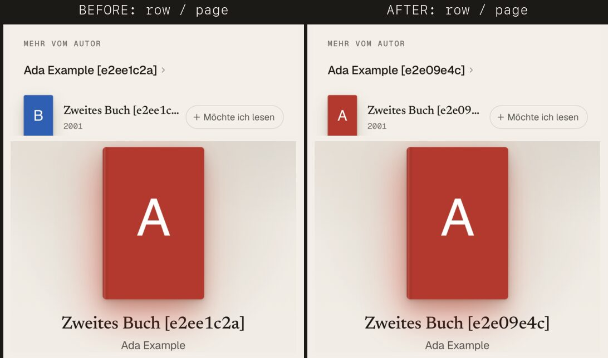
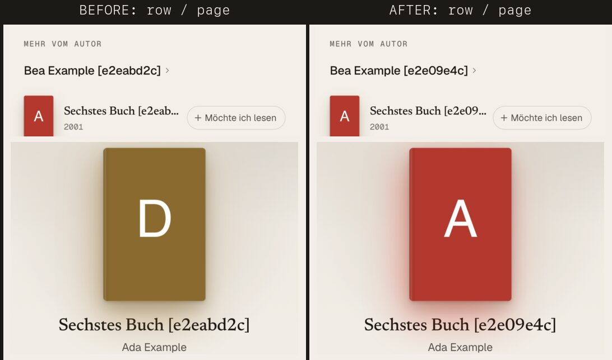
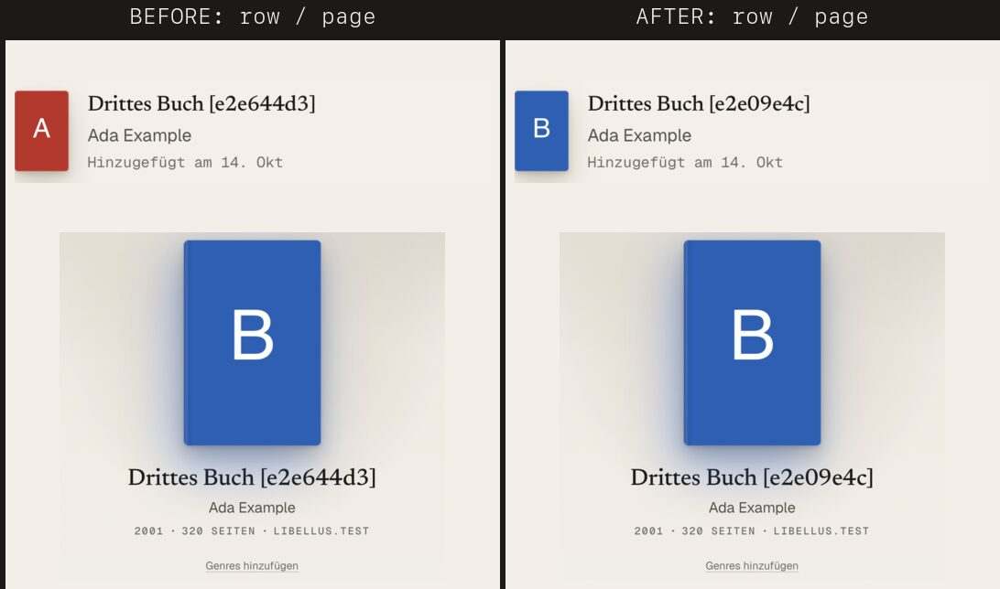
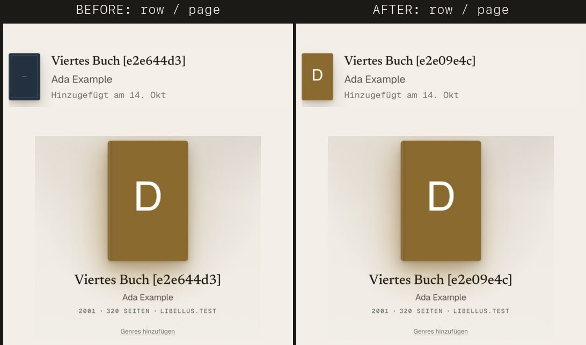

# One Book, one cover: why a row and the Book's page showed two covers

Owner report (production, several times): a list row shows a cover, the Book's page shows none or another
one (another colour, another edition), or the other way round. Owner rule: the small and the big cover
must **never** differ. This file is the analysis (code paths, production counts, local reproductions),
the judgement of the owner's hypothesis, the design and what was built. Counts only, no titles, no
member data. Measured 13–14 October 2026, read-only.

## The owner's hypothesis, in short

> Always store the high-resolution cover and derive the small one from it, so small and large are by
> construction the same image.

Half of it is already true and the other half would not have helped:

- The Catalogue stores the large original (Apple `600x900bb`, Open Library `-L`), and every smaller size
  is the CDN's own rendering of that same upload. Measured on every stored cover in production: the row's
  image and the page's image are **the same picture for 185 of 185 Books** (pixel difference ≤ 0.03 RMSE at
  32 × 48). Size derivation was never what made two covers.
- What made two covers is **which URL** each place shows (the row and the page reading different
  objects), **a mounted row holding on to an old cover** after the Book's cover changed, and **one size
  failing while the other loads**. Copying covers into our own storage changes none of the three, and the
  sources' terms do not allow it (below).

The principle behind the hypothesis is right and is what was built: **one stored cover per Book; every
place derives its size from that one URL, falls back only to that same picture, and shows what the Book
says now.**

## How a cover reaches the screen (as it was)

```mermaid
flowchart LR
  subgraph Server
    B[(books.cover_url<br/>+ thumbhash, colours)]
    W[(works.cover_url<br/>works.editions[lang].cover_url)]
    CC[catalogue-check<br/>pg_cron, every minute] -- "source's cover wins" --> B
    FB[fill_book_covers] -- "fills a missing one" --> B
    WC[work_card] -- "coalesce(mine, editions[lang], work, editions.en)" --> W
  end
  subgraph Device
    LS[(localStorage<br/>device Library)]
    ST[library store]
    SW[(service worker<br/>libellus-covers, opaque, 180 d)]
  end
  B -- "library_entries + books" --> ST
  LS -- "restore on start" --> ST
  ST --> ROW["Library / Home rows<br/>(kept alive)<br/>coverSrc(url, 'sm')"]
  ST --> PAGE["Book page<br/>coverSrc(url, 'xl')"]
  WC --> WROW["work rows: author page, series,<br/>More from the author, Next in your series"]
  WROW -- "opens isbn-… / ol-…" --> LOOK["page: Catalogue by ISBN,<br/>else lookupIsbn (Apple first, then OL)"]
  ROW -.-> SW
  PAGE -.-> SW
```

For one Book in her Library the row and the page read the **same object** (`library.entryByKey`, so
`stores/book.ts` `page()` returns the entry's Book). They still differed, because of what happens around
that object. For a work row (a work card) the row and the page read **different objects**.

### Every place a cover is chosen, stored or derived

| Where | What it picks | Notes |
| --- | --- | --- |
| Add (`resolveBookCover`, data/covers.ts) | Apple artwork → Apple by ISBN → the snapshot's Open Library cover → OL by ISBN; kept large with thumbhash and colours | the snapshot's own cover is not the first choice for an OL find (the ranking: Apple, exact, 900 px) |
| `catalogue_book_for` / `import_book_for` | first snapshot wins; an existing Book is returned unchanged | |
| Import (`coverFill`, `coverLender`, `fill_book_covers`) | lent cover at match time, filled into a Book without one | out of scope here (DNB worker) |
| **Catalogue check** (`catalogue_check_save`) | **the source's current cover replaced the stored one**, thumbhash and colours dropped | runs about a minute after a Book enters |
| Enrichment (`enrich_save`) | `works.cover_url` (the work's default) and `editions[lang].cover_url` | no thumbhash |
| **`work_card`** | `coalesce(her Book, editions[lang], work, editions.en)`, but opens `coalesce(editions[lang], editions.en)` | the cover and the edition it opens could come from different editions |
| Book page, not in the Catalogue | search's snapshot (`seenBook`), else **a fresh source lookup** by ISBN / OL key | a fresh lookup can name another picture |
| `UiCover` | `src` = `coverSrc(url, size)`; fallbacks **per call site** (OL by ISBN in search, edition picker, own edition, work rows; none in the Library, Home, the page) | |
| `UiCover` A8 rule | **a cover in view held on to its first artwork**; a new `src` of another artwork was held back | Home and the Library are `keepalive` |
| Service worker | `CacheFirst`, statuses `[0, 200]` (opaque, so a 5xx is cached too), 400 entries, 180 days, **one entry per size URL** | |
| Regal export, reading page, social | the stored `cover_url` (the page's own size) | consistent with the page |
| Reader, ebooks | the file's own cover | by design: her file, not the Catalogue's Book |

## Measured on production

### The Catalogue's covers

| | count |
| --- | ---: |
| Books | 194 |
| with a cover URL | 185 (Apple 125, Open Library 60) |
| without | 9 (5 have a work-level cover; no same-work sibling Book with one) |
| URL off the allow-list | 0 |
| every size a surface asks for (`sm`, `md`, `lg`, `xl`), fetched: 491 URLs | **0** non-200, 0 not an image, 0 blank |
| row image and page image the same picture | **185 / 185** |
| page image under 150 px on its short side | 3 (Open Library) |
| cover URL **without** its thumbhash and colours | 23, all Open Library |
| … of which exactly what the check's rule picks (the edition's first cover, else the work's) | **19** (13 of the 23 in a member's Library) |

The check runs every minute (`pg_cron`) and drops a cover's thumbhash only when it **replaces** the URL.
So at least 19 of 62 Open Library Books had their cover swapped by the check, after the member's device
had shown and stored the first one. Apple covers: none swapped (the check's Apple URL is the stored one).

No cover host rotates or expires its URLs (Apple's `mzstatic` paths are content-addressed, Open Library's
are cover ids), and all three CDNs send `Access-Control-Allow-Origin: *` with or without an `Origin`, on
every hop of Open Library's archive.org redirect.

### Work cards

3,572 of 4,758 works have an edition to open (all of them openable), 3,154 a work-level cover.

| a card for a reader in | shows a cover that is not the edition's it opens | of which the edition has its own | edition has none, card lends the work's | no cover on the card |
| --- | ---: | ---: | ---: | ---: |
| German (`de`, most of her works have no German edition) | **1,940** | **1,679** | 261 | 527 |
| English | 260 | 0 | 260 | 520 |

What the page then shows, 80 cards sampled through the app's own `lookupIsbn` (live Apple and Open
Library, one every 4 s):

| sample | page shows another URL | visibly another picture (RMSE > 0.12) |
| --- | ---: | ---: |
| card shows the work's cover, the edition has its own (40 → 33 with own cover) | **33 / 33** (26 the edition's own, 7 Apple's by ISBN) | **24 / 33** |
| card lends the work's cover, the edition has none (7) | 0 / 7 | 0 |
| card and edition agree (20) | 2 / 20 (Apple's by ISBN) | 1 / 20 |
| card shows no cover (20) | 3 / 20 show one (Apple's) | 3 / 20 |

Estimated for a German reader: about **1,350 of 3,572 openable works (≈ 38 %)** opened a page with a
visibly different cover or a cover the row did not have; for an English reader about 6 %.

### Failures of one size

3 of the 1,550 cover requests of these measurements failed, all Open Library (two 503, one 502, on work
covers at `-M` or `-L`; none of the 491 for stored Book covers); in October it answered 3 of 140 with 502
(docs/plans/cover-sources.md). One such answer for the row's size (`-M`) left that row on the Placeholder
for as long as it stayed mounted (no retry, no other size), while the page's `-L` loaded. Behind the
service worker the failed answer is opaque, so it is kept as if it were a cover, for 180 days.

## Reproduced locally

`web/e2e/covers/consistency.spec.ts` (WebKit, iPhone 15, production build, seeded local stack; by hand:
`LIBELLUS_E2E_COVERS=1`). Each picture: before on the left, after on the right; the row on top, its page
below. Covers drawn per cover id (A, B, C, D).

| Case | Before | After |
| --- | --- | --- |
| **More from the author** (German reader, the work's cover vs the English edition's) | row B, page A | A, A |
| **A work's row, a source asked again** (the edition's own A, the source by ISBN names D) | row A, page D | A, A |
| **Library, the Catalogue changed the cover** (the check; device copy first, then the database) | row A (held), page B | B, B |
| **Library, the row's size answers 503 once** | row Placeholder, page D | D, D |






## Root causes, by Books affected

1. **A work card showed another edition's cover than the one it opens** (`work_card`'s order: the work's
   own cover before the English edition's, for a reader without an edition in her language). ≈ 1,200
   works visibly different for a German reader. By accident.
2. **A kept-alive row held its first cover while the Book's cover changed** (A8, *A cover in view stays*,
   with Home and the Library `keepalive`). The Book's cover changes after the device showed it: the
   device's stored copy is replaced by the database's on start, the check swaps it about a minute after
   an add (≥ 19 of 62 Open Library Books in production), another member's import fills it. A page mounted
   afterwards shows the new cover, the row keeps the old one until it is unmounted. By design (A8) meeting
   data that changes.
3. **A size that fails is not retried at another size**: rows and the page ask for different sizes, each
   with its own failure, cache entry and eviction (the service worker keeps 400 entries of all sizes);
   one 503 or one evicted size leaves one place on the Placeholder. Probabilistic: 0.3 % of Open Library
   requests in this measurement, about 2 % on a bad day, every Book with an Open Library cover at risk.
4. **The page of a Book not in the Catalogue asked a source again** (Apple by ISBN first) and could name
   another picture of the edition than the row showed: about 5–15 % of the remaining work cards.
5. **Fallbacks differed per place**: search, the edition picker, own edition and work rows fell back to
   Open Library's cover by ISBN (possibly another picture), the Library, Home and the page did not.
   Needed by 0 covers in every measurement so far, but a second picture by construction.

Not causes (measured): size derivation (185/185 identical), rotating or expiring URLs, CORS, CSP
(`img-src` allows `https:`), thumbhash or colours (they travel with the URL on the same object).

## Options for "one image"

| Option | Consistent? | Cost | Terms | Verdict |
| --- | --- | --- | --- | --- |
| **A. Copy each original into our storage** (Supabase Storage or the R2 bucket behind `books.fabkho.dev`) and derive sizes from it, at write time | the sizes yes; causes 1, 2, 4 untouched | ~27 MB for 194 Books (~140 KB each), ~240 MB with the works' covers; a server job, a backfill, a new bucket, egress | **not allowed**: Apple's Search API terms allow linking the artwork, not hosting it; Open Library's covers are "not for bulk download"; Goodreads forbids automated use. THIRD-PARTY.md: "linked, never copied". Only a member's own image could be stored | no |
| **B. An image resizer on our domain** (Cloudflare Image Transformations on the Pages domain, `/cdn-cgi/image/width=…/<cover>`) | the sizes yes; causes 1, 2, 4 untouched; adds a failure of its own | Free plan: 5,000 unique transformations a month, then new ones answer error `9422` (not charged); Paid: $0.50 per 1,000. ~600 Book sizes + up to ~10,000 work-card sizes a month | an edge cache of third-party images: the same question as A; a CSP and service-worker change | no |
| **C. One URL everywhere, scaled by CSS** (the stored `600x900bb` / `-L` in every row) | yes for the sizes, by construction; causes 1, 2, 4 untouched | a row's Apple cover 11 KB → ~137 KB (12×); the Library's first screen ~300 KB → ~3.8 MB; a decoded 600 × 900 image is ~2 MB of memory, 50 rows ~100 MB on an iPhone; the sign-in wall's LCP regression (docs/covers.md) | fine | no: the same consistency is had at today's bytes (D) |
| **D. One stored cover per Book, every size derived from it, falling back only to that picture; every place shows what the Book says now; a row shows the cover of the Book it opens; the server never swaps a cover once a Book has one** | yes, for all five causes | no storage, no service; one more request only after a failed size | unchanged (linked, never copied) | **built** |

What I would **not** do: copy or proxy third-party covers (terms, cost, and it fixes the wrong thing);
serve the 600 px original in every row; keep a per-device "first cover shown" registry (it would hide data
drift instead of fixing it); add Open Library's by-ISBN cover as a fallback everywhere (it was the one
place a surface showed a picture the Book does not have); a blurhash (the thumbhash exists, and comes
with the URL).

## What was built

1. **One cover chain per Book** (`coverChain` in `web/app/utils/cover.ts`, used by `UiCover` for every
   cover): the size asked for, then the same artwork at the stored size (`xl`), then at a row's (`sm`).
   A row and the page both show the Book's picture, or both show the Placeholder when every size of it
   fails. `coverFallbacks` (Open Library by ISBN) is gone from every place that shows a cover; it stays
   where a Book's cover is resolved once (`resolveBookCover`, step 4).
2. **A mounted cover follows its Book** (`CoverShowing`, A8 reversed): a new `src` of another artwork
   starts the cover afresh (the thumbhash underneath, the new picture fading in). Another size of the
   picture in view still takes over only once it has loaded; `identity` still marks a change of edition.
3. **A work's row shows the cover of the Book it opens** (migration `20261029010000_work_card_opens_cover.sql`,
   `work_card`): her Book's, else the Catalogue's Book of the edition it opens (by ISBN, else Open Library
   edition key, as the page finds it), else that edition's own cover, else the work's (lent), else the
   English edition's. **The page shows the row's cover** for a Book not in the Catalogue yet
   (`useBookStore().seedCover`, called by `AuthorWorkRow` on the touch-down and before "+ Want to read"):
   a source asked again keeps every other fact it has, but not its cover.
4. **The check never swaps a cover** (migration `20261029020000_check_keeps_cover.sql`, `catalogue_check_save`): the Book's own cover stays
   with its thumbhash and colours; the source's only fills a missing one, as `fill_book_covers` does.

Tests: `web/tests/cover-showing.test.ts` (the rule, rewritten), `web/tests/cover-src.test.ts`
(`coverChain`), `web/tests/work-covers.test.ts`, `web/tests/book-row-cover.test.ts` (`seedCover`),
`supabase/tests/work_card_opens_cover_test.sql` (work_card's order), `supabase/tests/check_keeps_cover_test.sql` (the check keeps a cover),
`supabase/tests/catalogue_check_verified_test.sql` (its swap assertion now pins the new rule), and the
local flow `web/e2e/covers/consistency.spec.ts` (fails on the old code in all four cases, passes now).

## Migration and cost

- Two migrations, one `create or replace` each (`work_card`, `catalogue_check_save`), separable; no data rewritten, no
  backfill needed: work cards are computed when read, and the Books the check swapped earlier show their
  current cover everywhere now (the device's copy and the rows follow the database).
- No storage, no new service, no new host. Requests: one more only after a size failed (the other size,
  usually in the browser's cache already).

## Decisions for the owner

1. **The check keeps a Book's cover** (it fills only a missing one). Before, "a verified Book is the
   source's, and what the source says wins" (social v2a contract §5) included the cover. Keeping the
   source's cover instead is one line back in `catalogue_check_save`; the rows would then follow the swap
   (point 2 above), but a cover would still change about a minute after an add, lose its thumbhash, and an
   Open Library Book whose add took Apple's 900 px artwork would go back to Open Library's 500 px one.
2. **Follow, not hold** (A8 reversed). A cover whose Book truly gets another cover now changes in every
   place, once, instead of a row keeping the old one. With 1 and 3 there are few such changes left: a
   cover filled into a Book without one, a change of edition, a cover the add resolved better than the
   search row's.
3. **No Open Library by-ISBN fallback where covers are shown.** It never was needed in the measurements,
   and it was the one way a surface showed a picture the Book does not have.

## Follow-ups, not built

- **Service worker: cache covers only when they are covers.** `libellus-covers` keeps opaque answers
  (status 0), so a 5xx is kept for 180 days. The chain above makes it harmless for consistency (the other
  size shows), but the failed entry is retried and fails on every view. Fix: `` for the
  three CDN hosts (all send `ACAO: *`; not for an own edition's arbitrary host), the route on
  `mode === 'cors'` with statuses `[200]`, a new cache name; the preload (`preloadImage`), the prefetch
  (`coversToPrefetch`) and the flight's copies must ask in the same mode or each cover downloads twice.
  Needs a device check on iOS.
- **Thumbhash and colours for the 23 Open Library Books** that lost them to the check. Not a second
  picture, but a second colour: they load on the quiet fill, light the page neutrally, and Your shelf
  (Regal, `bookColour`) draws their spine in the title's cloth instead of the cover's colour. Needs a
  write the client cannot make today: an RPC like `fill_book_covers` that takes the thumbhash and colours
  a member's device read for a Book whose `cover_url` is the very URL it read.
- **A cover kind on the Book** so a lent cover can be replaced by the edition's own after the write (the
  ranking's "a better kind replaces a lent one" holds before the write only; on the server nothing
  replaces a cover now).
- **Import preview vs the Catalogue's Book** (DNB worker's area, `coverLender`): when a row's match is a
  Catalogue Book that has a cover, the preview should show that cover, not a lent one, since the write
  keeps the Book's.
