# Genres done properly: the sources' tags, her own tags, the twenty for the chart

Owner's ask (12 Oct 2026): "this should be thought through and great". A Book's genres today are a closed
list of twenty; the mapping drops everything that does not fit, so "New Adult", "Christmas", "Halloween",
"Dark Romance" or "Enemies to Lovers" can never exist, and a member cannot add her own. Decided so far (owner,
12 Oct, issue #344): not only the twenty; keep each source's raw labels with their source and derive the twenty
from them for the chart; show labels as chips on Books and search results; she may add her own (private to her
entry); a seasonal set like "Summer" that no source returns is a Collection by name today.

This is the plan, no code. Status: **draft for the owner** (open questions at the end, each with my answer).
Measured 15 Oct 2026 on production (read-only `SELECT`s, counts only) and on the live sources (58 well-known
books, the 175 Catalogue ISBNs; counts and the sources' labels only, no member data). Mock-ups:
`docs/prototypes/genres/` (static HTML on the real tokens), shots in `docs/images/genres/`.

**Words.** In code and in this file a *label* is one word a source or a member puts on a Book ("New Adult",
"Weihnachten"). In the interface it is a **Tag** (EN and DE, open question 1). *The twenty* are the canonical
genres (`genres`, `web/app/data/enrich/genres.ts`), unchanged and still what the Profile chart buckets by.

## In ten lines

1. A small **curated vocabulary** (75 tags to start, English and German names, a *kind*: sub-genre, audience,
   trope, setting, season, mood, theme, content note; which of the twenty each implies) lives in code like the
   genre mapping and is seeded into a `labels` table.
2. The **raw layer already exists**: `book_enrichment.signals` holds every Apple genre name, Open Library subject
   and Wikidata genre of every Catalogue Book (4,284 signals on 186 Books today). It stays the raw store; the DNB
   joins it.
3. A pure **resolver** (normalise, block, split paths, aliases EN/DE, per-source trust, threshold) turns signals
   into a Book's tags: `book_labels`, computed by `enrich` beside `book_genres`, recomputed from the stored
   signals with no source asked again.
4. **Only curated tags are ever shown.** Unknown labels are kept, counted and listed for curation (a script), never
   shown: this alone removes the noise measured below (character names, reading levels, French and Spanish
   subjects, publishers' SEO words).
5. Measured with a prototype of that resolver: 48 of 58 sample books (romance-heavy, EN and DE) get at least one
   tag beyond the twenty, median 3; without the DNB 47, median 2, and tropes on 4 books instead of 14. On today's
   sci-fi-heavy Catalogue: 108 of 194 Books, median 1.
6. **Her own tags** (`entry_labels`): any curated tag or her own words, up to 10 a Book, private to her, through
   the outbox (offline first); she may also **hide** a source's tag for herself.
7. **The twenty stay the chart's buckets**: `book_genres` still computed by the existing mapping (an equivalence
   test proves nothing moves), `entry_genres` still her explicit override. Her tags never change the chart.
8. Where it shows: chips on the Book page (two lines, then +N), one quiet line of up to three tags on search
   results, a Tags facet in the Library filter (AND), and a drill-down from a Genres row on the Profile.
9. Where labels come from: `enrich` for the Catalogue (Apple, Open Library, Wikidata as now, **plus the German
   National Library** for German ISBNs: the best trope source measured), the live search answers for search rows,
   her Hardcover CSV (Genres, Moods, Tags, Content Warnings) as her own tags. The import stores nothing itself.
10. Eight small PRs; the first shows tags on the Book page from data already in production, with zero new source
    requests.

## What exists today (measured 15 Oct 2026, production)

| Thing | Today |
|---|---|
| Catalogue Books | 194 (Apple 120, Open Library 66, import 8); languages: none 133, eng/en 49, ger/de 12 |
| `book_enrichment` | 191 enriched (186 with signals), 3 not found |
| Raw signals stored | 4,284: Open Library 3,378 (1,234 distinct), Apple 606 (52 distinct), Wikidata 300 (59 distinct) |
| Open Library subjects per Book | median 12, 90th percentile 41, max 124; 708 of 1,234 distinct subjects occur on one Book only |
| `book_genres` | 258 rows (sci-fi 127, fantasy 68, literary 16, horror 14, ya 10, …, romance 1) |
| `entry_genres` | **0 rows** (nobody has corrected a genre yet) |
| Library entries / Collections | 132 / 7 |

Code facts that shape the plan:

- `enrich` (`supabase/functions/enrich`) asks Apple (`lang=en_us`, ISBN lookup), Open Library (work and edition
  subjects, all of them) and Wikidata (P136) for every Book that enters the Catalogue, within minutes; it stores
  the raw signals in `book_enrichment.signals` and three genres in `book_genres`; `remap` recomputes the genres
  from the stored signals without asking a source (`GENRE_MAP_VERSION`).
- The import collects labels on the merged match (`genreLabels`, `mergeGenreLabels`, `Edition.genres`, PR #348)
  and drops them: nothing reads `Edition.genres`, the match memory strips them (`utils/importMatches.ts` `lean`),
  and `bookToRow` has no column. Search hits carry `book.genreLabels` (Apple genres, Open Library `subject`, at
  most 20 a source, `GENRE_LABELS_KEPT`) and no row renders them.
- Hardcover's CSV has `Genres`, `Moods`, `Tags`, `Content Warnings`; the importer drops them on purpose
  (`data/import/hardcover.ts`). Goodreads' `Bookshelves` already become Collections (`collectionShelves`).
- The Library filter's Genre facet is OR within the facet, AND across facets (`data/libraryView.ts`); there is no
  Collection or tag facet. Genre writes (`set_entry_genres`, `reset_entry_genres`) are **not** in the outbox.
- No in-app data export (#170) exists yet; `delete_my_account` cascades every per-entry table through
  `library_entries` and `auth.users`.

## What the sources really say (measured)

58 well-known books (42 English via the US store, 16 German via the DE store: romance, romantasy, new adult,
cosy crime, Christmas and Halloween books, plus controls), asked by title and author: Open Library `search.json`
(`subject`), Apple Search (`genres`), DNB SRU (MARC21: 653 free keywords, 655 genre/form, 650/689 GND, 082 DDC;
up to three records a book, so pooled over editions), lobid for the German ones. The 175 Catalogue ISBNs were
asked of the DNB by ISBN. Apple: 58 requests, never refused.

| Source | Books with any label | Median labels a book | Books with a real trope or New Adult string |
|---|---:|---:|---:|
| Open Library `subject` | 43 / 58 (EN 38/42, **DE 5/16**) | 15 | 7 |
| Apple `genres` | 56 / 58 | 5 | 11 (only "New Adult …") |
| DNB 653 (pooled over ≤3 records) | 47 / 58 | 41.5 | **22** |

Open Library subject sizes (`/subjects/<key>.json` work count): new adult 182, enemies to lovers 248, dark romance
485, slow burn 38, found family 38, fake dating 34, forced proximity 117, friends to lovers 119, second chance
romance 59, romantasy 147, paranormal romance 624, contemporary romance 2,189, cozy mystery 282 (cosy mystery 6),
christmas 11,776, christmas stories 4,809, halloween 2,524, summer 1,480, beach reading 0, booktok 2,
weihnachten 178, weihnachtsroman 0, liebesroman 15, jugendbuch 214. Spellings vary (`Enemies To Lovers`,
`enemies-to-lovers`, `Fiction, romance, new adult`, `Christmas-fiction`, `Christmas, fiction`).

What this changes in the brief's research (verify, extend):

- **The DNB is the best trope source**, not Hardcover or Open Library: its 653 keywords are the publishers' own
  (VLB), with English trope words even for German editions of English books: `Enemies to Lovers`,
  `Forced Proximity`, `Grumpy-meets-Sunshine`, `Slow Burn`, `Found Family`, `He falls first`, `Rivals to Lovers`.
  Its noise is heavy (VLB/BISAC codes `(Produktform)Paperback`, SEO words `neuerscheinung`, `2026`, `buch`, gift
  words `Weihnachtsgeschenk`, author and series names, typos `Weihachten`) and it only knows German-market ISBNs
  (14 of the 175 Catalogue ISBNs; 0 of the English ones). Its **VLB Warengruppe** (`(VLB-WN)1177: Hardcover,
  Softcover / Belletristik/New Adult/Romantasy & Romantic Fantasy`) and 655 (`New Adult/Romance`) are controlled
  and clean.
- **Apple has "New Adult Romance" literally** (US: Ugly Love, Twisted Love, Haunting Adeline, The Hating Game) and
  `New Adult-Liebesromane`, `Cosy Crime`, `Zeitgenössische Liebesromane` in the German store; also
  `Romantic Comedies`, `LGBTQIA+ Romance`, `Holiday Romance`, `Cozy Mysteries`, `… for Young Adults`. Clean, coarse,
  no tropes. `enrich` asks in English; the German names only matter for the search palette (DE storefront).
- **"Weihnachtsroman" was not seen** in 16 German books (`Weihnachten`, `Weihnachtsgeschenk` were). It stays an
  alias; it is not evidence.
- **"Summer" does appear, rarely**: Open Library `Summer Reads` (The Spanish Love Deception), `summer vacation`;
  DNB `Liebesromane Sommer`, `Beach Read`, `Urlaubslektüre`. 3 of 58 books get *Summer*, 5 *Beach read* from the
  sources. Her own tag stays the dependable way (below).
- **Wikidata P6962 (narrative motif) is useless here**: 1,421 items, folklore motifs (The Moon 42, giant ogre 13,
  doppelgänger 12). P136 does carry `romantic fantasy` (Q930383) on Fourth Wing and the ACOTAR series. Items exist
  for new-adult fiction (Q7005086), enemies to lovers (Q133830942), dark romance (Q115216305): useful as stable
  ids for aliases.
- **Single sources are wrong sometimes**: Open Library files Klara and the Sun, Der Vorleser and Normal People
  under "Romance"; Apple put The Haunting of Hill House under Paranormal Romance (probably a wrong title match;
  `enrich` takes Apple's track id, then the ISBN, and a title search only as the fallback, which is safer than the
  sample's title search but not proof).
- **Open Library's data is public domain / CC0, not ODbL** ("Our catalog was created by the generous donations of
  libraries who dedicated their data into the public domain", openlibrary.org/help/faq/using): no attribution or
  share-alike duty for stored subjects.

## 1. The data model

Four pieces, three of them new. Catalogue facts are readable by every member and written only by the service role
(as `book_genres`); hers are readable by her alone and written only through functions (as `entry_genres`).

```
labels            the vocabulary (curated, seeded from code)        new, ~75 rows, grows by PR
book_enrichment   .signals: the raw labels of a Catalogue Book       exists, + 'dnb' signals, + lang/count
book_labels       a Catalogue Book's tags, derived from the signals  new, ~3–8 rows a Book
entry_labels      her own tags and the ones she hid, per entry       new, ≤ 10 + hidden a Book
genres / book_genres / entry_genres                                   unchanged: the twenty for the chart
```

### `labels`: the vocabulary

| Column | |
|---|---|
| `key text primary key` | stable, `^[a-z][a-z0-9-]{1,40}$` (`new-adult`, `enemies-to-lovers`, `christmas`); the i18n-free id |
| `kind text` | `subgenre` · `audience` · `trope` · `setting` · `season` · `mood` · `theme` · `content-note` |
| `name_en`, `name_de text` | display names; a curated tag is shown in her app language |
| `genre_ids text[]` | which of the twenty it implies (`romantasy` → `{fantasy,romance}`); references `genres` by a check trigger |
| `wikidata_id text` | where an item exists (Q7005086 new-adult fiction): one more stable alias for P136 |
| `position smallint` | order inside its kind (the sheet, the typeahead) |
| `status text` | `shown` or `blocked` (kept so a key never changes meaning and a blocked one is never re-used) |

The source of truth is code, the way the genre mapping is: `web/app/data/enrich/labels.ts` (`LABELS`, `ALIASES`,
`LABEL_MAP_VERSION`), shared by Deno and the app, pure, unit-tested; a migration seeds the table and a pgTAP plus a
Vitest test hold the two together (as `genres` and `GENRES` are held today). The app ships the vocabulary in its
bundle, so names, the typeahead and the filter work offline and in both languages without a request. Why not
i18n keys: the names are data that grows with curation and the SQL readers (export, candidates report) need them.

### Raw: `book_enrichment.signals` stays the raw layer

The brief asks for a raw table (book, source, label as given, normalised key, language, confidence/count,
seen_at). Everything in it is already in `book_enrichment` except two fields:

| Brief | Where |
|---|---|
| book | `book_enrichment.book_id` (one row a Catalogue Book) |
| source | each signal's `source`: `apple`, `openlibrary`, `wikidata`, new `dnb` (and later `hardcover`) |
| label as given | each signal's `value`, verbatim (Wikidata adds its Q-id in `id`) |
| normalised key | **not stored**: computed by the resolver (versioned); the candidates script computes it |
| language | new optional `lang` on a signal where the source says it (DNB `ger`, Apple storefront) |
| confidence / count | new optional `count` (Hardcover taggers later; Open Library gives none); trust is per source in code |
| seen_at | `book_enrichment.enriched_at` (refreshed after 30 days) |

Why not a new table: one jsonb array a Book is what `enrich_save` already writes atomically and what `remap`
already reads; a row per label would be ~22 rows a Book today and ~60 for a German Book with DNB keywords, for no
reader that needs SQL over raw labels except the curation script, which reads the jsonb fine. If the owner wants
SQL over raw labels later, a view (`jsonb_array_elements`) gives it. The DNB's coded strings
(`(Produktform)…`, `(VLB-PF)…`, `(Zielgruppe)…`, BISAC codes) are dropped before they are stored, except the VLB
Warengruppe and 655, which carry the genre.

### `book_labels`: a Book's tags, derived

| Column | |
|---|---|
| `book_id uuid` | references `books` on delete cascade |
| `label_key text` | references `labels` |
| `score real` | sum of the sources' trust (below), capped at 1 |
| `sources text[]` | which sources said it (never shown: as today, "no source is ever named", docs/parity.md *Genres*) |
| `map_version integer` | `LABEL_MAP_VERSION` that computed it |
| `computed_at timestamptz` | |

Primary key `(book_id, label_key)`; only tags at or above the threshold are stored (unknown and below-threshold
labels stay in the signals). Written by `enrich` wherever it writes `book_genres` today: `enrich_save` (a new or
refreshed Book; it gains a `labels` argument) and `enrich_save_genres` (the `remap` path; it becomes
`enrich_save_tags(p_book, p_genres, p_labels, p_versions)`). `book_enrichment` gains `label_map_version` beside
`map_version`, and `remapCandidates` picks a Book when either is behind. Readable by every member
(`exists (select 1 from books …)`, as `book_genres`). Manual books have none (never sent anywhere).

### `entry_labels`: hers

| Column | |
|---|---|
| `entry_id uuid` | references `library_entries` on delete cascade (follows Change edition, like `entry_genres`) |
| `member_id uuid` | references `auth.users` on delete cascade |
| `key text` | a `labels.key`, or `own:<normalised>` for her own words |
| `name text` | her spelling for `own:` (1–40 characters, trimmed), null for curated |
| `hidden boolean` | true: a Book tag she hid for herself (only for curated keys) |
| `position smallint`, `updated_at` | her order; when she last changed it |

Primary key `(entry_id, key)`, an index on `member_id`. At most 10 of her own (not hidden) a Book and at most 300
distinct own words a member, checked on the server. Written only through three small functions, each idempotent
and commutative, so the outbox can replay them in any order and two devices that tagged the same Book offline
both keep what they added (a whole-set replace would let the last device to sync erase the other's tags):

- `add_entry_tag(p_entry uuid, p_key text, p_name text)`: a curated key (it must exist with `status = 'shown'`)
  or, with `p_key` null, her own words: the server normalises `p_name`, stores the curated key when the words
  are a curated name or alias (she types "Weihnachtsroman", she gets *Weihnachten*), else `own:<normalised>`;
  adding what is there is a no-op;
- `remove_entry_tag(p_entry, p_key)`: removing what is not there is a no-op;
- `set_entry_tag_hidden(p_entry, p_key, p_hidden)`: curated keys only.

They return nothing: `synced_writes` keeps a replayed write's result for 60 days, and her words should not sit
there. The Tags sheet's Save queues the difference between what it opened with and what she leaves. Refusals as
today: `not_signed_in` 42501, `entry_not_found` P0002, `labels_invalid` 22023 (unknown or blocked key, a hidden
`own:` key, a name outside 1–40 characters, over a limit). `revoke all … from public, anon; grant execute … to
authenticated`, as `set_entry_genres`.

### The twenty: derived, unchanged where it matters

- `book_genres` keeps its shape and its rule: `mapGenres` over the signals. PR 1 only moves its call next to the
  label resolver and adds a test that recomputes all 186 Books from production signals with no change. Later
  (PR 5) a curated tag's `genre_ids` may feed `mapGenres` as one more signal (Romantasy from the DNB's VLB group
  making a German romantasy book *Fantasy* + *Romance*), under a new `GENRE_MAP_VERSION` and `remap`.
- Recomputed whenever the labels change: `enrich` (new Book, 30-day refresh, member request) and `remap` (a new
  vocabulary or mapping version) write `book_genres` and `book_labels` together.
- `entry_genres` stays her explicit choice of the twenty (0 rows today; keeping it costs nothing). **Her tags
  never change her twenty by themselves**: she adds *Dark Romance*, her chart does not move unless she sets
  *Romance* in "Genres for your chart" (mock 2). A rule she can predict beats an invisible derivation, and the
  chart's shares stay comparable.
- Rejected: folding `entry_genres` into `entry_labels` (the twenty as tags she adds or hides). It would make the
  chart a function of her free-form tagging, needs the ranking and the three-genre cap re-implemented in SQL or
  on the device, and buys nothing a member can see.

### Readers (RPCs)

| Call | Answers |
|---|---|
| `book_tags(p_book)` | the Book's tags for her: `book_labels` minus the ones she hid, plus hers; `{key, kind, name?, mine, hidden}`, in display order |
| `library_tags()` | every entry of her Library with its tag keys (the same rule), paged 1,000 like `library_genres()`: the filter and the drill-down |
| `book_tags_for(p_books uuid[])` | for up to 50 Catalogue Books at once (search results): their twenty (`book_genres`) and tags, no member part |
| `add_entry_tag`, `remove_entry_tag`, `set_entry_tag_hidden` | her writes (above); nothing returned, the device already knows |

### RLS, sync, exports, deletion

- **RLS.** `labels`: select for `authenticated`. `book_labels`: select where the Book is readable; insert, update,
  delete for `service_role` only. `entry_labels`: select `member_id = auth.uid()`; no direct writes (security
  definer functions). The friends' views and the public reading pages (`/r/…`) never read `entry_labels`.
- **Sync and offline (the device Library).** The vocabulary is in the bundle. `stores/genres.ts` becomes the
  tags store too: its device copy (`libellus.genres`, `DEVICE_GENRES_VERSION` bumped from 1 to 2) keeps each
  entry's twenty *and* tag keys, so chips, filter and drill-down open offline. The three tag writers join
  `QUEUED_ACTIONS` and `sync_write`'s `case` (a branch each), and so do `set_entry_genres` and
  `reset_entry_genres` in the same PR, closing ENRICHMENT.md's "Not yet" (her twenty: one value an entry, the last
  write to sync wins, which is right for a choice she makes as a whole). A Book outside her Library shows its tags
  when online (one `book_tags` call, like `book_genres` now).
- **The Regal export** (`data/export/regal.ts`): the file format already has an optional `genre`; fill it with her
  first of the twenty (hers, else the computed one) in English. Tags stay out (the format has no field for them).
  The comment in `regal.ts` that lists `genre` among the fields left out changes with it.
- **The data export (#170)**, when it is built: her tags (key, name in her language, hidden), her twenty, and for
  each Book the tag names shown to her. `data/export/memberLibrary.ts` gets the same.
- **Account deletion.** `entry_labels` cascades from `library_entries` (which `delete_my_account` deletes first)
  and from `auth.users`; her words live nowhere else (the candidates script reads source signals only). The device
  copy goes with every `libellus.` key on sign-out.

## 2. Label quality: the hard part

The rule that carries everything: **a source's label reaches a member only through the curated vocabulary.**
Everything else in this section decides which curated tag a raw label is, and whether a Book has it.

### The resolver (pure, `labels.ts`, versioned)

1. **Normalise**: NFKC, lower case, one kind of dash, `&` → `and`, curly quotes straight, spaces collapsed,
   trailing `.;:` dropped (the genre mapping's `normalize`, extended).
2. **Unwrap**: Open Library's `genre:` and `form:` prefixes are kept without the prefix (`genre:science fiction`);
   the DNB's coded strings are dropped except `(VLB-WN)<n>: <binding> / <path>`, whose path is kept.
3. **Block** (never a candidate): provenance and bookkeeping (`nyt:`, `award:`, `series:`, `serie:`, `franchise:`,
   `collectionID:`, `New York Times bestseller`, `Accessible book`, `Protected DAISY`, `In library`, `Lending
   library`, `Large type books`, `Reading level-…`, `Open Library staff picks`, `Long Now Manual for Civilization`,
   `Braille books`, `Study guides`); characters and places (`(fictitious character)`, `(imaginary place)`,
   `(imaginary organization)`); people (`Surname, Forename, 1907-1987`); call numbers (`PS3603.H53 A6 2016`,
   `599.9`); years; the publishers' SEO and format words (`neuerscheinung`, `buch`, `bücher`, `taschenbuch`,
   `hörbuch`, `lesung`, `ebooks`, `bestseller`, `geschenk…`, `tiktok…`, `booktok`, `bookstagram`, `farbschnitt`,
   `special edition`, `buch zum film`, `abitur…`, `interpretation`, `inhaltsangabe`); words that name no kind
   (`fiction`, `general`, `literature`, `novel(s)`, `roman(e)`, `belletristik`, `ficción`). Measured: the list
   removes 15 % of the Catalogue's raw labels and 22 % of the sample's (the DNB's codes and SEO words).
4. **Split paths**, keeping the whole and every segment and adjacent pair: BISAC (`FICTION / Mystery & Detective /
   Cozy / General`), Open Library's comma-flattened BISAC (`Fiction, romance, new adult` → `romance new adult`),
   LCSH (`Christmas -- Fiction`, `Fairies--Fiction.`), VLB (`Belletristik/New Adult/Romantasy & Romantic
   Fantasy`), the suffix form `Christmas, fiction`.
5. **Resolve** each candidate against `ALIASES` (the curated names in both languages, plus each tag's aliases:
   English and German spellings, plurals, the sources' own phrasings, Wikidata Q-ids); a trailing plural *s* is
   tried once more. German compounds are aliases written out (`weihnachtsroman`, `liebesromane sommer`), never
   split by rule. No machine translation: a French or Spanish subject (`romans, nouvelles`, `magos`) never resolves
   and so is never shown; a curated tag may add such aliases when the candidates report shows they pay.
6. **Score**: each source adds its trust times the alias's strength, once per source:

   | Source | Trust | Why |
   |---|---:|---|
   | Apple genre name | 1.0 | a closed, edited store taxonomy; `enrich` finds the edition by Apple id or ISBN first (a title fallback exists) |
   | Wikidata P136 | 1.0 | a curated statement |
   | DNB 655, VLB Warengruppe | 1.0 | controlled vocabularies (`New Adult/Romance`) |
   | Open Library subject | 0.6 | rich but per-work and gathered from every edition |
   | DNB 653 free keyword | 0.6 | the publisher's own words, mixed with marketing |
   | Hardcover API tag (later) | 1.0 with ≥ 3 taggers | community votes |

   A *weak* alias counts half (`christmas`, `weihnachten`, `summer`, `winter`, `mafia`, `humor`, `dark`: words that
   name a theme, a gift or a setting at least as often as the kind of book). A tag is a Book's at **0.6**: one
   clean source, one specific Open Library or DNB phrase, or two weak hints that agree. Content notes need 1.0.
   Scores are kept in integer tenths (6 + 3 + 3), so "two weak hints" never miss the threshold by a float's
   rounding.
7. **Order and collapse** for display: kind order sub-genre, audience, season, trope, setting, theme, mood (content
   notes never as chips); inside a kind by score, then the vocabulary's position. A genre of the twenty is not
   repeated as a chip when a shown sub-genre implies it (*Romantasy*, not *Fantasy · Romance · Romantasy*), and
   the twenty that no tag covers come first (*Romance · New adult · Christmas …*).

### Measured with a prototype of exactly this resolver (scratch code, not in the repository)

| Set | Books | Raw labels | Blocked | Books with ≥ 1 tag beyond the twenty | Median / max tags | Tropes / seasons |
|---|---:|---:|---:|---:|---:|---:|
| Sample, Open Library + Apple + DNB 653 | 58 | 4,328 | 22 % | **48** | 3 / 12 | 14 / 9 books |
| Sample without the DNB | 58 | 1,373 | 11 % | 47 | 2 / 8 | 4 / 4 books |
| Catalogue (stored signals: Apple, Open Library, Wikidata) | 194 | 4,284 | 15 % | 108 | 1 / 5 | 0 / 0 (sci-fi) |

The 16 German sample books: 11 get tags either way (Apple's `New Adult-Liebesromane`, `Cosy Crime` carry them);
the DNB adds the tropes. 13 of 58 sample books have more than five tags with the DNB (4 without): the Book page
needs its +N.

What the sample looks like (tags as resolved, best first): *Twisted Love*: New adult, Contemporary romance,
Brother's best friend, Forbidden love, Romantic comedy, Dark romance, … (12). *Fourth Wing*: New adult, Romantasy,
Epic fantasy, Dragons, Enemies to lovers. *Begin Again* (DE): New adult, Contemporary romance, Enemies to lovers,
Forced proximity, Grumpy/sunshine, Emotional, College. *The Thursday Murder Club*: Cosy mystery, Funny, Cosy.
*Hercule Poirot's Christmas*: Cosy mystery, Christmas, Police procedural. *The Hallowe'en Party*: Cosy mystery,
Halloween. *Dune*: Epic fantasy (Apple's word). *Sapiens*, *Educated*, *Der Vorleser*: none.

False positives the prototype met, and the rule each one produced (all in the resolver above):

- *Weihnachten* on the German Thursday Murder Club and on *Silber* (DNB: a book marketed as a Christmas
  present): a season named bare is a weak alias, and the curated names count as aliases only at the strength the
  table gives them.
- *Funny* on *Dune* and *The Hobbit* (a VLB group `Comic, Cartoon, Humor, Satire` from a comic edition among the
  pooled DNB records): `enrich` asks the DNB by ISBN (that edition only), and `humor` alone is weak.
- *Post-apocalyptic* on *Project Hail Mary* (Open Library `End of the world`): such an alias is not added.
- Left as they are, judged acceptable: *Beach read* on *It Ends with Us* (DNB `Urlaubslektüre`, the publisher's
  word), *Paranormal romance* on *The Haunting of Hill House* (Apple, a wrong title match in the sample; `enrich`
  looks Apple up by id and ISBN before it tries a title).

### Unknown labels: kept, counted, curated, never shown

- Every unknown label stays in the signals. `web/scripts/label-candidates.ts` (service role, read-only, counts
  only) resolves all signals with the current vocabulary and prints the unknown normalised labels seen on **≥ 3
  Books or from ≥ 2 sources**, with counts and three example raw spellings. On today's Catalogue: 219 such
  candidates (most are spellings of the twenty, which the genre mapping handles and the report leaves out;
  the rest are curation material: `friendship`, `magic`, `wizards`, `space warfare`, `life on other planets`,
  `good and evil`, `schools`, `man-woman relationships`, `murder mystery`).
- The owner promotes a batch every month or so: a PR adding entries and aliases to `labels.ts`, a new
  `LABEL_MAP_VERSION`, `remap` recomputes every Book from its stored signals (no source asked).
- No automatic promotion (recommended, question 2): a label that fourteen Books carry can still be a
  publisher's SEO word or a series name, and an automatic tag has no German name.

### The first vocabulary

75 tags, in the appendix with their kinds, English and German names, the twenty they imply and their main
aliases: 25 sub-genres, 3 audiences (Young adult is one of the twenty), 19 tropes, 4 settings, 6 seasons and
occasions, 5 moods, 9 themes, 4 content notes. Chosen from what the sources measurably carry (Apple's store
genres, the DNB's trope keywords, Open Library's subjects) and what the brief names (New Adult, Dark Romance,
Enemies to Lovers, Slow Burn, Found Family, Cosy Mystery, Christmas, Halloween, Summer, Beach read, Cozy fantasy).
English names in British spelling like the app (*Cosy*), the American spellings as aliases; German names as
German readers say them (BookTok's English trope names stay English: *Enemies to Lovers*, *Slow Burn*; *Cosy
Crime*, *Regionalkrimi*, *Weihnachten*).

## 3. Where each source's labels enter

One rule decides the path: **what is shared is fetched by our server; what comes from her device is hers.** A
label a client sends can never become a Catalogue fact every member sees (a member could otherwise write any word
onto a shared Book); it can only become her own tag.

| Where | Sources | How | Stored as | Status |
|---|---|---|---|---|
| **`enrich`, the Catalogue** | Apple (lookup by Apple id or ISBN, a title fallback; English names), Open Library (work + edition subjects), Wikidata (P136) | as today, every Book entering the Catalogue within minutes, refreshed after 30 days, `member` requests | signals → `book_labels` + `book_genres` | exists; PR 1 resolves what is already stored |
| | **German National Library**: 653, 655, VLB Warengruppe | **new**: by ISBN-13 only, for ISBNs in group 978-3 (the German-speaking countries) or a Book in German; a new SRU request in `recordSchema=MARC21-xml` and its parser beside `dnbRecord.ts` (which reads the flat `oai_dc` record and has no keywords) | signals (`source: 'dnb'`) | PR 5 |
| | Hardcover API (tags, moods, content warnings with counts) | later: needs a token the owner has not made, and its terms read | signals (`count`) | skip for now |
| **Search palette, edition picker, scan, Book page cold** (#344) | the live answers already fetched: Apple `genres` (storefront language), Open Library `subject` | resolved on the device with the same `labels.ts`; a Catalogue hit reads `book_tags_for` (one call for the visible rows, after they render); a DNB-only row shows none | nothing (the row is a snapshot) | PR 2 |
| **The import** | collected on the match (`Edition.genres`) | not stored: every imported Book enters the Catalogue and `enrich` fetches its labels itself; `Edition.genres` may feed the preview later, nothing else | – | no change |
| **Hardcover CSV** | `Genres`, `Moods`, `Tags`, `Content Warnings` (comma-separated) | resolved to curated keys where they match, else her own words; the first 10 a Book; the preview says "Tags: 4" on the row | `entry_labels` (hers) | PR 6 |
| **Goodreads CSV** | `Bookshelves` | unchanged: shelves stay Collections (question 11) | Collections | – |
| **Her own** | typed in the Tags sheet | typeahead from the vocabulary (both languages, aliases) and her earlier own tags | `entry_labels` | PR 3 |

Two details for the search path: resolve **before** `GENRE_LABELS_KEPT` (20 a source) truncates, so a trope at
Open Library's 35th subject is not cut; and the row never waits for tags (the tag line fills in or stays empty).

## 4. The member experience (mock-ups)

Mobile first (390 and 360), light and dark, English and German, on the tokens of docs/DESIGN.md. The mock-ups
are static HTML in `docs/prototypes/genres/` (open one with `?theme=dark&lang=de`; `node shoot.cjs` renders the
shots, WebKit at 2×) and imitate the real components (the Book page's chip row, `UiSheet`, `UiPill`, the result
row, the filter sheet, the reads sheet). No app code.

### The Book page: chips under the facts line

| Light, English | Dark, German |
|---|---|
| 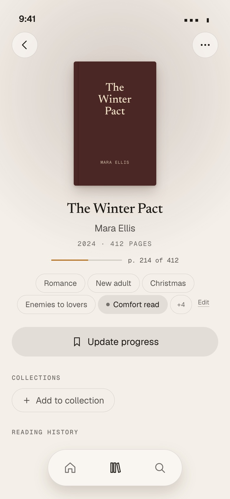 | 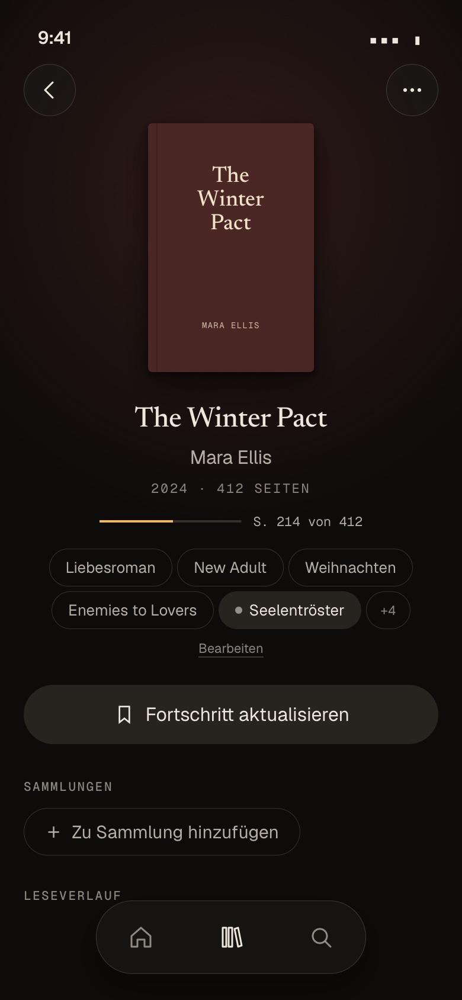 |

- Where the genre chips are now (`book/Genres.vue`), the same chip: the twenty no tag covers first, then the
  Book's tags in kind order (§2.7), **as many as fit in two lines** (measured, at least three), then **hers**
  (never folded away: the `fill` chip with a small dot, "Comfort read"), then **+N** for the rest, then the quiet
  **Edit** (or **Add tags**). +N and Edit open the same sheet.
- A Book outside her Library shows the Book's tags only (no Edit, +N opens the sheet read-only). The row keeps
  its room for a Book of hers, so nothing moves when the tags arrive (they are on the device).
- Plain chips, not links, as today. (A tag as a link to "all Books with this tag" is the Library filter's job.)

### The Tags sheet (replaces the Genres sheet)

| Dark, English | Light, German |
|---|---|
| 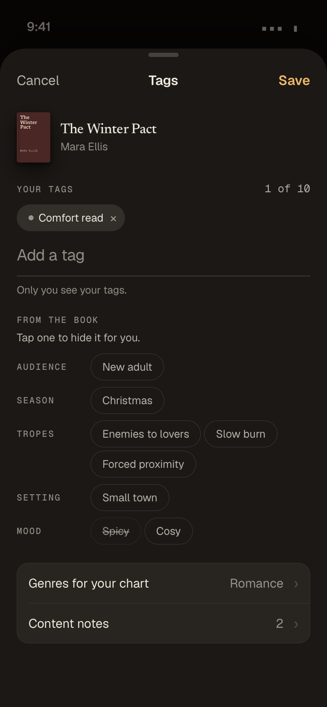 | 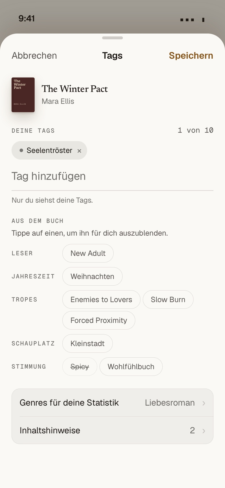 |

- `UiSheet` "Tags" (Cancel · Tags · **Save**), the Book line first.
- **Your tags**: her chips with ×, the count "1 of 10", the field **Add a tag**, and one line: "Only you see your
  tags."
- **From the book**, by kind (eyebrow left, chips right): tap one to hide it for her (struck through, in
  `inkFaint`; tap again to bring it back). The kinds a Book has none of are left out. The twenty are not in this
  list (they are not hidden, they are chosen: the row below).
- Two rows under it: **Genres for your chart** → the twenty pills of today's `GenreSheet` (up to three, Back to
  suggested), now a picker inside this sheet that hands its choice back instead of saving on its own;
  **Content notes · 2** → a list (the sources' content notes and hers), never chips.
- One Save for everything: the tag writes the change needs (`add_entry_tag`, `remove_entry_tag`,
  `set_entry_tag_hidden`) plus `set_entry_genres` or `reset_entry_genres` when the twenty changed, all into the
  outbox. Offline it saves too (queued, the sync chip shows it) instead of "Offline".
- Every chip and pill keeps a 44 px hit area (an invisible `::after`, as `UiPill` does), the 32 px drawing
  notwithstanding.

### Adding her own tag: typeahead

| Light, German ("Weihnachtsrom…") | Dark, English ("cosy") |
|---|---|
| 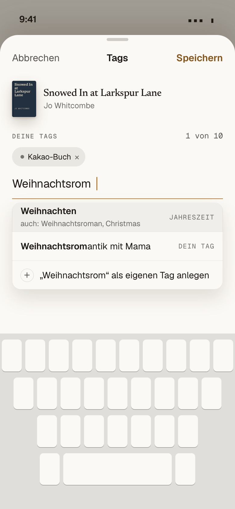 | 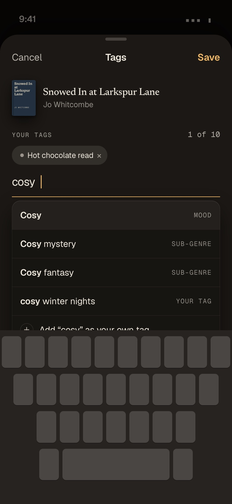 |

- Suggestions as she types (from the second letter): curated tags whose name or alias in **either** language
  contains it, best match first, the kind at the right ("Weihnachten · Jahreszeit", "also: Weihnachtsroman,
  Christmas"); then her own earlier tags ("Dein Tag"); last, **Add "…" as your own tag**. Enter takes the lit
  one. Typing a curated alias stores the curated key.
- Limits: 10 own tags a Book, 40 characters, 300 distinct own tags a member (question 5). At the limit the field
  says so ("10 of 10: remove one to add another").

### Search results: one quiet line

| Light, English, 360 | Dark, German, 360 |
|---|---|
| 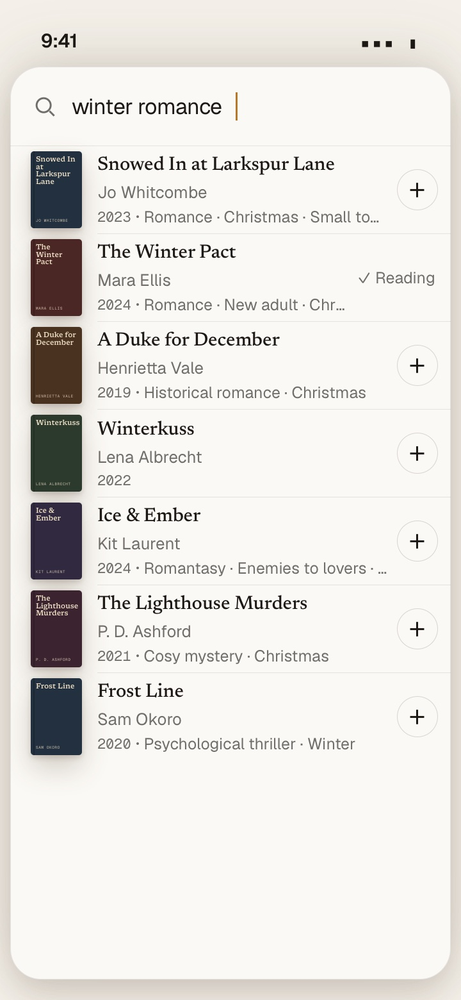 | 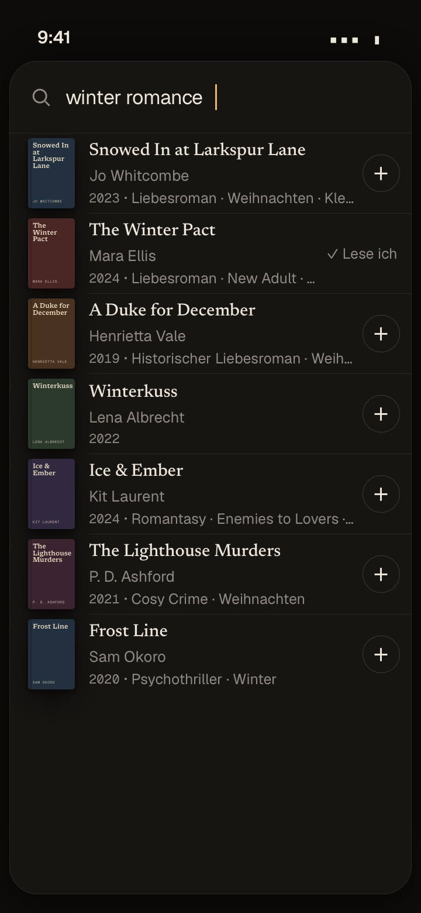 |

- The result row's third line (year, "Other edition") gains **up to three tags**, footnote size, `inkFaint`, one
  line, truncated with an ellipsis, in the Book page's order (the twenty no tag covers, then the most specific:
  sub-genre, audience, season, trope). No chips, no +N: a row that already has its year line stays as tall as
  today; a row without a year gains the line only when it has tags.
- None when no source said any (*Winterkuss*): a result is never hidden or ranked lower for lacking tags (#344's
  acceptance). Never waits: the line fills in when `book_tags_for` answers or the source's own labels are there.
- The search itself does not match tags in this plan (a query "christmas romance" still matches titles and
  authors as today); searching her Library by tag is the filter's job.

### The Library filter: a Tags facet

| Dark, English | Light, German |
|---|---|
| 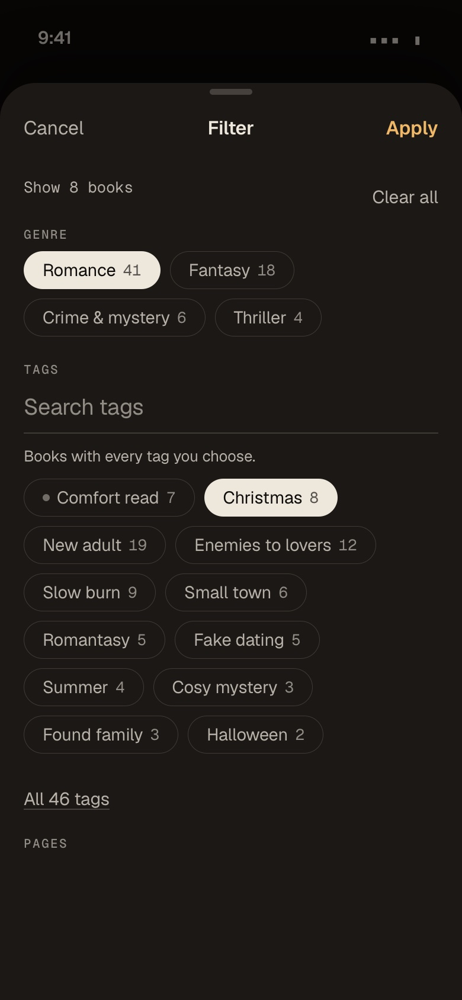 | 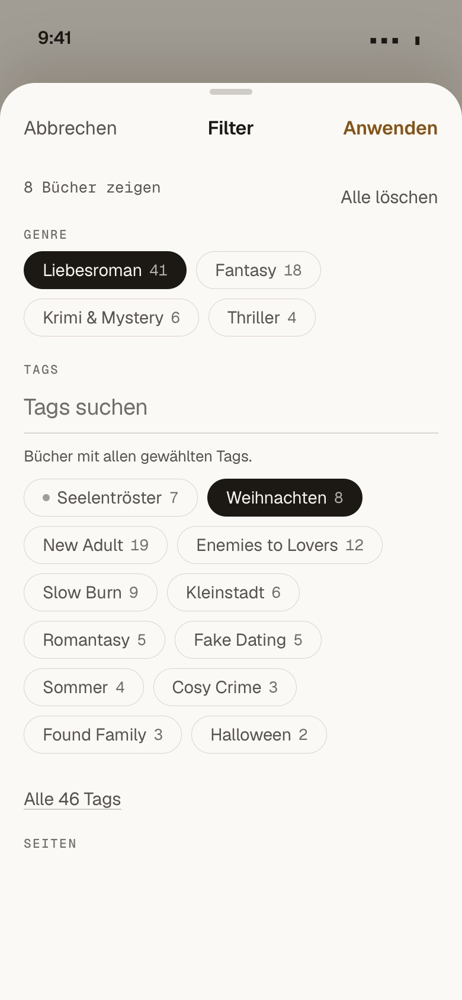 |

- A **Tags** section after **Genre** in every list's filter, offered when the list's Books have any tag; pills
  with counts, **her own first**, then by count; up to twelve shown, **All 46 tags** opens the rest, and
  a search field above them once there are more than twelve (the Author facet's pattern).
- **AND within the facet** ("Books with every tag you choose.": Christmas *and* Enemies to lovers), unlike Genre's
  OR: tags are properties that narrow, genres are buckets (question 7). AND across facets as today.
- The chosen tags show as removable chips in the view bar (`ViewBar.vue`) like the other filters; kept per member
  on the device (`libellus-library-view`).

### The Profile: still the twenty, now with a way in

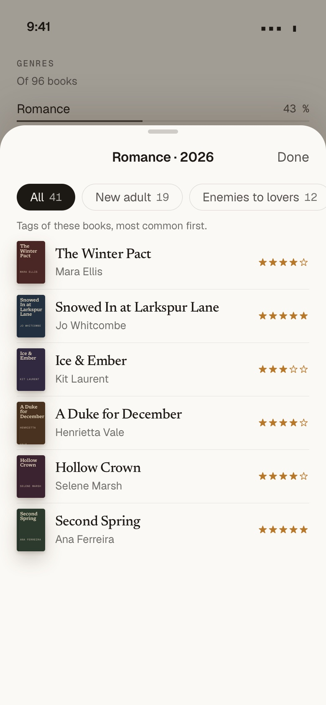

- The Genres block keeps its twenty rows and its numbers (`book_genres` unchanged; her `entry_genres` first).
- Tapping a row opens the reads sheet of that genre (exists); new: a row of tag pills over the list ("All 41 ·
  New adult 19 · Enemies to lovers 12 · …", the tags of those reads, most common first) that narrows the list.
  No new figures and no chart of tags (a later idea: "Your most-read tropes" in a year in review).

### Tags or a Collection? One rule

> **A tag says what a Book is. A Collection says what a Book is to you.**

A tag is true for anyone who reads the Book (a genre, a trope, an audience, a season it is set in or made for, a
mood, a content note); it has no order, is never shared, and every Book that has it shows up in the filter at
once. A Collection is hers and chosen: a named, ordered set (a plan, a challenge, a book club, favourites) that
can be shown as a mosaic and later shared. When in doubt: would she want it *on the Book page as a fact*? Tag.
Would she want *a list she arranges*? Collection.

The **Summer** case: "a summery book" is the curated tag *Summer* (season; *Beach read* next to it). The sources
give it to a few Books (3 of 58 in the sample); she adds it to the rest in two taps, and the filter shows "Summer"
across her whole Library. "What I'll read this summer" is a Collection. The same for Christmas: *Christmas* the
tag (most Christmas novels get it from the sources), "Advent 2026" the Collection.

### States and details

- Loading: the existing placeholder chip; none: the row keeps its room with Add tags; offline: everything reads
  from the device, writes queue; a failed write shows in the sync sheet like any queued write.
- Accessibility: the chip list is labelled "Tags"; her chips say "Your tag: Comfort read"; a hidden one is a
  toggle (`aria-pressed`); suggestions are a listbox under the field (arrow keys, Enter).
- Friends and public pages: a friend's view of a Book may show the Book's tags (Catalogue facts), never hers.
- Copy keys: `tag.*` beside `genre.*`; the 75 names live in `labels.ts`, not in `en.json`/`de.json`.

## 5. Costs and risks

| Topic | Estimate / answer |
|---|---|
| Storage | `book_labels`: ~3–8 rows a Book (sample median 3, max 12; Catalogue median 1): 10,000 Books ≈ 50,000 rows ≈ 5 MB with indexes. `entry_labels`: ≤ 10 own + hidden a Book; a 700-Book Library rarely above 2,000 rows. Signals grow only for German Books with DNB records (≈ 20–40 kept keywords after the codes are dropped). Negligible on the current plan. |
| `enrich` load | **No new Apple, Open Library or Wikidata requests**: the labels are in the answers it already fetches. +1 DNB SRU request a German Book (14 of 194 Catalogue Books today; most of a German reader's import). PR 1's backfill is `remap` over the stored signals: 0 requests. PR 5's backfill: one DNB request for each German ISBN in the Catalogue. |
| Source limits | Apple untouched (`enrich` paces it at one every 3 s; the import's Apple budget is untouched). DNB: `enrich` asks at most 2 a second (4 s timeout, its own breaker), so with `dnb-lookup`'s 5 a second the two never send the DNB more than 7 a second; `dnb-lookup`'s member budgets (30/min, 120/min import) are untouched. Open Library's proxy (`openlibrary`, 360/min a member) untouched. Search: Open Library's `subject` is already in `OPENLIBRARY_FIELDS`; +1 `book_tags_for` RPC a search (Catalogue hits only). |
| Licences | Open Library: public domain / CC0 (not ODbL as the brief assumed): no duty. Wikidata, DNB: CC0. Apple: genre names are already stored per Catalogue Book (`signals`, THIRD-PARTY.md); they stay limited to Books members added, never a bulk copy. Hardcover API: terms to read before PR "later". Goodreads, StoryGraph: no API, no scraping. THIRD-PARTY.md gets the DNB row's purpose extended ("keywords for tags"). |
| Moderation | None needed: the only text other members ever see is the curated vocabulary. Her own tags are private (RLS), never in feeds, friends' views, public pages or exports of others. |
| GDPR | Her tags are her data: in the data export (#170), deleted with the entry and the account, cleared from the device on sign-out. The privacy notice's list of what is stored gains "tags you add to your Books". No new processor. |
| Language mix | Curated tags in her app language; her own as she typed them; unknown source labels never shown, so French, Spanish and Polish subjects never leak. A German member reads *Weihnachten*, an English one *Christmas*, for the same Book. |
| Quality | Wrong source matches (a Book's Apple genres of another book) → `enrich` looks Apple up by id and ISBN before a title, the threshold; marketing words → curated only, weak aliases; drift → the candidates report, versioned remaps. Residual: a wrong tag now and then; she can hide it for herself. |
| Owner effort | Curation: a batch of 10–20 tags from the report, about 30 minutes, monthly at first; German names are part of each batch. |
| Performance | `library_tags()` one paged call like `library_genres()`, kept on the device; the filter counts on the device (a 1,000-entry Library: a few thousand keys). |

## 6. Build plan

Small PRs in order; each ships something a member sees or makes the next one safe. Tiers as the owner's agent setup names them
(hard: Opus, normal: DeepSeek V4.1 Flash on GOAT, simple: Haiku; Sonnet at high for UI-heavy ones).

| # | PR | Size | Tier | Visible value |
|---|---|---|---|---|
| 1 | **Tags on the Book page**: `labels.ts` (vocabulary, aliases, resolver, block list, tests incl. the prototype's false positives), migration (`labels`, `book_labels`, `book_tags`, `library_tags`, `enrich_save_tags`), `enrich` writes `book_labels` beside `book_genres` (equivalence test: the 186 Books' genres do not move), `remap` backfill from stored signals (0 requests), the chip row with +N and a read-only sheet | L | hard | every Catalogue Book with Apple/Open Library/Wikidata labels shows its tags (108 of 194 today) |
| 2 | **Tags on search results** (#344): resolve the live labels on the device before the cap, `book_tags_for` for Catalogue hits, the third-line tags | S | normal | the palette, picker and scan show tags; #344's acceptance |
| 3 | **Her own tags**: `entry_labels`, `add_entry_tag` / `remove_entry_tag` / `set_entry_tag_hidden` in `QUEUED_ACTIONS` and `sync_write` (and `set_entry_genres` / `reset_entry_genres` with them), the Tags sheet (yours, from the book with hide, the twenty as a nested picker, content notes), typeahead, device copy v2 | M–L | hard (or Sonnet high) | she adds *Comfort read*, *Summer*, hides *Spicy* |
| 4 | **Library filter by tag**: the facet, AND, counts, search above twelve, view-bar chips | S–M | normal | "all my Christmas romances" in two taps |
| 5 | **The DNB in `enrich`**: ISBN lookup for German Books, 653/655/VLB parsed, codes dropped, `source: 'dnb'`; `label-candidates.ts`; curated `genre_ids` feed `mapGenres` (new `GENRE_MAP_VERSION`, `remap`; the `book_genres_source` check widened to `dnb`) | M | normal | tropes for German Books (14 vs 4 in the sample); German romance gets *Romance* reliably |
| 6 | **Hardcover CSV tags** → her tags; the preview's count | S | normal | a Hardcover member keeps her tags |
| 7 | **Profile drill-down**: tag pills in the genre reads sheet; Regal export's `genre` (and its comment) | S | normal | "what kind of romance did I read this year" |
| 8 | **Curation round 1**: the first candidates report, 10–20 tags with German names, `remap` | S | simple | more Books with tags; then monthly |

Ships first for visible value: PR 1 (from data already in production), then 2 and 3 together in one release if
possible (the search line is small; own tags are the owner's headline).

Skipped on purpose: the Hardcover API (no token, terms unread), Wikidata P6962 (measured useless), Goodreads or
StoryGraph scraping, automatic promotion of unknown labels, public or voted tags, spice levels and ratings of
tags, search matching tags, tags on Regal's shelf, a chart of tags. Each can come later without changing the
model.

## 7. Open questions for the owner

Each with my recommendation; "yes" takes it, "default" means the same.

1. **The word in the app is "Tags"** (DE "Tags", "Deine Tags", "Tag hinzufügen"; Hardcover and StoryGraph say
   tags, German apps too; "Labels" reads oddly in German). *Recommend: yes.*
2. **Only curated tags are ever shown**; unknown labels wait in the candidates report until you add them (no
   automatic promotion, no raw chips). This narrows #344's "show the raw labels". *Recommend: yes.*
3. **The raw layer stays `book_enrichment.signals`** (jsonb a Book) instead of a new raw table. *Recommend: yes.*
4. **The twenty stay as they are**: `book_genres` by the existing mapping, `entry_genres` her explicit choice
   ("Genres for your chart"); her tags never change the chart by themselves. *Recommend: yes.*
5. **Limits**: 10 own tags a Book, 40 characters each, 300 distinct own tags a member. *Recommend: yes.*
6. **She may hide a Book's tag for herself** (not for others). *Recommend: yes.*
7. **The Library's Tags facet combines with AND** (Genre stays OR). *Recommend: yes.*
8. **Content notes never as chips**, only behind the "Content notes" row in the sheet. *Recommend: yes.*
9. **Ask the German National Library in `enrich`** for German ISBNs (CC0; the best trope source measured).
   *Recommend: yes.*
10. **Hardcover CSV's Genres, Moods, Tags and Content Warnings become her own tags.** Unverified: whether the
    export holds her own tags or the book's community tags; a real export settles it (your own file, if you have
    one). *Recommend: yes, after one look at a real export.*
11. **Goodreads shelves stay Collections** (as the import does now), not tags. *Recommend: default.*
12. **The Regal export fills its `genre` field** with her first genre of the twenty. *Recommend: yes.*
13. **The first vocabulary as in the appendix** (75 tags; *Spicy* in, *BookTok* out as marketing), and you review a
    candidates report monthly. *Recommend: yes.*
14. **A sub-genre stands in for its genre on the chips** (*Romantasy*, not *Fantasy · Romance · Romantasy*); the
    chart still counts the twenty. *Recommend: yes.*
15. **Search results show up to three tags on the third line**, no chips, no matching by tag in the query.
    *Recommend: yes.*
16. **Hers in the Book page's chip row are never folded into +N.** *Recommend: yes.*

## Appendix A: the first vocabulary (75 tags)

`implies` is the share of the twenty a tag adds to `mapGenres` from PR 5 on (and the drill-down's grouping);
aliases are normalised (lower case, `&` as `and`); the curated names in both languages are aliases too; *italic*
aliases are weak (half strength, §2.6). Wikidata Q-ids (new-adult fiction Q7005086, romantic fantasy Q930383,
enemies to lovers Q133830942, dark romance Q115216305) join their tags as aliases.

| Key | Kind | English | German | Implies | Main aliases (besides the names) |
|---|---|---|---|---|---|
| `romantasy` | subgenre | Romantasy | Romantasy | fantasy, romance | romantic fantasy, romantasy and romantic fantasy, fantasy romance, new adult fantasy |
| `dark-romance` | subgenre | Dark romance | Dark Romance | romance | dark new adult |
| `contemporary-romance` | subgenre | Contemporary romance | Contemporary Romance | romance | zeitgenössische liebesromane, romance contemporary |
| `romantic-comedy` | subgenre | Romantic comedy | Romantische Komödie | romance | romantic comedies, romcom, rom-com, liebeskomödie, liebes-komödie |
| `paranormal-romance` | subgenre | Paranormal romance | Paranormal Romance | romance, fantasy | romance paranormal |
| `historical-romance` | subgenre | Historical romance | Historischer Liebesroman | romance, historical | romance historical, historische liebesromane |
| `romantic-suspense` | subgenre | Romantic suspense | Romantic Suspense | romance, thriller | romantische thriller, romance suspense |
| `sports-romance` | subgenre | Sports romance | Sports Romance | romance | romance sports |
| `cosy-mystery` | subgenre | Cosy mystery | Cosy Crime | crime | cozy mystery, cozy mysteries, cosy crime, mystery and detective / cozy, women sleuths |
| `police-procedural` | subgenre | Police procedural | Polizeiroman | crime | polizeiromane, mystery and detective police procedural |
| `regional-crime` | subgenre | Regional crime | Regionalkrimi | crime | regionalkrimis |
| `psychological-thriller` | subgenre | Psychological thriller | Psychothriller | thriller | psychological thrillers, thrillers psychological |
| `epic-fantasy` | subgenre | Epic fantasy | High Fantasy | fantasy | fantasy epic |
| `urban-fantasy` | subgenre | Urban fantasy | Urban Fantasy | fantasy | fantasy urban |
| `dark-fantasy` | subgenre | Dark fantasy | Dark Fantasy | fantasy | fantasy dark fantasy |
| `cosy-fantasy` | subgenre | Cosy fantasy | Cosy Fantasy | fantasy | cozy fantasy |
| `space-opera` | subgenre | Space opera | Space Opera | sci-fi | science fiction space opera |
| `dystopian` | subgenre | Dystopian | Dystopie | sci-fi | dystopia, dystopian fiction, dystopias, dystopian fiction for young adults |
| `post-apocalyptic` | subgenre | Post-apocalyptic | Postapokalypse | sci-fi | postapocalyptic, post-apocalyptic fiction, apocalyptic and post-apocalyptic |
| `cyberpunk` | subgenre | Cyberpunk | Cyberpunk | sci-fi | cyberpunk fiction |
| `time-travel` | subgenre | Time travel | Zeitreise | – | zeitreisen |
| `dark-academia` | subgenre | Dark academia | Dark Academia | – |  |
| `gothic` | subgenre | Gothic | Schauerroman | horror | gothic fiction, gothic novel |
| `magical-realism` | subgenre | Magical realism | Magischer Realismus | – | magic realism |
| `family-saga` | subgenre | Family saga | Familiensaga | – | familien roman, familienroman |
| `new-adult` | audience | New adult | New Adult | – | new adult romance, new adult fiction, new adult-liebesromane, fiction / romance / new adult, new adult/romance (DNB 655) |
| `middle-grade` | audience | Middle grade | Kinderbuch ab 10 | – | middle-grade |
| `childrens` | audience | Children's | Kinderbuch | – | childrens books, kinderbücher, children's stories |
| `enemies-to-lovers` | trope | Enemies to lovers | Enemies to Lovers | – | enemies-to-lovers, haters to lovers |
| `rivals-to-lovers` | trope | Rivals to lovers | Rivals to Lovers | – |  |
| `friends-to-lovers` | trope | Friends to lovers | Friends to Lovers | – | best friends to lovers |
| `slow-burn` | trope | Slow burn | Slow Burn | – | slow-burn |
| `fake-dating` | trope | Fake dating | Fake Dating | – | fake relationship, fake-dating |
| `second-chance` | trope | Second chance | Second Chance | – | second chance romance, second-chance |
| `forced-proximity` | trope | Forced proximity | Forced Proximity | – |  |
| `grumpy-sunshine` | trope | Grumpy/sunshine | Grumpy meets Sunshine | – | grumpy sunshine, grumpy-meets-sunshine, grumpy x sunshine |
| `found-family` | trope | Found family | Found Family | – | wahlfamilie |
| `forbidden-love` | trope | Forbidden love | Verbotene Liebe | – | forbidden romance |
| `love-triangle` | trope | Love triangle | Liebesdreieck | – | love triangles |
| `fated-mates` | trope | Fated mates | Fated Mates | – | fated mate |
| `billionaire` | trope | Billionaire | Billionaire | – | billionaire romance, billionaires |
| `office-romance` | trope | Office romance | Office Romance | – | workplace romance, work relationships |
| `brothers-best-friend` | trope | Brother's best friend | Brother's Best Friend | – | brothers best friend, brother’s best friend |
| `opposites-attract` | trope | Opposites attract | Gegensätze ziehen sich an | – |  |
| `he-falls-first` | trope | He falls first | He falls first | – |  |
| `chosen-one` | trope | Chosen one | Chosen One | – | the chosen one |
| `retelling` | trope | Retelling | Retelling | – | retellings, fairy tale retelling, fairy tale retellings, myth retelling, märchenadaption |
| `small-town` | setting | Small town | Kleinstadt | – | small town romance, kleinstadtroman, small town life |
| `college` | setting | College | College & Uni | – | college romance, college and university, campus, universität |
| `boarding-school` | setting | Boarding school | Internat | – | boarding schools, internatsroman, school stories |
| `royals` | setting | Royals | Royals | – | royalty, kings and rulers, princes, princesses |
| `christmas` | season | Christmas | Weihnachten | – | christmas stories, christmas fiction, weihnachtsroman, weihnachtsgeschichte; weak: *christmas*, *weihnachten*, *holidays and celebrations* |
| `halloween` | season | Halloween | Halloween | – | halloween, halloween fiction, halloween stories |
| `summer` | season | Summer | Sommer | – | summer reads, sommerroman, liebesromane sommer; weak: *summer*, *summer vacation*, *sommer* |
| `winter` | season | Winter | Winter | – | winter romance, winterroman; weak: *winter* |
| `autumn` | season | Autumn | Herbst | – | autumn romance, fall romance, herbstroman; weak: *autumn*, *herbst* |
| `beach-read` | season | Beach read | Strandlektüre | – | beach reads, beach reading, urlaubslektüre, urlaubsroman |
| `cosy` | mood | Cosy | Wohlfühlbuch | – | feel-good, feel good, wohlfühlroman, cosy read, cozy read |
| `funny` | mood | Funny | Humorvoll | – | humorous, humorous fiction; weak: *humor*, *humour*, *witzig*, *lustig* |
| `emotional` | mood | Emotional | Emotional | – | große gefühle, tearjerker |
| `spicy` | mood | Spicy | Spicy | – | steamy, *sexy*, erotic romance |
| `dark` | mood | Dark | Düster | – | weak only: *dark*, *düster* |
| `coming-of-age` | theme | Coming of age | Coming-of-Age | – | bildungsroman, bildungsromans, erwachsenwerden, coming of age fiction for young adults, coming of age - fiction |
| `lgbtqia` | theme | LGBTQIA+ | LGBTQIA+ | – | lgbtqia+ fiction, lgbtqia+ romance, lgbtq, lgbtq+, lgbt |
| `dragons` | theme | Dragons | Drachen | – | drachenreiter, dragon riders |
| `fae` | theme | Fae | Feen & Elfen | – | faeries, fairies, elfen, elfenfantasy, feen |
| `witches` | theme | Witches | Hexen | – | witchcraft, witch |
| `vampires` | theme | Vampires | Vampire | – | vampire fiction |
| `mafia` | theme | Mafia | Mafia | – | mafia romance; weak: *mafia* (Open Library's `mafia` is mostly non-fiction) |
| `grief` | theme | Grief | Trauer | – | bereavement |
| `mental-health` | theme | Mental health | Psychische Gesundheit | – | mental illness, depression, psychische erkrankung |
| `cn-domestic-abuse` | content-note | Domestic abuse | Häusliche Gewalt | – | domestic violence, family violence |
| `cn-sexual-content` | content-note | Sexual content | Sexuelle Inhalte | – | explicit sexual content |
| `cn-self-harm` | content-note | Self-harm | Selbstverletzung | – | self harm, suicide, suizid |
| `cn-violence` | content-note | Violence | Gewalt | – | graphic violence |
Considered and left out of the first list: *BookTok* (marketing, not a property of the Book), *Booktok
made me buy it*, *Spice level* (a rating, not a tag), *Holiday romance* (Apple US means Christmas, British readers
mean a summer holiday: a candidate once the report shows how it is used), *Bad boy*, *Rich boy/poor girl*,
*Groveling*, *Bully romance* (seen in DNB keywords; the report will tell whether they recur), the Hardcover moods
beyond the five here (*adventurous*, *reflective*, *tense*, …: added with PR 6 if the export carries them).

## Appendix B: method and reproducing

- Production: read-only `SELECT`s through the Supabase management API (`read_only: true`), counts only: Books,
  `book_enrichment.signals` per source, label frequencies, `book_genres`, `entry_genres`, entries, Collections.
  Nothing of a member's (no titles of her Library, no ISBN list) is in this repository.
- Sources: Open Library (`search.json`, `subjects/<key>.json`, 1 request a second, identified), Apple Search
  (58 requests, one every 2 s, never refused), DNB SRU (MARC21, ≤ 3 a second), lobid, Wikidata SPARQL (6 queries)
  and `wbsearchentities`, on 15 Oct 2026. 58 well-known books chosen to cover romance, romantasy, new adult, cosy
  crime, Christmas and Halloween in English and German, plus controls (Dune, Sapiens, Normal People, Der
  Vorleser, …). Caveats: title-and-author top hits are sometimes another book; DNB keywords pooled over up to three
  records (other editions, audiobooks) inflate its counts.
- The resolver measured in §2 is a scratch prototype of §2's rules (75 tags, the block list, path splitting,
  trust 1.0 / 0.6, weak aliases, threshold 0.6), run over the stored Catalogue signals and the sample; PR 1
  implements it properly with the measured cases as tests.
- Mock-ups: `docs/prototypes/genres/*.html` (static, tokens copied from `tokens.generated.css` at 1.22.0); shots
  with `PLAYWRIGHT=<path to @playwright/test> node docs/prototypes/genres/shoot.cjs` → `docs/images/genres/`.
