# The Notes and buddy-read composer: why the chips vanish, and three versions

**Status: draft for the owner, mock-ups only (PR "mocks: the Notes and buddy-read composer, three versions", DO NOT MERGE).** No product
code and no change to `fabkho/ui` in this PR. Written 7 Nov 2026 against `origin/main` `6aec0180` (1.41.1), `@fabkho/ui` 0.12.0
(`1e50b00`, the installed copy is byte-identical to `origin/main` of the UI repo for `Composer.vue` and `ChatThread.vue`), `@fabkho/chat` 0.1.0,
Trappist `07eab300` (on `@fabkho/ui` 0.10.5).

**Try it:** open `docs/prototypes/notes-composer/index.html` (three live phones side by side; tap the field and a faux 291 px keyboard
comes up; EN/DE, light/dark, 360×640 and 390×844, Notes and buddy read). `v1.html`, `v2.html`, `v3.html` have every switch: reply, Everyone,
Only me, Spoiler, microphone held, 200 % text, the 44 px finger areas, a measured-size readout and, on V1, **Today (bug)**, which replays the
owner's bug (Android back closes the keyboard, the field keeps the focus, the row stays gone). Shots: `docs/images/notes-composer/` (48 files;
`node docs/prototypes/notes-composer/shoot.cjs` regenerates them).

**The owner's feedback.** The select that switches the scope of a note is above the input; when the field is tapped it disappears; after the
keyboard closes it does not come back until the chapter is left and entered again. The Spoiler chip behaves the same. Scope select and Spoiler
chip sit side by side at different heights: unify. Wanted: mock-ups, maybe a rethought input for notes and buddy reads; three versions: today
plus the fixes, and two new ideas.

## In short

- **Why it vanishes on focus:** by design. The base `UiComposer` folds *its* `actions` slot row (grid row to 0, `inert`, `visibility: hidden`) while
  the textarea has the focus (`Composer.vue:396, 495, 613`). The Notes page and the buddy-read page put the scope control and the Spoiler chip
  into that slot (`notes/[book]/[chapter].vue:520-526`, `together/[id]/[section].vue:542-546`), so they inherit the fold.
- **Why it does not come back:** the fold follows *focus*, not the keyboard. It ends on the textarea's `blur` event (`Composer.vue:614`). Any way
  of closing the keyboard that leaves the field focused leaves the row folded for good: on Android (Chrome, and so the TWA) the back gesture or the
  keyboard's own "hide" button closes the keyboard and sends no `blur`. What brings the row back: a blur (iOS ✓ accessory button, a drag or wheel
  on the thread, `blur()` of the exposed handle), starting a voice recording (`Composer.vue:179`), or a re-mount (leaving the chapter: the page's
  `key` is `route.fullPath`, `[chapter].vue:35`).
- **Whose bug:** both. The base's rule is wrong in kind (it ought to follow the keyboard: `useKeyboardViewport().shown`, which the same package's
  `UiChatThread` already uses for a different job, `ChatThread.vue:300`); and the app uses a folding slot for controls the member needs while typing.
  **Same in Trappist and in the buddy read** (same base code, 0.10.5 has the same lines; Trappist floats four chips there).
- **Cheapest fix that works:** in this repo, no UI release: stop using `#actions` for these two controls; draw the row above `<UiComposer>` in the
  page's `#composer` slot (the Everyone line already sits there and never folds). The shared fix (fold only while `focused && keyboard shown`) is a
  `fabkho/ui` patch release plus app bumps, and only worth it for Trappist's chips and for any app that keeps a folding row.
- **Sizes:** the Spoiler chip is **34 px** drawn (pill, glass, shadow) with a 44 px `::after`; the scope control is **48 px** (14 px radius, `fill`
  track, 44 px segments). Same at 360 and 390 (`ComposerChip.vue:53`, `LevelPicker.vue:45`).
- **Versions:** V1 *Today, fixed*: same layout, never folds, one 36 px control shape. V2 *In the capsule*: scope and Spoiler are two icon buttons inside
  the field's capsule. V3 *Send as*: the send button is split; scope and Spoiler live behind its tab.
- **Recommendation:** ship V1 now (this repo, ~half a day, no release); take V2 as the redesign if the owner likes it on a phone (needs a UI minor);
  not V3 for Notes. Details and costs in part 3.

## 1. Diagnosis

### 1.1 How it is wired (file:line, all verified in the code named)

| Piece | Where | What it does |
|---|---|---|
| Header comment | `fabkho/ui app/components/ui/Composer.vue:31-34` | "While the field has the keyboard they fold away … They come back when the field is left (a drag on the thread closes the keyboard, UiChatThread)." |
| The state | `Composer.vue:396` `const focused = ref(false)` | The *only* input to the fold. |
| Set | `Composer.vue:613-614` `@focus="focused = true"` `@blur="focused = false"` on the textarea; `Composer.vue:177-179` (a recording starts: the field is removed, which sends no blur, so it resets by hand) | |
| The fold | `Composer.vue:495` (non-compact; the Notes and buddy pages) `class="actions" :data-folded="focused \|\| undefined" :inert="focused \|\| undefined"`; compact bar `:464-467` folds only without a `note` | |
| The CSS | `Composer.vue:670-693` | `.actions[data-folded] { grid-template-rows: 0fr; padding-bottom: 0; opacity: 0; visibility: hidden }` on the standard motion; the row's room goes to the thread. |
| Closing the keyboard | `UiChatThread ChatThread.vue:272-296, 475-477` | A `touchmove` of more than `DRAG_PX` (10) on the thread, or a `wheel`, calls `blurComposer()` = `textarea.blur()`. A tap does nothing. |
| What the thread knows that the composer does not | `ChatThread.vue:270, 299-300` `useKeyboardViewport(…).shown`; `keyboardUp = typing && keyboard.shown` | The thread already treats "the field has focus" and "the keyboard is up" as two facts (`useKeyboardInset.ts:56-61, 78`: `shown` "also where it resized the page and the inset reads 0 (Android)"). The composer does not. |
| Notes page | `web/app/pages/notes/[book]/[chapter].vue:510-527` | `<UiComposer>` with `<template #actions>` holding `UiComposerChip` Spoiler (`:521`) and `NotesLevelPicker` (`:524`), plus the held-back line (`:525`). The Everyone line is *outside*, above the composer (`:509`). |
| Buddy-read page | `web/app/pages/together/[id]/[section].vue:529-547` | `<template v-if="sectionId !== null" #actions>` with the Spoiler `UiComposerChip` (`:543`); the microphone is on (`:535`). |
| Trappist | `trappist/web/app/components/chat/ChatPage.vue:787-831` | `#actions` with quote, Spoiler, share book, share phone chips; `@fabkho/ui` 0.10.5 has the same `focused` lines (`Composer.vue:139, 236, 327-328`). |

### 1.2 Why the row disappears when the field is tapped

`@focus` sets `focused`, `.actions` takes `data-folded` and `inert`. It is the documented iMessage-style behaviour of the base, and it is
*not* an accident: the row's room goes to the thread while the keyboard eats the screen. It is just wrong for these two controls, which the member
wants while typing (the scope of the note she is writing, the Spoiler flag): the owner's "weird in itself".

### 1.3 Why it does not come back on blur

It does come back on a `blur` event. I ran the real `UiChatThread` + `UiComposer` with the Notes page's exact `#actions` content (the real
`UiComposerChip` and `NotesLevelPicker`) in a throwaway dev page, WebKit, at 360 and 390:

| Step | `actions` row |
|---|---|
| rest | open: `data-folded` absent, 56 px high (48 picker + 8) |
| tap in the field | `data-folded`, `inert`, `visibility: hidden`, 0 px |
| `blur()` (what a drag on the thread calls) | open again, 56 px |
| tap on the empty thread (desktop WebKit moves focus to `body`) | open again |

So when `blur` fires the base is right. The row stays gone only if the field keeps the DOM focus after the keyboard is gone:

1. **Android back / the keyboard's hide button (Chrome on Android, so the installed TWA, `docs/ANDROID.md`).** The keyboard closes, the textarea stays the
   `activeElement`, no `blur`. Documented widely (Stack Overflow 18614204: "in iOS … Done … blur; the same does not happen when a user clicks the
   back icon in Android … The elements … keep their focus"; React Native #33532 "pressing hardware back dismisses the keyboard but doesn't blur";
   there "pressing on the input again doesn't trigger the keyboard" either). That matches the owner's "stays hidden until I leave the chapter".
2. **A programmatic `focus()` without a keyboard.** After **Show anyway** on a veiled chapter the page calls `field.focus()` after two `nextTick`s
   (`[chapter].vue:332-346`, same in `[section].vue:381-395`). iOS only opens the keyboard for a focus inside the gesture's call stack, so the field
   can be focused, the row folded, and no keyboard to close. (Inferred from how iOS works; I could not run it on a phone.)
3. **iOS taps.** A tap on the thread does not blur on iPhone (reports: Stack Overflow 40469948, angular/components#9623), only a drag or the ✓
   accessory button does. Not a bug, but a member who "taps away" sees the keyboard stay and the row stay folded; it reads the same.

**What I could not do:** reproduce on the owner's phone. I do not know whether it is an iPhone or the Android app. If it is an iPhone and the row
still stays folded after the keyboard is gone, the gesture that closes it is one this analysis does not cover; tell me which and I add it to the
Today (bug) switch. The fixes below do not depend on the answer: V1 has nothing to fold; the shared fix follows the keyboard, not the focus.

### 1.4 What makes the row come back

| Event | Brings it back | Where |
|---|---|---|
| `blur` of the textarea: iOS ✓ accessory button, tapping into another focusable | yes | `Composer.vue:614` |
| Drag or wheel on the thread | yes (it calls `blur()`) | `ChatThread.vue:284-296` |
| `UiComposer.blur()` (exposed; nothing in the app calls it) | yes | `Composer.vue:444-455` |
| A recording starts (buddy read) | yes (`focused = false`) | `Composer.vue:177-179` |
| Leaving the chapter and entering again | yes (re-mount, `key: route.fullPath`) | `[chapter].vue:35` |
| Android back / hide-keyboard | **no** | — |
| Closing the keyboard by a tap on the thread (iOS) | **no** (keyboard stays too) | — |

### 1.5 Base or app?

Both, and each alone would be survivable:

- **Base (`fabkho/ui`)**: folds on `focused`, but what it means is "the keyboard is up". `useKeyboardViewport().shown` exists for exactly that and
  is already used one component over.
- **App (this repo)**: puts controls the member needs while typing into a slot whose contract is "folds with the keyboard". The base's own
  header says the slot is for "Photo", "GIF" and chips like "Share number": things you reach for *before* you type.

### 1.6 Trappist and the buddy read

The buddy read is this repo (Spoiler chip in `#actions`): same fold, same stuck state, with the microphone in the capsule (a recording start
resets `focused`, so the row returns once a voice message is started). Trappist (`ChatPage.vue:803-831`): four chips in `#actions`, `@fabkho/ui` 0.10.5,
same `focused` logic: same bug, and there it is the base only (those chips are "before you type" actions, folding fits them). BetterReads'
fix in this repo does not reach Trappist.

### 1.7 Heights, measured

Real components, WebKit, device pixel ratio 2, 360 and 390 wide (heights do not depend on width; widths do):

| | Spoiler chip (`UiComposerChip`) | Scope control (`NotesLevelPicker`) |
|---|---|---|
| Drawn height | **34 px** (`ComposerChip.vue:53` `height: 34px`) | **48 px** (`LevelPicker.vue:45` `h-(--size-row)`; `--size-row` 48) |
| Inner | text only: 13 px (`--text-caption`), icon 16 | segments **44 px** high, 12 px radius, icon 20, 13 px |
| Radius | pill (999) | **14** (`rounded-md`) outer, 12 inner |
| Padding | `0 12px` (`--spacing-ms`) | 2 px (`p-xxs`) around the segments |
| Surface | glass + `shadow-button` | `fill` + `edge-faint`; the chosen segment raised |
| Finger target | 44 via `::after` (`ComposerChip.vue:67-71`) | the segments themselves, 44 |
| Width, 360 / 390 | 87.7 / 87.7 | 240.3 / 270.3 (`min-w-0 flex-1`: it takes what is left) |
| Row (`.actions-row`, `flex flex-wrap gap-sm`, `Composer.vue:496`) | 56 px with its bottom padding (48 + 8) | |

A 14 px difference in height, two radii, two surfaces, two icon sizes: the "looks weird" is exactly this, and both are top-aligned in the row.

### 1.8 Minimal fix per cause, and where it lives

| Cause | Minimal fix | Lives in | Release cost |
|---|---|---|---|
| The two controls fold with the keyboard (by design, wrong for these) | Draw the row in the page's `#composer` slot above `<UiComposer>` (as the Everyone line is), not in `#actions`; the Spoiler chip and the scope control are one shape (V1) | **this repo** (`[chapter].vue`, `[section].vue`, `LevelPicker.vue`, one new small row component) | none |
| The fold follows focus, not the keyboard (Android back; programmatic focus) | `const { shown } = useKeyboardViewport(() => focused.value)`; fold on `focused && shown` (`Composer.vue:466-467, 495`). Where there is no soft keyboard (a hardware keyboard, desktop) the row simply never folds | **`fabkho/ui`** (patch, 0.12.1) | UI release, then bump BetterReads and Trappist (0.10.5 → 0.12.1: catch up the releases between; check their changelog) |
| Heights and radii differ | One shape, 36 drawn / 44 hit (V1) | this repo | none |
| Focus after **Show anyway** with no keyboard (inferred) | Moot with V1 (nothing folds); with the shared fix the row follows the keyboard | this repo or base | none / same release |

Prefer this repo, as asked: the first row removes the owner's bug and the second the sizes, with no package change. The shared fix is worth
doing once because Trappist keeps four folding chips and the same stuck state; it is not needed for BetterReads once V1 ships.

## 2. The three versions

Common to all three (the rules the mock-ups are built on):

- **Friends is the default.** The device remembers the last non-public choice; **Everyone is for one note** and returns to the remembered
  level after the send (`docs/plans/book-notes.md` 2.3.5; the mock-ups do this: send an Everyone note and the next one is back on Friends).
  A reply cannot be wider than the note it answers (Everyone is `aria-disabled` and says why).
- **A cue before sending, not only a hint line:** in V1 the chosen segment names itself (word + icon) and Everyone is lit in the lamp tone; in V2
  the capsule gains a header line ("🌐 Everyone · Visible to all members …", "🔒 Only me · …") and the scope button lights; in V3 the send button
  itself turns amber and says "Everyone" (or says "Only me").
- **Buddy read = the same composer without scope, with Spoiler.** All three versions are shown in both contexts (switch in the page, shots below).
- **Accessibility:** every control is a real `<button>` with a name and a state: V1 a `radiogroup` of three `role="radio"` and an `aria-pressed`
  chip; V2 a menu button (`aria-haspopup="menu"`, `aria-expanded`) with `menuitemradio`s, Spoiler `aria-pressed`; V3 two buttons ("Send as:
  Friends", "Send · Friends") and `menuitemradio` / `menuitemcheckbox` rows. Finger areas are 44 px everywhere (the readout in each page prints
  visual size and hit area; the "Show the 44 px areas" switch draws them). Reduce motion: nothing in the mock-ups depends on motion (the fold
  animation is gone in all three); popovers appear without a transition.
- **Words:** the app's existing strings (`notes.level.*`, `notes.thread.*`, `together.thread.*`) in EN and DE; **new strings are proposals**:
  *Send as / Senden als*, *Send options / Sendeoptionen*, *Spoiler: hidden for others until they tap / Spoiler: für andere verdeckt, bis sie
  tippen*, *Remove Spoiler / Spoiler entfernen*.
- **Room, measured in the mock-ups** (the thread's height with the keyboard up and the field not empty; the screen above the 291 px keyboard
  minus status, top bar and dock):

| 360×640, keyboard up | V1 | V2 | V3 |
|---|---|---|---|
| Notes · Friends | 157 px | 201 | 201 |
| Notes · Everyone + Spoiler | 119 | 138 | 163 |
| Notes · reply, Friends | 81 | 121 | 125 |
| Buddy read · Spoiler on | 157 | 175 | 201 |

At 390×844 the same rows give 338 / 382 / 382 for the first, 300 / 319 / 344, 262 / 302 / 306, 338 / 356 / 382. A fixed row costs **44 px** of thread
while typing; at 360×640 the reply case leaves V1 81 px, about one short bubble. That is the real price of "the row stays visible while typing".

### 2.1 V1 · Today, fixed

*The layout the app has, with the owner's fixes.* The row (Spoiler left, scope control right) stays above the capsule and **never folds**, so there is
nothing to get stuck. The Spoiler chip and the scope control are **one shape**: 36 px drawn, pill, glass with `shadow-button`, 13 px
caption type, 12 px side padding (the scope's segments sit 2 px in, so the first label starts 12 px from the edge, as the chip's does), a 44 px finger
area as an `::after` on the chip and on each segment. The chosen segment shows icon and word; the others are icons (the app's segmented pattern). An
"on" Spoiler is the lamp tone; so is Everyone: *lit* means "this note is special".

| Notes, DE, dark, 390 | Reply, 360 | Everyone + first-use line, 390 | Buddy read, microphone held |
|---|---|---|---|
| 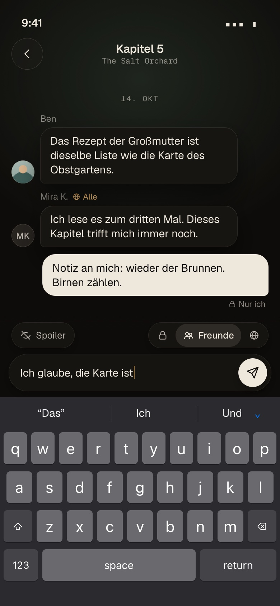 | 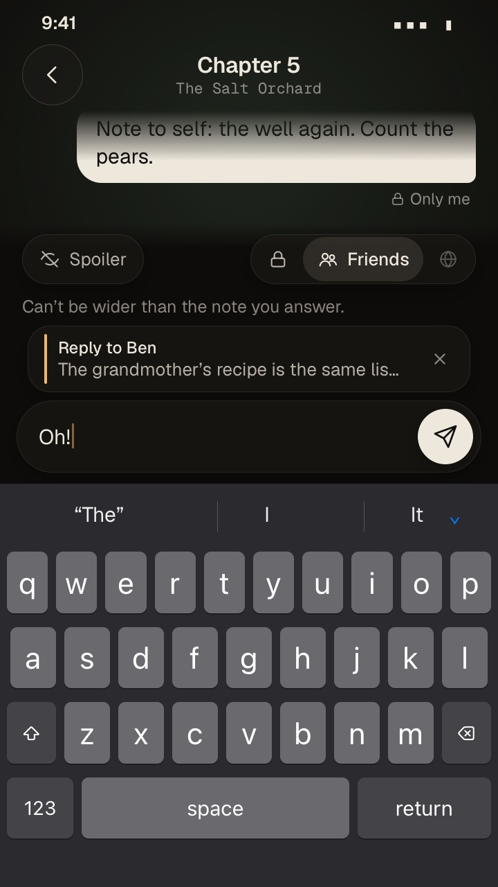 | 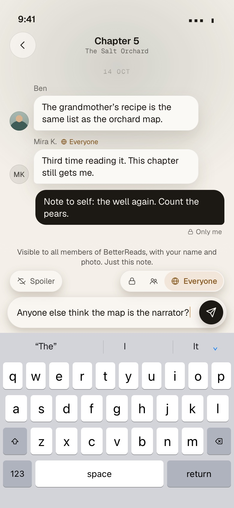 | 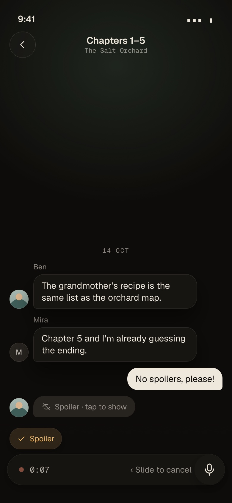 |

| 200 % text, 360 | Today's bug: focused | Today's bug: keyboard gone, field still focused | Finger areas |
|---|---|---|---|
| 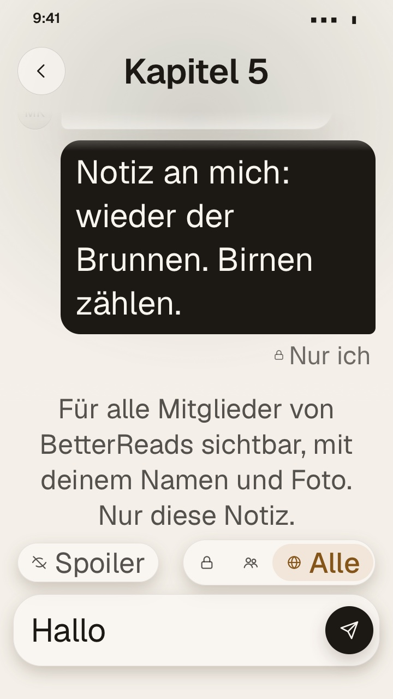 | 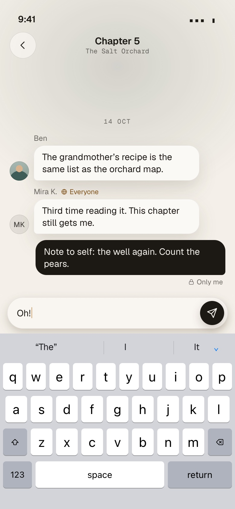 | 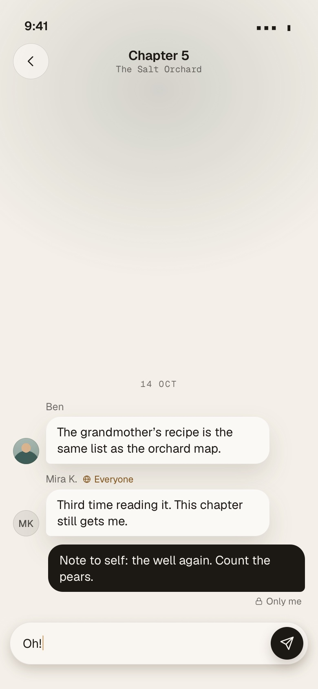 | 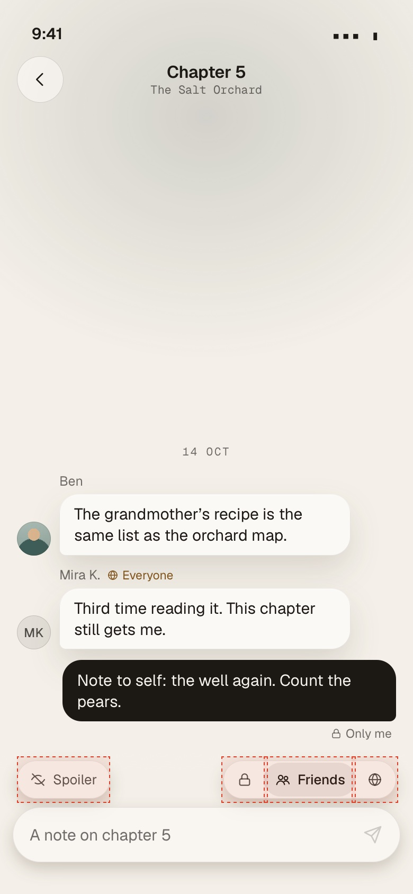 |

Also in the folder: `v1-notes-everyone-360-dark-de.jpg` (German with Spoiler and Everyone, 360), `v1-notes-onlyme-390-dark-en.jpg`, `v1-notes-typing-360-light-en.jpg`,
`v1-notes-big-390-dark-en.jpg`, `v1-buddy-*`.

- **Pros:** most discoverable (words, always there); the least new thinking (the owner's own pattern, fixed); everything inside the app, no release; a
  wrong scope is hard (always visible, the chosen word named, Everyone lit, the first-use line above, reset after the send); both controls are
  reachable at the row's height, about 100-130 px above the bottom edge.
- **Cons:** the 44 px row costs thread room all the time while typing (table above); on the buddy read the row exists for one chip (a whole row for
  Spoiler); at 200 % text the row wraps to two lines and the dock grows; the composer is still three stacked things (line, row, quote) over the capsule.
- **One-handed reach:** good on the right (the scope control sits right), the Spoiler chip is left; both inside the lower third of a 390×844.
- **Risk of wrong scope:** lowest of the three.
- **Cost:** files: `web/app/pages/notes/[book]/[chapter].vue` (row moved out of `#actions`, `:509-527`), `web/app/pages/together/[id]/[section].vue` (Spoiler chip out of `#actions`, `:542-546`), `web/app/components/notes/LevelPicker.vue` (36/32 segments, glass track, 44 px `::after`), one new `components/notes/ComposerOptions.vue` shared by both pages (the row, the held-back line), their e2e specs and `docs/parity.md`. About half a day, **no `@fabkho/ui` release, no app bump**. Effect on Trappist: none.

### 2.2 V2 · In the capsule

*Nothing outside the capsule, so nothing can fold.* The capsule becomes `[scope icon ▾] [field] [Spoiler eye] [send]`. The scope button is a 36 px
circle with the level's icon and a small chevron; tapping it opens a tiny popover of three choices (icon, name and, with room, the existing hint:
"Just you: your notebook for this chapter."), one tap to choose and it closes. The Spoiler is a 36 px icon toggle (`aria-pressed`, lit when on). A note that is
not plain Friends, or is a Spoiler, says so in a **header line inside the capsule** (a lock and "Only me · Just you …", a globe and "Everyone ·
Visible to all members of BetterReads, with your name and photo. Just this note.", an eye and "Spoiler · …"): this is both the cue and the first-use
line, and it moves with the capsule, so it can never be left behind or folded. Friends, no Spoiler: no header, a slim capsule. Buddy read: just
`[field] [eye] [send or mic]`, no row at all.

| Notes, DE, dark, 390 | Choosing, 390 | Everyone, 360 DE | Reply + menu, 360 | Buddy read, 360 DE |
|---|---|---|---|---|
| 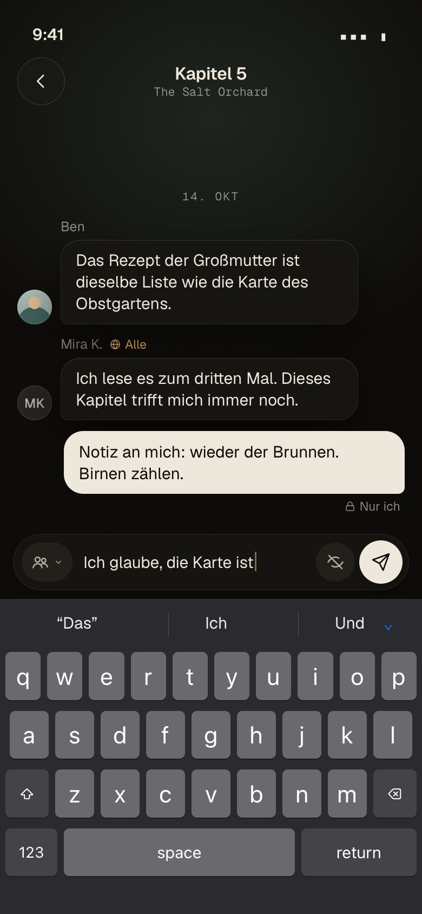 | 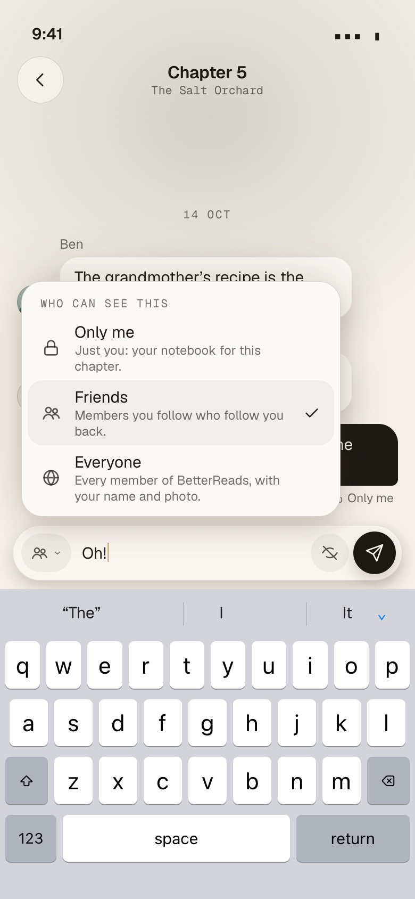 | 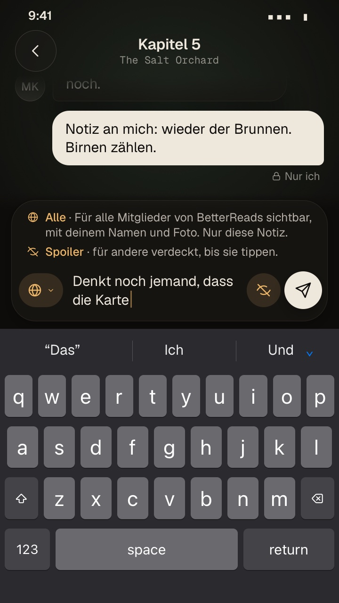 | 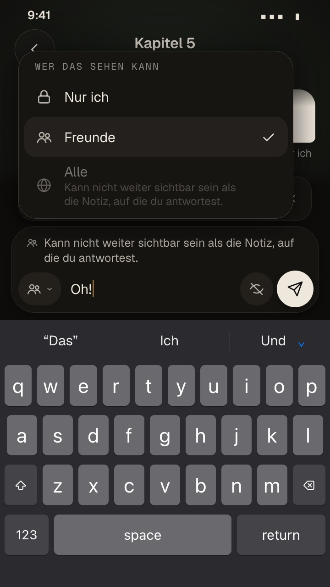 | 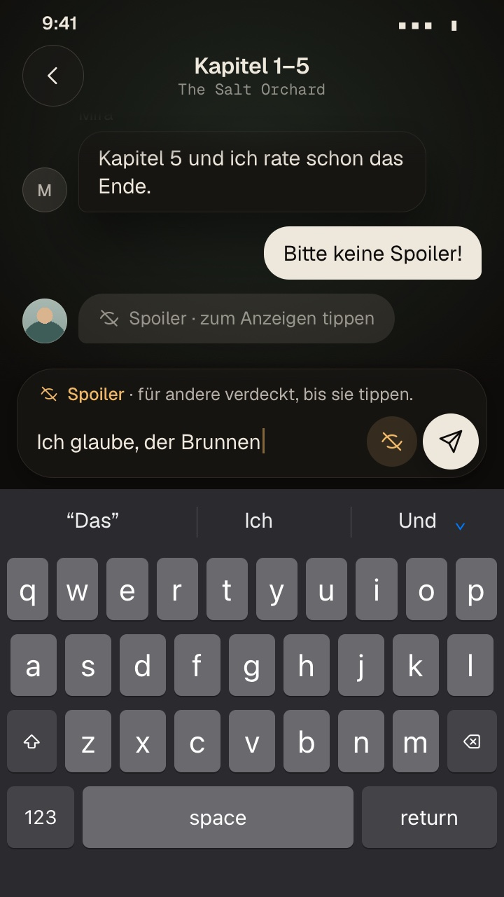 |

- **Pros:** the least chrome: no row, 44 px more thread than V1 in the common case (table); the audience is *attached to the thing you are
  writing*; both icon buttons are one size and one shape, so the owner's "unify" is a given; in a buddy read the Spoiler is one icon and the row is gone;
  the header line makes Everyone and Only me unmissable before sending.
- **Cons:** icons are learned (people, lock, globe, the crossed eye); Friends has no word in the capsule (the popover and `aria-label` name it); the
  field gets narrower (187 px at 360, 217 at 390, with both buttons); the popover is a new component (the base has none, only `UiSheet`); at 360×640
  with the keyboard up the popover must drop the hint lines (done in the mock) or it does not fit; a header line with Everyone and Spoiler is two or
  three lines high.
- **One-handed reach:** best of the three for Spoiler and send (right edge, in the thumb's arc); the scope button sits at the left end, a stretch on a right-handed 390.
- **Risk of wrong scope:** low (the popover shows the choice with words; Everyone and Only me add a header line; Friends vs Only me before opening is lock vs people
  only, which is why Only me *also* gets a header).
- **Cost:** `fabkho/ui`: two new `UiComposer` slots inside the capsule (`leading`, `trailing`), a popover component (menu pattern: focus in, arrows, Escape,
  focus back), a minor release (0.13.0), changelog, Storybook, tests. BetterReads: bump, `[chapter].vue`, `[section].vue`, a new `NotesScopeMenu.vue`
  replacing `LevelPicker.vue`, e2e and `docs/parity.md`; the Everyone first-use line moves into the header. About 2-3 days across both repos. Trappist:
  unaffected (new slots are optional; its chips keep the old row and the old fold until the shared fix).

### 2.3 V3 · Send as

*The audience belongs to the act of sending.* The capsule is just `[field] [send]` plus a **split send button**: a small tab at its left
(the level's icon and a chevron) and the paper plane. Tapping the plane sends in the current scope, tapping the tab opens **Send as** (Only me / Friends /
Everyone) and the **Spoiler** switch in one popover that opens above the thumb. The cue is the button itself: Friends is the usual ink button; **Only me**
says so on the tab (lock + word); **Everyone** turns the whole button the lamp amber and says "Everyone". A Spoiler shows as a removable token at the start of
the field. The first-use line for Everyone sits above the capsule as today. Buddy read: the tab carries the crossed eye and opens a one-row menu with
the Spoiler switch; the microphone takes the plane's place while the field is empty.

| Notes, DE, dark, 390 | Send as, Everyone, 390 | Everyone + Spoiler, 360 DE | Reply + menu, 360 | Buddy read menu, 390 |
|---|---|---|---|---|
| 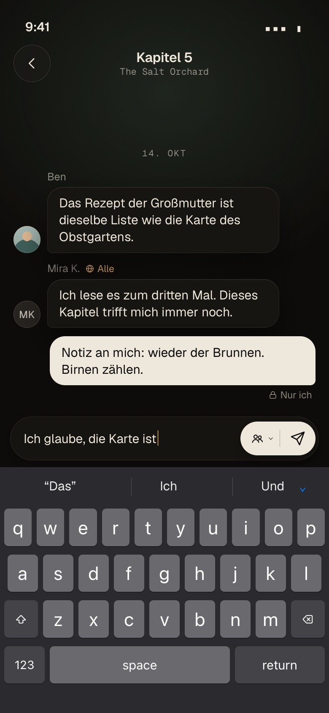 | 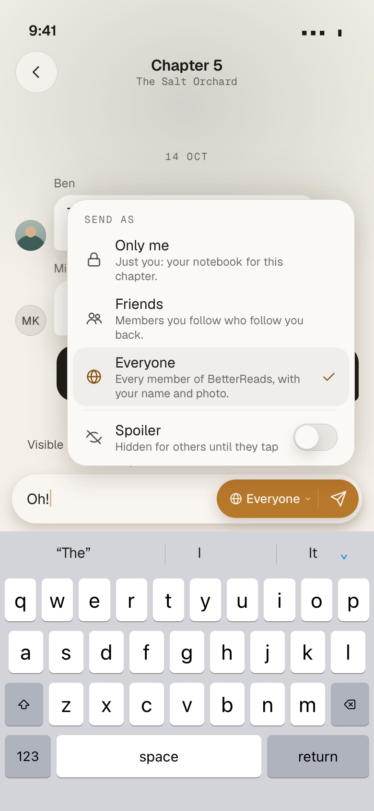 | 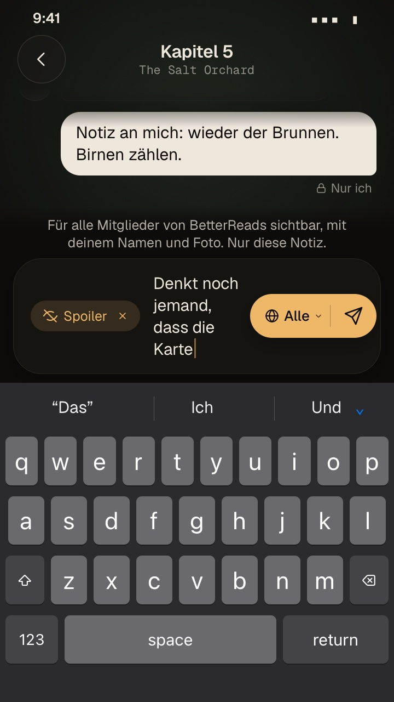 | 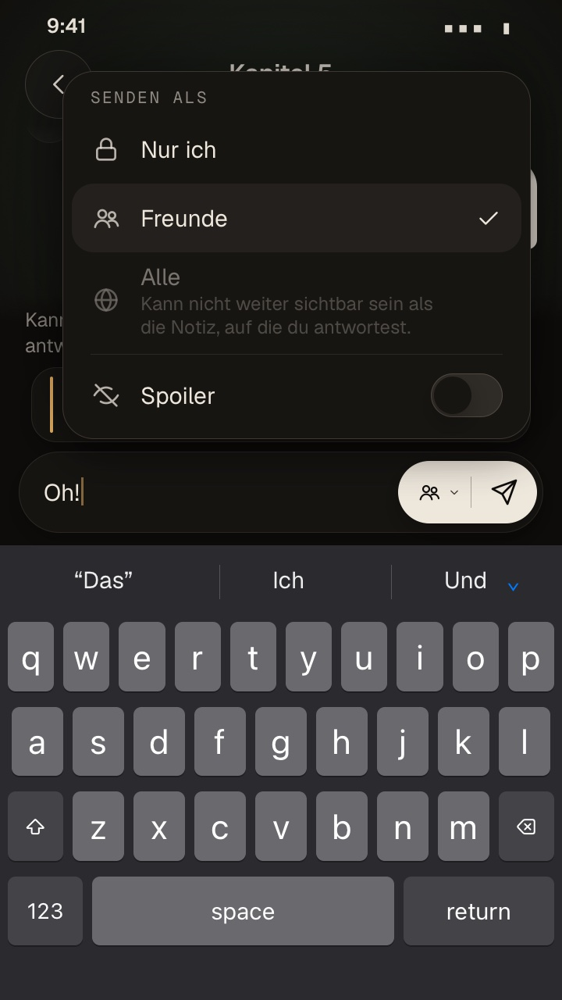 | 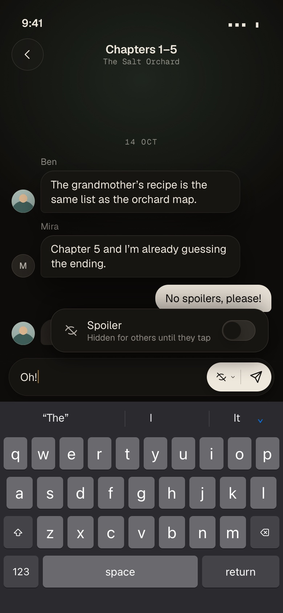 |

- **Pros:** the quietest composer and the most thread room (it equals V2's in the common case and beats it with Everyone + Spoiler); everything is under the right
  thumb, the popover opens beside it; the choice is made at the moment of commitment; the amber send button is the strongest "this is going to everyone"
  cue of the three.
- **Cons:** the audience is one tap *behind* the button, so it is the least discoverable (the owner said "each note needs the switch inside the notes"; this hides it
  by default); tap-to-send in the current scope means a mistake is a sent note, not a wrong selection, so the amber and the reset after each send are what
  guard it; Spoiler behind a menu is slow for something used per note; on the buddy read a menu for one switch is heavy (the honest fallback there is V2's eye button);
  a hold on the plane would clash with the microphone's hold gesture, so only the tab opens the menu.
- **One-handed reach:** best.
- **Risk of wrong scope:** highest. The dangerous direction (Friends to Everyone) takes two deliberate taps and turns the button amber; Only me, the safe direction, is cheap.
- **Cost:** as V2 (the popover) plus a `send` slot or a split-button prop on `UiComposer`, and a gesture rule for the buddy read's microphone. About 3 days, UI minor release; Trappist unaffected.

### 2.4 Side by side

| | V1 Today, fixed | V2 In the capsule | V3 Send as |
|---|---|---|---|
| Fixes the stuck row | yes (nothing folds) | yes | yes |
| Spoiler and scope unified | yes, one 36/44 shape | yes, two 36/44 circles | yes (token, switch row) |
| Thread room, 360×640 typing, Friends | 157 px | 201 | 201 |
| Discoverability | best (words) | good (icons + words in the menu) | weakest |
| One-handed (right thumb) | good | best for Spoiler and send | best |
| Risk of wrong scope | lowest | low | highest |
| Cue before sending | chosen word, Everyone lit, line above | header line in the capsule, lit button | the send button's colour and word |
| Buddy read | a row for one chip | one icon, no row | a menu for one switch |
| 200 % text | row wraps, dock grows | header wraps, buttons stay 44 | button grows with its word |
| Needs a `@fabkho/ui` release | no | yes (minor) | yes (minor) |
| Files in this repo | 2 pages, `LevelPicker`, 1 new component, e2e, parity | 2 pages, new `NotesScopeMenu`, e2e, parity | as V2 |
| Effect on Trappist | none (it keeps the bug until the shared fix) | none until it adopts the slots | none |

## 3. Recommendation

1. **Now, in this repo: V1.** It is the owner's own layout with the bug gone and the sizes unified, shippable without a release. It fixes the buddy read's
   Spoiler chip in the same change. Cost: about half a day, `web/` only. The price is 44 px of thread while typing, and the row for a single chip on the
   buddy read.
2. **Next, small, shared: the keyboard-based fold in `fabkho/ui`** (`focused && keyboard.shown`), 0.12.1, then bump BetterReads and Trappist (which has
   four folding chips and today's stuck state). About an hour in the UI repo with its test, plus two bumps. Do it even if V2 follows: any app that keeps a folding row
   is exposed to the same Android back gesture.
3. **Then, if the owner likes V2 on a phone: V2 as the redesign** (UI minor with two capsule slots and a popover, then the app switch). It gives back the 44 px,
   removes the row on the buddy read, and keeps the scope visible and labelled where it matters. **V3 is not recommended for Notes**: it hides the headline
   feature (the audience) behind a tab and makes a mistake a sent note; if wanted, its idea fits the *buddy read* better than Notes only as V2's eye button.
4. The owner should try `index.html` on the phone, in both contexts, with the keyboard up (the 360 wide column is the hard case) and say which of V1/V2 to
   carry on; the order above does not depend on it for steps 1 and 2.

Open questions for the owner: which phone and which way of closing the keyboard shows the bug (see 1.3); whether the 44 px of thread V1 costs at 360 is
acceptable; whether Friends may stay a word-less icon in V2's capsule (the header line only appears for Only me and Everyone).

## 4. What is in this PR

- `docs/prototypes/notes-composer/`: `index.html` (the three versions side by side, live), `v1.html`, `v2.html`, `v3.html` (every switch), `composer.css`,
  `composer.js` (the three composers, two contexts, EN/DE, the faux keyboard), `tokens.css` (a copy of `web/app/assets/css/tokens.generated.css`, 1.41.1),
  `shoot.cjs` (WebKit shots at 2×).
- `docs/images/notes-composer/`: 48 shots: for each version Notes at rest, typing (390 dark DE, 360 light EN), reply, Everyone (390 light EN, 360 dark DE),
  Only me, 200 % text (360 DE, 390 EN), buddy read at rest, typing and with the microphone held; the menus of V2 and V3; today's bug (two shots); the finger
  areas; two comparison pages.
- This document. No product code, no migration, no change to `fabkho/ui`.

**Method.** Diagnosis: read `fabkho/ui` `origin/main` (`Composer.vue`, `ChatThread.vue`, `ComposerChip.vue`, `useKeyboardInset.ts`) and the installed copy (identical),
this repo's Notes and buddy-read pages, Trappist's `ChatPage.vue` and the tag `v0.10.5`; then ran the real components with the Notes page's slot content in a
throwaway dev page (not committed; Nuxt dev, port 3102, WebKit via Playwright) to measure heights and the fold. Not tested: a real phone, the Android back
gesture itself (cited from reports), a screen reader.
