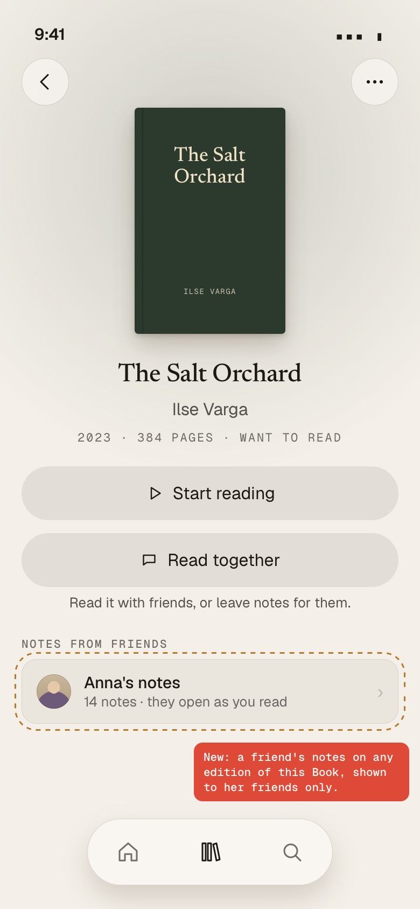
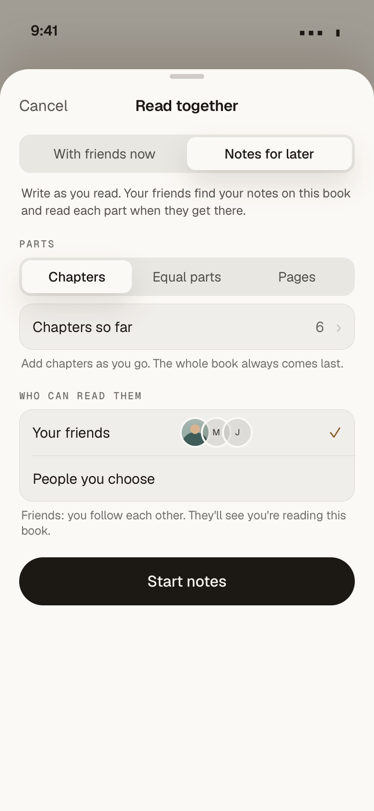
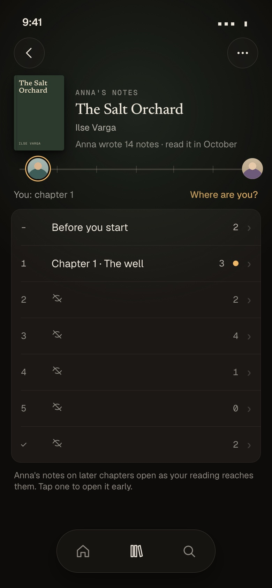
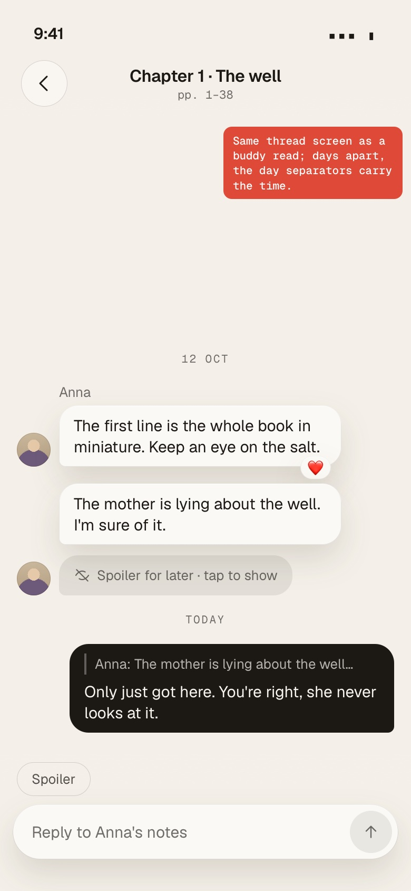
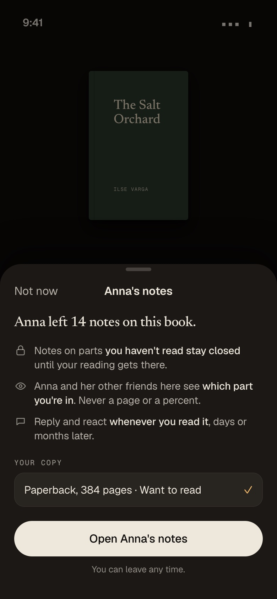
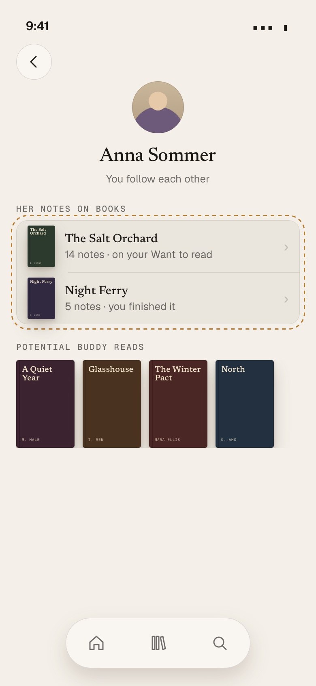
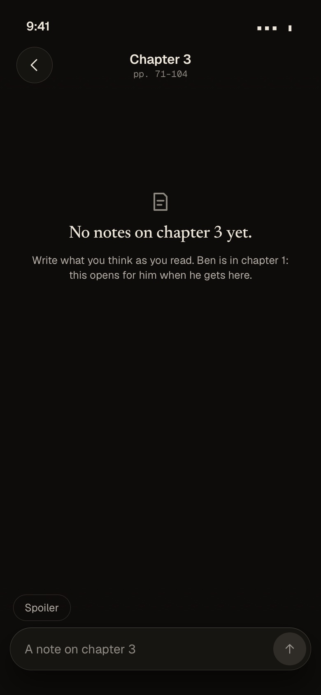

# Notes on a Book for friends: an async buddy read (a forum per Book)

**Status: plan for the owner, documentation only. Draft PR, DO NOT MERGE.** Written 6 November 2026 against `origin/main`
`ee6893ce` (1.40.0). Measured the same day on production with read-only `SELECT`s that return counts only (Appendix C).
Mock-ups: `docs/prototypes/public-book-rooms/` (static HTML on the app's real tokens, copied from
`web/app/assets/css/tokens.generated.css`), shots in `docs/images/public-book-rooms/`. The file keeps the name of the first
brief ("public book rooms"); the owner's steering of 5 November re-centred it, and the public version is now Appendix B.

**The owner's case, in his words:** "I am reading a book, he has not read it; I take notes per chapter so he can react later
when he reads it: an async buddy read in the form of a forum." Friends first. Strangers later, if ever.

**Words.** A *buddy read* is what exists (`CONTEXT.md`: 2 to 12 Members, a Host, Sections, a thread each). *Notes* (DE
*Notizen*) is the proposed name of a buddy read started for later: one member writes as she reads, her friends read and
answer when they get there. *Friends* here means **two members who follow each other** (both follows accepted); `CONTEXT.md`'s
"Friends" is one-way (the members she follows), so this plan says "mutual friends" where it matters.

## In ten lines

1. **The buddy read already does most of it.** A member can start a read alone, cut the Book into chapters, post in any
   Section whatever her own position, and a co-member behind her sees those Sections veiled until his reading gets there or
   he taps *Show anyway*. Unread counts only count Sections he has reached. Measured in the code, part 1.
2. **What is missing is small and specific** (part 2): friends cannot *find and open* her notes without an invitation; she
   cannot add a chapter once a note exists (`buddy_sections_locked`); *Finish* stops all new joins (`buddy_read_ended`); a
   friend who finished the Book before joining is "not set", so everything is veiled for him; notes rooms eat the cap of 10
   active reads; there is no "Notes" entry on a friend's Book page or profile.
3. **The owner's own case works today with no code**, with care: start a buddy read alone with all chapters set up front,
   invite the friend, never press *Finish*. The plan removes those three "with care"s.
4. **Recommended shape: one notes room per author per Book** ("Anna's notes"), open to her mutual friends or to people she
   picks; each friend joins it when he first opens it. Not one room per pair (notes would be written twice), not one shared
   room per Book (whose room is it?). Part 3.
5. **Audience is an explicit axis**: *mutual friends* (v1 default), *people you choose* (v1, today's invite list), friends of
   friends (later, probably never needed), all members (Appendix B, not now).
6. **Privacy is light**: friends already see each other's names and photos. The one new thing is that opening a friend's
   notes makes you a member, so she sees which Section you are in (never a page). The join sheet says so (part 7).
7. **Measured**: 2 members, 1 mutual pair, 7 Books both have; on **4 of them one is ahead of the other** (3 finished vs
   want-to-read, 1 reading vs want-to-read). So the async case is not rare: it is the most common shape of a shared Book.
8. **Data model: two columns and a handful of RPCs** on the buddy tables (`buddy_reads.mode`, `.audience`), no new tables, no new
   Realtime, no new storage; forward-only migration on a table with 1 row.
9. **Build: 4 small PRs, about 6 worker-days; a first usable slice (DB + start sheet + join sheet) in one week** with one
   Opus and one normal worker. No switch: buddy reads are on for everybody since 1.34, and notes are a buddy read.
10. **Not in v1**: push notifications, a "notes" item in the friends feed, strangers, moderation tooling beyond today's
    report and block, DMs (never).

## The recommendation

**Build it now, small.** It is a mode of something that exists, it fits the size of the app (two members who follow each
other is enough, unlike a public forum), and the measured data shows the case the owner describes is the usual one. Ship
the one-week slice (N1 + N2, part 9), use it with one friend for two weeks, then do the entry points and polish (N3, N4).
**Do not build the public version.** At 2 members there is nobody to be public to; Appendix B says what would have to be true.

## What exists today (measured, production, 6 Nov 2026)

| Thing | Count |
|---|---|
| Members (accounts) | **2** (invite codes: 8, used 4 times; waitlist: 3) |
| Accepted follows / mutual pairs | 2 / **1** |
| Library entries | 843 (finished 538, reading 6, want to read 299); 28 on Manual books |
| Catalogue Books in a Library grouped by Work | 803 Works (Work = `book_works.work_id`, else `books.openlibrary_work_key`, else the Book) |
| Works both members have | **7** (5 by `book_works` alone) |
| …of which one is ahead of the other | **4**: finished/want-to-read 3, reading/want-to-read 1; both finished 3 |
| Reading entries with progress set | 5 of 6 (progress pages on 9 sessions, percent on none) |
| Buddy reads / members / messages | 1 / 2 / 2 |
| Reports / blocks / feedback | 0 / 0 / 0 |
| Catalogue Books with a page count | 671 of 869 |
| Works with 2+ editions (`book_works`) | 48; across editions the page count differs by 13 % (median), up to 40 % |
| Database size | 43 MB (Free plan: 500 MB); `buddy_messages` 120 kB |

## 1. What the buddy read already does for the async case

Evidence from `supabase/migrations/20261113*.sql`, `20261114020000_buddy_voice.sql`, the schema snapshot and
`docs/parity.md` ("Buddy read, the room", "Buddy read, a thread").

| The async case needs | Today | Evidence |
|---|---|---|
| She starts it without anyone else | ✓ The setup's invite step can be empty; the room says "You're the only one here for now." | `create_buddy_read`, parity *Buddy read, the room* (`together.alone`) |
| Notes per chapter | ✓ Sections by count, by pages or **by a list** (labels, page ranges), up to 100 parts plus *The whole book* | `buddy_read_sections` (`kind`, `label`, `start_page`, `end_page`, `to_fraction`), `private.buddy_sections_parse` |
| She posts ahead of him | ✓ Any member may post in any Section; nothing checks her position | `post_buddy_message` (no position check) |
| He sees later Sections veiled until he gets there | ✓ Veiled rows (number, count, "hidden", no title), *Show anyway* per Section, kept on his device | `utils/buddyThread.ts`, `components/together/ShowAnyway.vue` |
| His position follows his reading, with a hand override | ✓ From his entry's open session (pages or percent) or *Where are you?* | `private.buddy_fraction`, `set_buddy_hand` |
| A different edition | ✓ His own entry of another edition of the same Work is accepted; Sections are fractions, so they line up | `link_buddy_entry` (same `openlibrary_work_key`) |
| He has not got the Book yet | ✓ He can join and skip "Which copy?"; his Section is then set by hand | `components/together/EntryPicker.vue` ("I'm not tracking it here") |
| "New since you were here", only where he may look | ✓ Unread counts and dots count only Sections his position opened | `private.buddy_unread`, `buddy_counts` ("a veiled Section's activity never shows") |
| Replies, reactions, spoiler marks, voice, delete, report, block | ✓ All there | parity *Buddy read, a thread* |
| Somewhere to see it again | ✓ Book page action, Home card *Reading together*, the friend's profile has *Potential buddy reads* | `components/together/BookRow.vue`, `components/home/Together.vue`, `components/friends/BuddySuggestions.vue` |
| Weeks between messages | ✓ Day separators, messages kept until deleted; nothing expires | `buddy_messages` (no retention rule) |

**So the owner's case runs today**, as long as he (a) sets up all chapters before the first note, (b) invites the friend
(who accepts), and (c) never presses *Finish*. Each of those is a trap the plan removes.

## 2. What is missing for the async-friend case

| # | Gap | Where in the code | Fix (part 5) |
|---|---|---|---|
| G1 | **Friends cannot find or open her notes without an invitation.** Invitations go to people the host follows (`private.buddy_invite`: accepted follow, not blocked) and must be accepted; there is no "my friend's notes on this Book" query | `private.buddy_invite`, `answer_buddy_invite`, `join_buddy_read(token)` | `audience = 'friends'`: a mutual friend may join on first open (`open_notes`) |
| G2 | **No chapter can be added once a note exists.** Changing the number of Sections is refused when any Section has a message (`buddy_sections_locked`); only renames pass | `set_buddy_sections` (lines 31–49 of the snapshot) | allow *appending* parts before *The whole book* (existing ids and fractions untouched) |
| G3 | **Finish closes the door.** After *Finish*, invitations and the link stop (`buddy_read_ended`), so a friend who starts the Book months later cannot get in | `invite_to_buddy_read`, `finish_buddy_read` | notes have no *Finish*; joining a friends' notes room is allowed until it is archived |
| G4 | **A friend who read the Book before joining is "not set".** `buddy_fraction` only counts an open session or one that ended on or after the day he joined, so a friend who finished it last year sees every Section veiled | `private.buddy_fraction` | for notes: a finished session at any time counts as "read it all" |
| G5 | **Notes rooms eat the cap of 10 active reads** (`buddy_active_count` counts every active read she joined); notes live for months | `private.buddy_active_count` | notes rooms do not count (own cap, 50) |
| G6 | **He links his copy once, by hand.** If he joins before he has the Book and adds it later, nothing links it; his Section stays where his hand put it | `private.buddy_on_entry` refreshes linked entries only | link automatically when he adds an edition of that Work and has no entry linked |
| G7 | **No "Notes" entry points**: the friend's Book page shows only her own buddy reads (`my_buddy_reads()`); her profile shows *Potential buddy reads*, not her notes | `components/together/BookRow.vue`, `app/pages/friends/[member]/index.vue` | *Notes from friends* row on the Book page; *Her notes on books* on her profile |
| G8 | **No notification** when a friend reacts or replies. Buddy reads have no push (web push exists for import jobs only: `supabase/functions/import-job/webpush.ts`); reactions are not counted as unread at all | `push_subscriptions`, `buddy_unread` | v1: unread counts as today; later: opt-in push (part 8) |
| G9 | **The words are "buddy read", "host", "readers"**: right for reading together, odd for notes | `i18n` keys `together.*` | one mode flag drives "Anna's notes", "Your notes", "Start notes" |
| G10 | Leaving: when the last member leaves a read, it is deleted; when the host leaves, the earliest member becomes host | `leave_buddy_read` | for notes: the author leaving ends the room for everybody (it is hers), after a confirm |

## 3. One room per author per Book (recommended), compared

| Shape | How it works | For | Against |
|---|---|---|---|
| **A. Per pair** (today's buddy read with two members) | She makes one read per friend | Exists; most private | She writes the same note twice; a third friend means a third room |
| **B. Per author per Book: "Anna's notes"** (recommended) | One room she owns; each friend who may see it joins when he opens it; everybody in it sees the others' replies | One place to write; scales from 1 friend to 10; maps 1:1 to a buddy read with a host | Ben's reply is read by Anna's other friend Jo, whom Ben may not know (friends of friends, inside one room; the join sheet says "her other friends here") |
| **C. One shared room per Book per friend-circle** | Whoever writes first opens "the" room on that Book for everyone connected | One conversation per Book | "Circle" has no edge (A–B–C friends but not A–C); two people start at once; nobody owns or can delete it; it is the public room in miniature, with its moderation questions |

**B**, because it keeps the buddy read's model (one host, members, the host's tools) and only changes *who may come in*.
Two friends who each leave notes on the same Book have two rooms; the Book page lists both ("Anna's notes", "Jo's notes").
If a pair wants privacy from her other friends, *People you choose* (today's invite list) is the same room with one guest.

## 4. Audience, an explicit axis

| Audience | Who may open her notes | v1? |
|---|---|---|
| **Mutual friends** (default) | Members she follows **and** who follow her, both accepted, not blocked either way, at the time they open it | **yes** |
| **People you choose** | Today's invite list (members she follows), each invited; no lazy join | **yes** (exists) |
| Friends of friends | Also her friends' mutual friends | no: not asked for; widens who sees her reading beyond what her follow settings allow |
| All members | Anyone signed in with the Book | no: Appendix B |

Why mutual, not "her followers": a notes room is two-way (his Section and replies reach her), so both should have chosen the
other. Why "at the time they open it": friendship can end. **Recommended**: losing the mutual follow (an unfollow, or a block,
which already deletes follows, `public.block`) removes him from her *friends* notes rooms; his messages stay, as when a
member leaves without deleting them. Open question 6.

## 5. The data model: a small delta on the buddy tables

No new table. Everything below goes through `security definer` RPCs as today (RLS on with no policies, `revoke all` from
`anon`/`authenticated`).

**`buddy_reads`**
- `audience text not null default 'invited' check (audience in ('invited','friends'))`. `invited` is every existing read;
  nothing about them changes.
- `mode text not null default 'together' check (mode in ('together','notes'))`, or fold it into `audience` (a notes room
  with *People you choose* is `mode = notes`, `audience = invited`). It drives the words (G9), *Finish* hidden (G3), the cap
  (G5), the position rule (G4), leaving (G10).
- The existing unique index `buddy_reads_one_active (host_id, book_id) where status = 'active'` already gives "one notes room
  per author per Book"; a notes room and a buddy read of the same Book by the same host would collide, so the index gains
  `mode` (open question 8).

**RPCs (new)**
- `friend_notes(p_book)`: the notes rooms on this Book (any edition of its Work) that she may open: author card, notes
  count, whether she joined, her unread. Mutual-friend check and block check inside.
- `member_notes(p_member)`: the notes rooms of a friend, for her profile; same checks.
- `open_notes(p_read, p_entry)`: the lazy join. Refuses unless `audience = 'friends'`, caller is a mutual friend now, not
  removed (`private.buddy_read_removed`), not archived, room not full; links her entry if given; else as `join_buddy_read`.
- `add_buddy_sections(p_read, p_parts)`: append parts before *The whole book* (G2), host only, under the read lock; each new
  `to_fraction` above the last part's and below 1; existing Sections keep id, position and fraction (positions after them
  move by the count added, which no message references). `set_buddy_sections` keeps its lock for everything else.

**RPCs (changed, each with pgTAP)**
- `create_buddy_read`: takes `mode` and `audience`.
- `private.buddy_fraction`: for `mode = notes`, a finished session at any time returns 1 (G4). A re-read is still a finished
  read: he has read it.
- `private.buddy_active_count`: counts `mode = together` only; a separate cap of 50 notes rooms a member (G5).
- `invite_to_buddy_read`, `buddy_read_link`, `finish_buddy_read`: notes refuse *Finish*; inviting and the link stay allowed
  while not archived (G3).
- `leave_buddy_read`: the author leaving a notes room deletes it, after the client's confirm (G10).
- A trigger on `library_entries` insert: a member of a notes room with no linked entry gets the new entry linked when it is
  an edition of the read's Work (G6), using the same rule as `link_buddy_entry`.
- A trigger on `follows` delete: removes the follower from the other's `friends` notes rooms (open question 6).

**Realtime, storage, cost:** unchanged. Events already go to each member's private topic (`member:<id>`,
`20261113040000_buddy_read_realtime.sql`); a notes room of 2–5 members costs what a buddy read costs. Voice already works
there (bucket `buddy-voice`, limits per member). At 2 members the Free plan's 200 connections and 2 million Realtime
messages a month are not in sight.

**On the live database:** one migration adding two columns with defaults to a table with 1 row, new functions, replaced
functions; forward-only as `AGENTS.md` requires, `pnpm schema:snapshot` committed with it. No backfill.

## 6. Sections for notes

- **Chapters are hers.** No source in the Catalogue carries a table of contents (the only TOC parser is the e-reader's,
  `web/app/reader/`), so chapters come from her: *Chapters* mode starts with the parts she has typed (or a count) and grows
  with *Add a chapter* as she reads (G2). A chapter may carry its page range ("pp. 71–104"), which is what turns her pages
  into fractions; without a range, the part is placed by her current page when she adds it.
- **Equal parts** and **Pages** stay as they are, for a member who does not want to count chapters.
- **Editions:** Sections end at fractions of the Book, and each member's position is his page over *his* edition's page
  count. Measured spread between editions of one Work: 13 % median, 40 % at most, so "chapter 7 ends at 0.42" can be a few
  pages early or late in his copy. The existing tolerance (0.5 %) does not hide that; the room's hint and *Where are you?*
  cover it. A chapter's page range is shown as hers ("pp. 71–104 in Anna's edition") when his edition differs (N4).
- **"Before you start"** (the room thread) stays spoiler-free and always open; *The whole book* stays last.

## 7. Position, the veil and what a friend reveals

- **What she sees of him**: his Section ("Chapter 3", "read it all", "not set") on the track, never a page, a percent or a
  date: the existing rule (`private.buddy_where`, `CONTEXT.md` *Position*). It reaches only the members of that room, only
  while he is in it, and not at all across a block.
- **What is new**: today a member gets there by accepting an invitation; with `audience = friends` he gets there by opening
  her notes. So the first open is a sheet (mock-up 5) that says so, and nothing is created before he taps *Open Anna's notes*.
  Looking at the Book page row ("Anna's notes, 14 notes") creates nothing and tells her nothing.
- **The veil stays the app's**, as today: the database gives every member every message, and the app does not open a Section
  his position has not reached (parity *Buddy read, a thread*; `docs/OPERATIONS.md` "The veil is the app's"). Among friends
  that is the right trade: it is a courtesy, not a secret. Not changed.
- **A friend who has not started**: position "not set", only *Before you start* open; his reading opens the rest as it goes
  (once his copy is linked, G6). **A friend who finished long ago**: "read it all" (G4).
- **Her own position**: the author usually is ahead; her face sits at the end of the track. Fine among friends.

## 8. Privacy, friends-only

- **Names and photos**: unchanged; friends already see them (`private.member_card`, `private.can_see_photo`).
- **Her friend-visibility settings.** A notes room tells her friends that she reads (or read) this Book. That is new
  information when she has switched off *Currently reading* / *Finished* for followers or hid the Book (*Hide from
  followers*, `library_entries.hidden`). Rule: the start sheet says "They'll see you're reading this book" (mock-up 2); a
  Book she has hidden offers *People you choose* only, with one line why. Her switches are not changed by it.
- **His settings**: opening notes reveals his Section to the room, said on the join sheet. Nothing of his Library is shown.
- **Blocks**: a blocked pair never sees each other's notes rooms (`private.blocked_either` in `friend_notes`), and a block
  inside a room hides as today (`private.buddy_hidden`).
- **Leaving and deletion**: as buddy reads: leave keeping or deleting his messages; account deletion removes everything
  (`delete_my_account` cascades; voice queued for the sweep). When the author deletes the room, everybody's messages in it go.
- **Push**: none in v1. If reply notifications come later (opt-in, web push like the import job's), the notice gains one
  line and the payload carries no message text.
- **The privacy notice** (`web/app/legal/privacy.ts`, both languages, and the version line). Proposed change to the
  *Buddy reads* bullet:
  - EN: "**Buddy reads and notes (only if you start or open one).** A reading room for one Book with up to 12 members. You
    either read together (members you invite, or who join by your link) or leave notes for later, which your friends (members
    you follow who follow you back) or people you pick can open while you are friends. It holds your messages, your reactions
    and the Section of the Book you are in. That Section is worked out from your reading progress (or set by you) and shown to
    the other members of the room as a Section only: never a page, a percent or a date. Opening someone's notes makes you a
    member of that room."
  - DE: "**Buddy-Reads und Notizen (nur wenn du einen beginnst oder öffnest).** Ein Leseraum zu einem Buch mit bis zu 12
    Mitgliedern. Ihr lest entweder gemeinsam (Mitglieder, die du einlädst oder die über deinen Link beitreten) oder du
    hinterlässt Notizen für später, die deine Freunde (Mitglieder, denen du folgst und die dir folgen) oder von dir gewählte
    Personen öffnen können, solange ihr befreundet seid. Er enthält deine Nachrichten, deine Reaktionen und den Abschnitt des
    Buchs, in dem du bist. Dieser Abschnitt wird aus deinem Lesefortschritt berechnet (oder von dir gesetzt) und den anderen
    Mitgliedern des Raums nur als Abschnitt gezeigt: nie als Seite, Prozent oder Datum. Wer Notizen öffnet, wird Mitglied
    dieses Raums."
  - `docs/legal-checklist.md` *Buddy reads* line: add "notes rooms (friends may join on opening)".
- **The old promise** "progress never leaves her account" is already replaced by the Section-only rule (`CONTEXT.md`,
  *Position*); notes do not change it.

## 9. The experience

| Where | What | Mock-up |
|---|---|---|
| Her Book page | *Read together* opens the setup sheet; its first choice is **With friends now / Notes for later**. With notes running: "Open your notes · 2 friends · 3 new" (the existing *Open the buddy read* row, reworded) | 2 |
| His Book page | Under the actions, **Notes from friends**: one row a friend ("Anna's notes · 14 notes · they open as you read"), on every edition of the Work, in any state of his Library (also not in it) | 1 |
| Her profile, seen by him | **Her notes on books**, above *Potential buddy reads*: cover, title, count, how the Book stands in his Library | 6 |
| First open | The join sheet: what stays closed, what she sees of him, which copy | 5 |
| The room | The buddy room unchanged: track, *Where are you?*, rows; hero eyebrow "Anna's notes"; no *Finish* in ⋯; *Add a chapter* for her | 3 |
| A thread | Unchanged; the composer says "A note on chapter 3" for her, "Reply to Anna's notes" for him | 4, 7 |
| Home | *Reading together* lists notes rooms like reads ("Anna's notes", unread pill); when his reading opens a Section with notes, its count shows there by itself | (as today) |









German and 360 px shots are in the same folder (`*-de*.jpg`, `3-room-light-de-360.jpg`).

**Notifications.** v1 has none, as buddy reads have none: the Home card's unread pill and the Book page row carry it. A
reaction does not count as unread today; for notes that is the most common answer ("❤️ on your note"), so N4 counts
reactions on *her* messages into her unread number. Push (opt-in, "Replies to your notes") is a later PR on the import job's
web push; open question 5.

**Empty states.** Her new room: "No notes on chapter 3 yet. Ben is in chapter 1: this opens for him when he gets here."
(mock-up 7). His Book page with no friend's notes: nothing (no empty row).

## 10. Build plan

Every PR follows `CONTRIBUTING.md` (conventional title, pgTAP for rules, `pnpm schema:snapshot`, parity entry, EN/DE copy).
Sizes in one worker's days (S < 0.5, M ≈ 1, L ≈ 2–3). Tiers as `AGENTS.md`: hard = Opus, normal = DeepSeek on GOAT.

| # | PR | Size | Tier | After | Week 1? |
|---|---|---|---|---|---|
| **N1** | DB: `mode`/`audience`, `friend_notes`, `member_notes`, `open_notes`, `add_buddy_sections`, the position rule (G4), the cap (G5), no *Finish* for notes (G3), author leaving (G10); pgTAP for each, including "a non-friend, a blocked member, a removed member get `not_found`" | M–L | **hard (Opus)**: gates and RLS | — | **yes** |
| **N2** | Web: the setup sheet's *Notes for later* (chapters that grow), the join sheet, *Add a chapter* in ⋯, the notes words; store and data layer on the existing `stores/buddyRead.ts` / `data/buddyReads.ts` | M–L | normal | N1 | **yes** |
| N3 | Entry points: *Notes from friends* on the Book page, *Her notes on books* on a friend's profile, Home rows worded as notes | M | normal | N1 (N2 for the sheet it opens) | no |
| N4 | Polish: auto-link his copy (G6, a trigger, pgTAP), unfollow removes from friends' notes (open question 6), reactions on her notes count as unread, "pp. in Anna's edition"; privacy notice EN/DE and legal checklist | M | normal (the two triggers reviewed by Opus) | N1–N3 | no |
| later | Opt-in push "Replies to your notes"; a feed item "Anna left notes on …" | M each | normal | owner's call | no |

**About 6 worker-days.** In one calendar week: N1 (Opus, 2 days) then N2 (normal, 2–3 days, starting on N1's branch after
its RPC signatures are fixed on day 1). That is a usable slice: start notes, a friend opens them from a link or from the
room address, chapters grow, nothing closes. N3 and N4 the week after. No switch: the owner removed the buddy-read switch
(parity: "Buddy reads have no switch here: they are for every member (from 1.34)"), and nothing here is risky enough to
need one; the two members can try it on production at once.

**Not in v1**: strangers (Appendix B), friends of friends, push, feed items, a separate "notes" screen outside the buddy
room, editing a note, images or polls beyond what the thread already has, **direct messages (never)**.

## 11. Risks

| Risk | Likelihood | Effect | Mitigation |
|---|---|---|---|
| A gate mistake lets a non-friend open notes | low | her reading and notes seen by someone she did not choose | Opus on N1; pgTAP for non-friend, one-way follow, blocked, removed, archived; mutual check at open time |
| Notes reveal a Book she hid from followers | medium | a privacy surprise | hidden Book → *People you choose* only; start sheet says what friends will see |
| Ben opens notes "just to look" and is surprised Anna sees his Section | medium | mild | the join sheet says it before anything is created |
| Edition page counts make a chapter open a few pages early or late | high (13 % median spread) | a small spoiler | page ranges shown as hers; spoiler marks; *Where are you?* |
| Appending Sections breaks positions | low | wrong veils | append only before *The whole book*; existing fractions unchanged; pgTAP |
| Unfollow leaves an ex-friend in her notes | medium if not done | privacy | N4 trigger (open question 6) |
| Nobody uses it | medium | a week of work | it is a mode of an existing screen; measured: 4 of 7 shared Books are the async shape |

## 12. Open questions for the owner

Each with my recommendation; "yes" takes it. "If no" says what changes.

1. **Build notes now, public rooms not now.** *Recommend: yes.* If no (public too): Appendix B's prerequisites come first
   (reports, owner tools, legal), weeks of work before any value.
2. **One room per author per Book**, friends join it (shape B). *Recommend: yes.* If per pair (A): no lazy join is needed
   (invite only), but notes are written twice; N1 shrinks, N3 lists pairs.
3. **"Friends" = mutual follows, at the time of opening.** *Recommend: yes.* If her followers instead: one-way; a follower
   she never followed back could read her notes and show his Section to her.
4. **The word: "Notes" / "Notizen"**, inside *Read together* ("Notes for later"). *Recommend: yes.* If a separate action
   ("Leave notes"): one more button on every Book page.
5. **No push in v1**; reactions on her notes count as unread. *Recommend: yes.* If push now: +1 PR (M), a privacy line.
6. **Unfollow or block removes him from her friends' notes rooms** (his messages stay). *Recommend: yes.* If no: he stays
   until he leaves or she removes him (as in a buddy read).
7. **Notes rooms do not count against the 10 active reads; own cap 50.** *Recommend: yes.* If no: the 11th thing she
   annotates or reads together is refused.
8. **One notes room and one buddy read of the same Book may coexist for the same host.** *Recommend: yes* (the unique index
   gains `mode`). If no: she must pick one per Book.
9. **The author leaving deletes her notes room for everybody.** *Recommend: yes* (it is hers). If no: the host passes on,
   as in a buddy read, and her notes stay under her name.
10. **A finished read at any time opens the whole book in notes rooms.** *Recommend: yes.* If no: a friend who read it
    last year sets "I've read it" by hand.
11. **Cap: 12 members a notes room, as buddy reads.** *Recommend: yes for now.* If higher: Realtime fan-out grows with it;
    revisit only if someone hits it.
12. **No switch.** *Recommend: yes.* If you want one anyway: a per-device or per-member flag like the old W1, one more PR.

---

## Appendix A: what the owner can do today, with no code

1. On the Book page, *Read together*; in the setup, Sections **by a list**, with **every chapter you expect** (renames stay
   possible later, adding is not).
2. Invite nobody, or invite the friend now; *Start*.
3. Write notes in each chapter's thread as you read; mark spoilers.
4. Invite the friend (⋯ → Invite, or the link) whenever he starts; **do not press *Finish***, or nobody can join again.
5. If he read the Book before he joined, he sets *Where are you? → I've read it*.

## Appendix B: later, all members (the public room), kept short

**What changes if we ever open it up.** A notes room or a buddy read visible to members who are not friends turns a private
feature into user-generated content shown to strangers. That brings, in this order:

1. **Numbers first.** Today: 2 members, 1 mutual pair, no Work held by 3 or more members. A room "feels alive" when a few
   people post in the same weeks; if one reader in ten who opens it posts and one in three who has the Book opens it, that is
   about 100 readers of one Book, which a typical Book reaches only at a few thousand members. Revisit when open sign-up
   (#331) is live and at least 10 Works have 30 or more members with them reading or finished (the query in Appendix C).
2. **One room per Work** (`book_works.work_id` where matched by Open Library or ISBN: 699 of 869 Catalogue Books; the rest a
   room per edition; Manual books none), with fixed Sections (quarters, *The whole book*, *Before you start*), membership by
   joining, no host, no track (nobody sees anyone's Section), text only.
3. **Identity**: a short public name ("Anna S.") and photo off by default, chosen on a first-use sheet; tapping a face gives a
   mini card with *Report* and *Block*, never a profile or a follow (the app has no member directory, and must not get one
   through a forum).
4. **Moderation before launch**: the report flow exists (`report_buddy_message` into the owner's Feedback inbox, 5 an hour,
   20 a day) but the owner gets no alert, cannot remove a post as owner, cannot ban, and the author is never told why. Needed:
   an owner alert, *Remove* and *Ban from discussions* with a reason, a notice to the author, report reasons incl. "against
   the law" with a required explanation, tighter limits (e.g. 5 posts a minute, 50 a day), no links.
5. **Law (not legal advice; a lawyer's question)**: whether the EU Digital Services Act applies to a free, non-commercial,
   members-only app at all; if so, hosting duties (notice and action, Art. 16; statement of reasons, Art. 17; contact point,
   Art. 12; moderation rules in terms, Art. 14) and whether the micro-enterprise exemptions apply. The imprint (postponed,
   `IMPRINT_ENABLED = false`) likely has to come back. Terms or community rules do not exist yet.
6. **#331** (open sign-up bundle): its report flow (WP-25), name rules (WP-26) and launch texts (WP-27) are prerequisites;
   captcha and the e-mail budget (WP-24) are independent of rooms.

| Risk if opened | Likelihood | Effect | Mitigation |
|---|---|---|---|
| Empty rooms | very high at today's size | the feature looks dead | wait for the numbers above |
| Harassment or spam with no owner tools | medium after open sign-up | members hurt, legal exposure | owner tools and alert first |
| A post with illegal content noticed late | low–medium | liability once the owner knows | alert, removal within a day, a record of decisions |
| Strangers learn who reads what | medium | privacy | short names, photo off, no positions, no profile from a room |
| Minors meet strangers | low (16+ by notice, unchecked) | serious | an age line at sign-up (WP-24) before opening |

Mock-ups kept for that phase: [first-use sheet](../images/public-book-rooms/later-1-first-use-light-en.jpg),
[the mini card](../images/public-book-rooms/later-2-member-dark-en.jpg),
[the report sheet](../images/public-book-rooms/later-3-report-light-de.jpg).

## Appendix C: method, queries, what I could not verify

Run from the main checkout with `supabase db query --linked` against `ltedflcewdcqtqzcjeyr` (production, `docs/OPERATIONS.md`),
read-only, counts only; no member id, name or title was printed. The two that matter now:

```sql
-- Mutual pairs, and Books both members of a pair have, by Work (book_works, else the Open Library work key, else the Book)
with f as (select follower_id a, followee_id b from public.follows where accepted_at is not null),
mutual as (select f1.a, f1.b from f f1 join f f2 on f2.a = f1.b and f2.b = f1.a where f1.a < f1.b),
e as (select le.member_id m, le.status::text st,
             coalesce(bw.work_id::text, b.openlibrary_work_key, 'b:' || b.id::text) wk
        from public.library_entries le join public.books b on b.id = le.book_id
        left join public.book_works bw on bw.book_id = b.id
       where b.owner_id is null)
select (select count(*) from mutual) mutual_pairs,
       count(*) shared, count(*) filter (where ea.st <> eb.st) one_ahead
  from mutual p join e ea on ea.m = p.a join e eb on eb.m = p.b and eb.wk = ea.wk;

-- The public-room trigger (Appendix B): Works with at least 30 members reading or finished
select count(*) from (
  select coalesce(bw.work_id::text, 'b:' || b.id::text) wk
    from public.library_entries le join public.books b on b.id = le.book_id
    left join public.book_works bw on bw.book_id = b.id
   where b.owner_id is null and le.status in ('reading', 'finished')
   group by 1 having count(distinct le.member_id) >= 30) x;
```

**Not verified**: the page-range-to-fraction maths for chapters added mid-read (designed here, not prototyped); whether the
base's `UiThreadRow` takes a long chapter title in German at 360 px without a second line (the mock-up suggests yes); the
Realtime and connection figures are from `docs/OPERATIONS.md`, not re-checked on Supabase's pricing page; the DSA questions in
Appendix B are a lawyer's.
