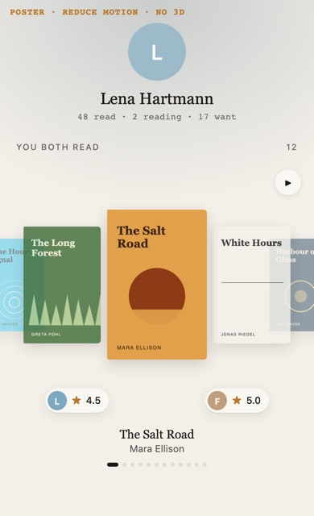
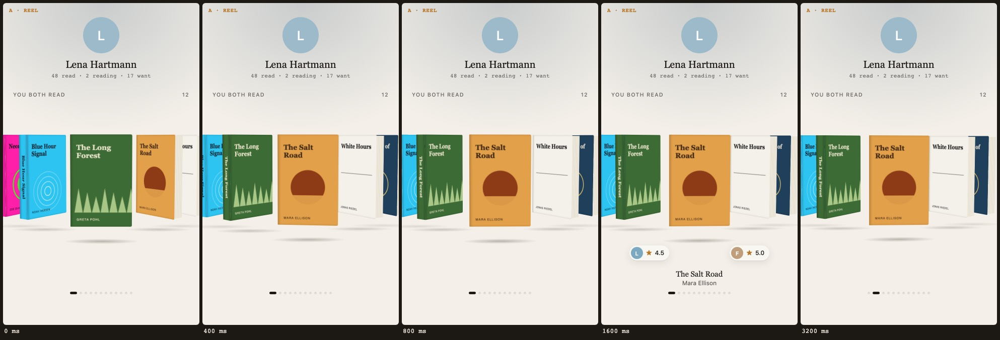
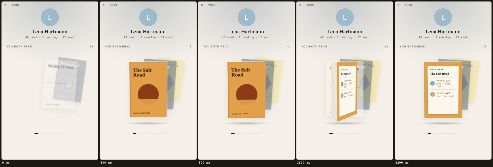
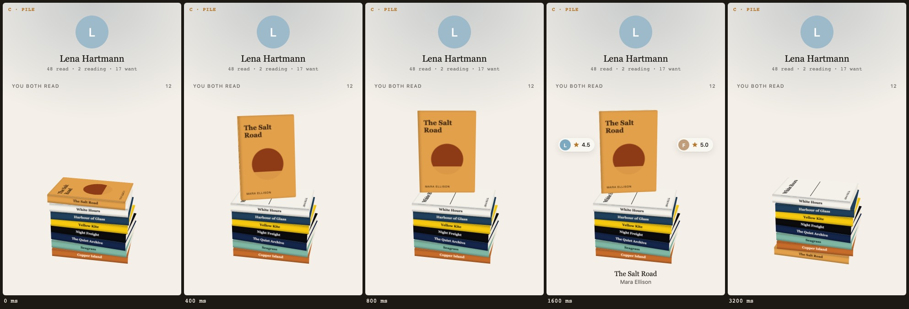

# You both read, as a slideshow

> **Plan only. Nothing here is built.** The owner reviews it before any code is written.

Owner's idea (condensed): steal one from Fable. On another member's profile Fable shows the books
*both* of them read, in 3D, animating by itself through the books like a slideshow (reference: its
"Stories You Shared" card, a thick-book coverflow with each reader's avatar and rating in a pill beside
the book in front). Combine it with Regal, ideally as a new native mode of Regal, and use it in
Libellus in place of the "You both read" section on a member's profile.

Throwaway mock-ups of the three variations (CSS 3D, synthetic covers from `web/perf/shelfCovers.ts`,
filmstrips at 0, 400, 800, 1600 and 3200 ms at 390 px wide) are under `docs/plans/img/`; their sources
stayed in `/tmp/shared-books-ref/mockups/` and are not part of the repo.

---

## A. What exists today

### The section

- **Component:** `web/app/components/friends/BothRead.vue` (46 lines): the eyebrow `member.bothRead`
  ("You both read" / "Beide gelesen"), then a horizontal, snap-scrolling row of `md` covers
  (`UiCover`: thumbhash, cover colours, a Placeholder for a Book without a cover), and under each cover
  **her** stars only (`UiStars`, `role="img"`, label `member.bothReadHers` "{name}: {rating}"). Not
  drawn at all without Books. A cover opens its Book through `FriendsMemberBookLink` (the cover flight,
  `useBookFlight`); a Manual book or an unverified one opens nothing (`shownBook`, `bookPathOf`).
  Test ids `member.bothRead`, `member.bothRead.book`, `member.bothRead.hers`.
- **Where:** `web/app/pages/friends/[member]/index.vue:295`, the **third** block of a visible profile:
  hero → Follow → Currently reading → Want to read → **You both read** → (figures …). It is not
  literally at the top; see question G1. The same component stands on her year page,
  `web/app/pages/friends/[member]/[year].vue:141`, with `p_year`.
- **Data:** `stores/memberProfile.ts` loads it with the profile (`loadBothRead`, line 134), only while
  the profile is visible **and** her *Finished* switch is on (line 128–130, "privacy review L4"); a
  refusal shows nothing (no error line). Keyed by `bothReadKey(year)`.
- **Database:** `public.both_read(p_member, p_year)` in
  `supabase/migrations/20261025010000_social_v2a.sql` (contract: `docs/proposals/social-v2a-contract.md`
  §1.3), `security definer`, pgTAP in `supabase/tests/social_v2a_test.sql` and
  `catalogue_check_failed_test.sql`.

### What the answer carries (`BothRead`, `web/app/data/socialShapes.ts:140`)

| Field | What | Shown today |
|---|---|---|
| `book` | **her** edition as `SocialBook`: id, title, authors, year, `coverUrl`, `coverThumbhash`, `coverColors` (dominant, secondary), `manual`, `unverified` | cover, title (label) |
| `hers.rating` | her latest finished read's rating in quarters; **null when her Ratings switch is off** | stars |
| `hers.endedOn` | the day her latest finished read ended | no |
| `mine.rating`, `mine.endedOn` | the caller's own latest finished read of the same work | no |

No page count, no blurb, no review, no genres. "The same book" is the same `books.id` or the same
`openlibrary_work_key` (her edition, my edition may differ). Order: her newest finished first.
**No limit**: a pair with 300 shared Books gets 300 rows.

### Privacy: what a member may see, and what the slideshow may show

`both_read` answers `[]` unless `private.visible(caller, member)` (her account is public, or the
caller follows her; nobody blocked anybody) **and** her switches *Finished* **and** *Year in review
and figures* are both on. Her hidden Books are left out; an unverified Book carries no title, authors
or cover. Her rating is nulled without *Ratings*.

**Rule for the slideshow: it draws from the `both_read` answer and from nothing else of hers.** No
extra call for her page counts, blurbs, reviews or likes; the Regal document built from it (section D)
is tested to carry only these fields. What it may add over today's section, all already visible
elsewhere on her profile under the same switches:

- **My own rating** (mine, never a privacy question). Fable shows both; recommended.
- **Her finish date, at month precision at most** (her year pages, which need the same *Year in review*
  switch, already show every finished Book by month). Recommended: not shown on the slide at all; at
  most in the text list (question G5).

### States

- **0 Books** (none shared, her switches off, private and not followed, blocked, offline before the
  first answer): no section, as today.
- **1 Book:** today a one-cover row. The slideshow has nothing to cycle: one still Book with both
  badges.
- **2–3 Books:** a loop that wraps visibly; an arc looks thin (the Regal deal prototype found the same
  for its wheel with 2 Books).
- **Many:** today a long scroll row. A slideshow of 300 is 16 minutes; it needs a cap (newest 24
  proposed) and a See all.

### The 3D side (Regal, fabkho/regal, read at `3376fce`, PR #83, today)

- **Views:** the Stack (`RegalBooksStage`), the Row (`RegalBooksRow`, the Stack turned 90° for a
  card), the Bookcase (Regal's own site). The `Pile` is the Stack's loading/sort choreography
  (`utils/stack/shuffle.ts`), not a separate view.
- **What Libellus uses:** `components/shelf/{Stage,Row,RowCard,YearRow,BookSheet}.vue`, always
  `Lazy`, so Regal, three.js, TresJS and GSAP land in one `regal` chunk that the entry never imports
  and the service worker never precaches (`web/regal.config.ts`, `nuxt.config.ts:151`; CI fails if
  it is precached, `.github/workflows/ci.yml:322`). Fetched `CacheFirst` into `libellus-shelf-code`.
- **In-memory library and flat faces** (Regal #82, #83): a host passes `library` (a library-file
  document) instead of a URL; each Book's `assets.color` makes its Spine and back flat in one colour,
  typeset by Regal, and its front loads only when it shows. Libellus builds every member's own shelf
  this way on the device (`web/app/data/memberShelf.ts`, `utils/bookColour.ts`), see
  `docs/plans/shelf-for-everyone.md`.
- **Motion and device rules Regal already owns:** the row's intro (0.7 s cascade,
  `utils/row/intro.ts`, held until a third of the card is in view, never with Reduce Motion), haptics
  (`utils/books/haptics.ts`: a 1 ms tick per Book passing the focus line at most every 60 ms, a
  `[10, 45, 18]` "da-dum" for a Book taken out; Android only, never with Reduce Motion), render tiers
  (`utils/stage/quality.ts`: phones get a 1024² shadow map, on-demand frames and a pixel ratio that
  steps down), the frame gate (`utils/stage/frameState.ts`: no frame is rendered unless something on
  screen changed).
- **Precedent for exactly this kind of component:** Regal PR #81 (draft, "DO NOT MERGE") adds
  `RegalBooksDeal`, a timed 3D choreography (deck, stack, wheel) for Libellus' Pick my next book
  (Libellus #259, draft #268). Its shape is the model here: pure planning in `app/utils/deal/` with unit
  tests, `components/deal/{Scene,Books}.vue`, a thin `components/regal/BooksDeal.vue`, `ready` and
  `picked({ index, id, rect })` events (the rect lets the host lay a DOM cover there and fly it to its
  page), a shader warm-up before `ready`, a `/dev/deal` page. Its measured cost in Libellus: **+9.2 KB
  br** on a `regal` chunk of **293 KB br** (main, 2026-10-10), **~350 KB** first use with CSS and fonts;
  60 fps on a real GPU, 0 LoAF. (Regal's own `docs/nuxt-layer.md` still says ~230 KB; the measured
  number is the one to plan with.)
- **How Libellus "pins" Regal: it does not.** `web/regal.config.ts:85` extends
  `github:fabkho/regal` with no ref, i.e. the default branch at build time, in CI and in the Pages build;
  the portfolio does the same (`~/code/portfolio/nuxt.config.ts:14`). The tags `portfolio-v1`
  (→ `904ee54`, 2026-10-02), `portfolio-v2` (`2eb237e`, 2026-10-03) and `v2.0.0` exist but nothing
  references them. Consequence: a Regal PR merged to `main` reaches Libellus' next build at once; a
  Regal change must be additive, and the Libellus PR that uses it can only pass CI after the Regal PR is
  merged (the shelf-for-everyone order).
- **Who already has the chunk cached:** every member with a read Book sees Regal's row on her own
  Profile (`components/profile/Shelf.vue`, `ShelfRowCard`), which fetches the chunk. So for most members
  who have a Book in common with someone, the slideshow's 3D costs only its own code, until the next
  release changes the chunk's hash.

---

## B. The target experience

Lena opens Fabian's profile. Under his name, where "You both read" was, the Books they both read stand
in 3D. One is in front; beside it two small glass pills: his avatar and his rating, hers and her
rating. After a moment the next Book comes forward, and the next, without her doing anything, slowly
enough to read the titles. She puts a finger on it: it stops. She swipes: it follows her finger, a soft
tick per Book on Android. She taps the Book in front: its page opens, the cover flying into it as
everywhere in the app. A pause button sits in the card's corner (a requirement, not a nicety: WCAG
2.2.2, anything that moves on its own for more than 5 s beside other content needs one). After one
round it rests on the newest Book and stays still. Off screen, in a hidden tab, with Reduce Motion or
without WebGL it never moves; the same card then shows the poster (below) with the same pills.
Under it, one line of shared figures ("You agree on 7 of 9 · Lena read 8 of them first", section E).
A screen reader gets a list of the Books with both ratings in words instead of a canvas.

The section is never an empty card: the moment `both_read` answers, a **poster** is drawn with the
app's own covers (thumbhash first) in the slideshow's resting pose, flat; the 3D fades in over it when
its first frame is ready (`standard`, 250 ms), and stays the poster when it never comes.



---

## C. Three variations

All three share: the cadence of a **beat** (one Book's turn), the poster, the pills, swipe and tap,
the pause button, the text list, and the stop rules (one round, then rest on the newest; never off
screen, in a hidden tab, with Reduce Motion or on `Save-Data`). Timings below use D's tokens
(`docs/MOTION.md`): `standard` 250 ms `cubic-bezier(0.2, 0, 0, 1)`, `exit` 200 ms, `sheet` 380 ms
`cubic-bezier(0.32, 0.72, 0, 1)`.

### A · The Reel (coverflow with a slow dolly), closest to Fable



- **Look.** Books standing on an arc, the one in front square to the camera, the neighbours turned 52°
  so their Spines show (Spine and back in the cover's one colour, Regal's flat faces), two more fading
  at the edges, a soft floor shadow. Pills under the front Book, the title and author under them, dots.
- **Motion.** Beat 3.2 s: 0.8 s move on `standard` (the arc rotates one place), 2.4 s hold. Pills and
  caption in over `standard` once landed, out over `exit` 200 ms before the next move. The camera
  sways ±4° and pushes in 18 px over three beats (the "dolly"); on phones only while the arc moves, so
  holds render no frames.
- **Interaction.** Auto-play; a touch pauses; a horizontal drag scrubs the arc 1:1 and flings to the
  nearest Book (Regal's row drag and fling, `utils/row/touchDrag.ts`), a vertical one scrolls the page;
  a tick per Book passed; auto-play resumes 6 s after the last touch. Tap the front Book: its page.
  Tap a neighbour: it comes to the front.
- **Reduce Motion.** No auto-play, no dolly, no 3D chunk: the poster, with ‹ › and swipe stepping the
  front Book (a crossfade of the pills, the covers in place).
- **Loading.** Poster at once; canvas over it when `ready`.
- **Cost.** Reel code ~10–12 KB br in the `regal` chunk (the deal was 9.2); 5 textures live at most
  (the front at `xl` 600 × 900, ~117 KB per `docs/perf/final-round.md`, the rest `lg` 240 × 360);
  ~5 Books × 6 materials = ~30 draw calls. Frames: 25 % of the time on phones (moves only), 100 % on
  desktop if the dolly runs continuously (cap it to moves there too).
- **Reuse.** Book meshes and faces (`components/books/Meshes.vue`, `utils/covers/bookFaces.ts`
  `drawSpine`/`drawBack`, flat faces), cover loading (`coverTextures.ts`, `loadQueue.ts`,
  `loadWindow.ts`), the row's lights and floor shadow, quality tiers, the frame gate, drag/fling,
  haptics, theme tokens, `preloadRegal`. **New:** the arc layout and the beat timeline (pure), the
  camera dolly, the focus-slot DOM overlay, the events.

### B · The Turn (one Book, turned over to a library slip)



- **Look.** One large Book alone; behind it, a blurred deck of the next three covers. Its **back** is
  a library due-date slip: "BOTH READ", the title, then a ruled row each: her avatar, stars, rating;
  yours, stars, rating (and, if the owner wants dates, the month each finished).
- **Motion.** Beat 4.4 s (longer: the reading is on the back). 0.08–0.8 s it rises out of the deck on
  `sheet` (from 260 px back, 18 px low); holds front; 1.3–2.3 s turns over its Spine to the back on
  `standard`; holds the slip; the next beat begins with the previous Book leaving left on `exit`
  (0.4 s) while the deck moves up one place. A slow ±4° "breath" on the front, desktop only.
- **Interaction.** Auto-play; touch pauses; a sideways flick turns the Book over at once (Regal's free
  spin, `utils/books/spin.ts`); a swipe past it goes to the next; tap the front: its page.
- **Reduce Motion.** The poster with the slip as a DOM card under the front cover; no turns.
- **Loading.** Poster at once; the deck behind is CSS, so it shows before the canvas.
- **Cost.** One live Book plus three flat deck images (cheapest in GPU: 1 front `xl` + 1 drawn
  back); motion 2.1 of 4.4 s (~48 %).
- **Reuse.** Meshes, faces, spin, theme. **New:** the slip has to be drawn **on the back texture**
  (host data inside Regal's canvas: either a new `drawBack` mode with host-given lines, or a DOM slip
  matched to the turning back, which never looks glued on). This is the variation that fits Regal
  worst: its interesting part is Libellus' data, not Regal's look.

### C · The Pile (Regal's Stack, dealing one Book at a time)



- **Look.** Regal's Stack in small: the Books both read lying in one pile, Spines to you, each in its
  one colour with its title typeset, the newest on top. The pile's height *is* the count (up to 8 lie
  in it; above that the eyebrow's count says the rest).
- **Motion.** Beat 3.2 s. 0–0.8 s the top Book lifts and stands up facing you over the pile
  (`standard`; Regal's Pick); pills either side of it; 2.4–3.2 s it lies down again and slides in at
  the **bottom** on `sheet`, the pile rising by one Book, so the next is on top. A ±6° idle sway while
  it stands, desktop only.
- **Interaction.** Auto-play; touch pauses; a swipe **up** deals the next, down puts the last one back
  (a sideways swipe would fight the page less, but a pile reads vertically: question G1); tap the
  standing Book: its page; the tick on each deal.
- **Reduce Motion.** The poster (the Reel's flat pose), or a still pile with the top Book standing.
- **Loading.** Poster at once; Regal's Spines for a pile of 8 draw in well under the row's 2.5 s wait.
- **Cost.** 8 Books lying (Spine textures only, flat, typeset), one front texture at a time: the
  smallest texture budget of the three; motion 1.6 of 3.2 s (50 %).
- **Reuse.** The most: the Stack's pile layout and jitter, flat faces, Pick (out, turn, back), the
  shuffle's `staggerIn` for the first appearance, haptics. **New:** the deal loop, a compact camera
  for a short pile in a card (the shelf plan's P5 already notes a short Stack sits too low).

### Side by side

| | A · Reel | B · Turn | C · Pile |
|---|---|---|---|
| Reads as | Fable's coverflow, "a slideshow" | a library card, the most information | Regal's shelf, the most "ours" |
| Books seen at once | 5 | 1 (+ deck) | up to 8 |
| Both ratings | pills, always visible on hold | on the back, half the beat | pills, while it stands |
| Swipe | sideways, natural | sideways | vertical (clashes with page scroll) |
| Rendered frames on a phone | ~25 % | ~48 % | ~50 % |
| Regal reuse | high | medium (back slip is new) | highest |
| Fit as a generic Regal view | good (a "reel" of any Library) | poor (Libellus' data on the back) | good (a "deal" of any Library) |
| Risk | dolly reads as motion for its own sake | slow; one Book only | swipe direction; pile height in a short card |

---

## D. Where it lives

| | Regal-native renderer (hybrid) | Libellus-only CSS 3D | All in Regal |
|---|---|---|---|
| What | `RegalBooksReel` in Regal draws the 3D; Libellus owns data, pills, poster, list, flight, i18n | DOM books with CSS `preserve-3d` (what the mock-ups are) | Regal also owns the pills, ratings, list |
| Look | real light, shadow, typeset Spines, same Books as Your shelf | convincing (see the strips), no light, Spine type by CSS | as hybrid |
| Bytes | +~10–12 KB br in the `regal` chunk; a cold member pays ~300 KB br + ~40 KB fonts once per release hash | ~8–12 KB br in the member page's chunk (the throwaway sketch is 3.6 KB br), precached | as hybrid, plus Libellus' data shape in Regal |
| Offline | only if the chunk was fetched before; else the poster | yes | as hybrid |
| Covers | WebGL textures need CORS (Apple's CDN has it; other hosts fall back to Regal's drawn front) | plain ``, any host | as hybrid |
| Tap → Book page | Regal hands a rect, Libellus lays a DOM cover there and flies it (the deal's pattern) | the existing flight as is | as hybrid |
| Reusable | portfolio could show a reel of favourites; Pick my next book shares the timeline code | no | yes, but Regal would know about "two readers" |
| Cost to build | two repos, PR order, Regal docs/playground/tests | one PR | worst: Regal grows a social concept |

**Recommendation: A · The Reel, as a Regal-native renderer in the hybrid split.** Regal gets a generic
`RegalBooksReel` (any Library, a Book in front, auto-play, a slot over the front Book); Libellus keeps
everything that is about two members: the `both_read` data, the pills, the shared figures, the poster,
the text list, the pause button, the flight, both languages. Reasons, in order:

1. It is the owner's wish to combine it with Regal, and the evidence allows it: the chunk is already
   on the device of nearly every member who has a Book in common with anyone (their own Profile's row),
   the deal prototype measured +9.2 KB br and 60 fps for the same kind of component, and Regal already
   owns the Books' look, flat faces, haptics, tiers and frame gate the reel needs.
2. A is the variation that is both a good Regal view (a reel of any Library) and the clearest for the
   two pills; B needs Libellus' data painted inside Regal's back texture; C's vertical swipe fights the
   page.
3. The hybrid keeps Regal free of a social concept (no "her rating" in a library file), as the deal
   keeps Regal free of the draw.

**The trade-off the owner should weigh:** for a member who never opened her own Profile (or after a
release changed the chunk's hash), the first visit to a friend's profile fetches ~350 KB for one card.
The mitigations below make that fetch lazy and skippable; the honest alternative is the Libellus-only
CSS version, which looks close (strip A is CSS) at a thirtieth of the bytes and works offline. If the
owner prefers that, the plan below loses the Regal PR and keeps everything else. Not recommended:
building **both** a 3D and a CSS choreography (two motions to keep in step); the fallback is the
still poster, not a second animation.

**Loading rules (hybrid):** the 3D is mounted only when all hold: the build has Regal
(`appConfig.regal`), ≥ 2 Books, no Reduce Motion, WebGL available, not `navigator.connection.saveData`,
the section within one viewport height of the screen (`IntersectionObserver`, `rootMargin: 100%`),
and the browser idle (`onIdle`, `utils/idle.ts`). Otherwise, and until `ready`, the poster.
`<KeepAlive>`: paused and its frames stopped on `onDeactivated`; the WebGL context disposed when the
page leaves the cache.

### Regal API sketch (`RegalBooksReel`)

```vue
<RegalBooksReel
  :library="doc"                 <!-- in-memory document, as RegalBooksRow; order = the document's -->
  v-model:index="front"          <!-- the Book in front -->
  :autoplay="{ hold: 2400, move: 800 }"   <!-- or false -->
  :paused="sheetOpen || userPaused"
  :rounds="1"                    <!-- then rest on index 0 -->
  intro="visible" theme="auto" label="…" :accessible-list="false"
  @ready="…"                     <!-- first frame drawn with the textures in view -->
  @focus="({ id, index }) => …"  <!-- a new Book in front (auto-play, swipe, keys) -->
  @select="({ id, index, rect }) => …"  <!-- the front Book tapped; rect: its cover, viewport px -->
>
  <template #tooltip="{ book, index, rect }"><!-- host's pills and caption, placed under the front Book --></template>
</RegalBooksReel>
```

Regal never sees a rating that is not in the document: Libellus passes `rating: 0` and draws both
ratings in the slot from its own `BothRead` by `book.id`. Reduce Motion inside Regal: no auto-play, no
dolly, index changes cross-fade (the host shows the poster instead anyway). Haptics: the existing tick
on each Book passing the front while a finger moves the reel; nothing on auto-play (the Vibration API
needs a gesture anyway).

---

## E. Stats on the other member's profile

### What Libellus already shows (by her switches)

Hero: since when, the Library line (read · reading · want). Currently reading (covers). Want to read
(newest 12, See all). You both read. The year pills and **four figures** (`components/profile/Figures.vue`:
Books with re-reads and not finished, Pages with pages per book, Average rating with rated/unrated,
Days a book "usually"). By year / By month columns (to her year pages or a month's sheet). Ratings
(per whole star). Records (longest, shortest, quickest, slowest; `data/stats.ts` `YearFigures`).
Authors you return to. Recently finished (newest 3, See all, likes and Want to read on each). Years
in review (cards to her year pages, with her favourite). Never her reading days or progress.

### Cheap additions from data already on the device (not to build now)

From the `both_read` answer alone (no new privacy surface):

1. **The count** in the eyebrow ("You both read · 12").
2. **Agreement:** of the Books both rated, how many within half a star ("You agree on 7 of 9"), and
   the biggest disagreement as a link ("Copper Island: Lena 2.0, you 4.5"). Absent when her Ratings
   are off (`hers.rating` null).
3. **Who got there first:** "Lena read 8 of them first" (`hers.endedOn` vs `mine.endedOn`, both in
   the answer).
4. **Authors you share:** the authors with two or more shared Books.
5. **Your best shared Book:** the one with the highest sum of both ratings.

Combined with what her profile already loads and my device Library holds:

6. **Share of her reading:** "12 of her 48" (`counts.read`, null when hidden: then not shown).
7. **This year, side by side:** her Books and pages this year (her record) next to mine (my own stats).
8. **Want to read in common:** her Want to read (the newest 12, or all once See all loaded it) against
   mine.
9. **Reading the same now:** her Currently reading against mine.
10. **Her 5-star Books you have not read:** from her record's finished reads with rating ≥ 18 quarters,
    minus my Library: a gentle recommendation row.

Not cheap (new data or new rules): genres in common (no genre in `social_book_json`), a taste
"match %" across both whole Libraries (server-side), anything from her reading days (never shown).

---

## F. Build plan

### PR order

1. **This plan** (docs only, draft, not merged).
2. **Libellus · shared figures** (E 1–5) and the **text list** alternative: no Regal, can land first.
3. **Regal · `RegalBooksReel`** (additive; merged first by the coordinator, because Libellus builds
   from Regal `main`).
4. **Libellus · the reel section**, its CI building against the merged Regal `main`.
5. Optional: **Libellus · pin Regal** (`github:fabkho/regal#<sha>` in `regal.config.ts`, bumped by
   hand), if the owner wants Regal merges to stop reaching production unannounced (G9).

### Regal (fabkho/regal), PR 3

| File | What |
|---|---|
| `app/utils/reel/layout.ts` | Pure: the arc pose of each Book for a continuous `focus` (x, z, yaw), visible window, wrap for n ≥ 4, no wrap for 2–3 |
| `app/utils/reel/timeline.ts` | Pure: beats (move/hold), pause/resume, `rounds`, swipe → index, Reduce Motion → no auto-play |
| `app/components/reel/Scene.vue`, `Books.vue` | The row's lights, floor shadow, frame gate, quality tier; meshes and faces as the row's; load window ±2 |
| `app/components/regal/BooksReel.vue` | Props, events, `#tooltip` slot, theme, error card (as `BooksRow.vue`) |
| `app/utils/preload.ts` | `preloadRegal({ reel: true, library })` warms the front Books' textures |
| `app/pages/dev/reel.vue`, `app/showcase/settings.ts`, `components/showcase/` | Dev page and playground, synthetic data only |
| `docs/nuxt-layer.md`, `README.md`, `CONTEXT.md` | The component, a **Reel** entry in the glossary |
| `tests/unit/reel.test.ts` | Layout for n = 1, 2, 3, 12 (no NaN, front square to camera, symmetric neighbours), timeline (phase at each ms, pause, rounds stop, reduced motion), swipe snapping |
| `tests/e2e/` (local only) | A screenshot of the reel in the layer host |

Regal CI runs lint, typecheck, unit tests; its e2e stays local (`AGENTS.md`).

### Libellus (fabkho/libellus), PRs 2 and 4

| File | What |
|---|---|
| `web/app/utils/sharedFigures.ts` | Pure: agreement, first, shared authors, best shared (PR 2) |
| `web/app/components/friends/BothRead.vue` | Becomes the section shell: eyebrow with count, poster, `LazyFriendsBothReadReel` when the loading rules hold, pause button, figures line, the list toggle; keeps the test ids |
| `web/app/components/friends/BothReadPoster.vue` | The flat resting pose with `UiCover`s and the pills: loading, Reduce Motion, no Regal, 1 Book |
| `web/app/components/friends/BothReadReel.vue` | The only file importing Regal (`RegalBooksReel`), added to `regal.config.ts` `SHELF_STAGE`/`SHELF_COMPONENT` so it lands in the `regal` chunk; the `select` rect → a DOM cover → `useBookFlight` |
| `web/app/components/friends/BothReadList.vue` | The text alternative: a list of links, "Title, Author. Lena: 4.5 stars. You: 5 stars." (also the See all sheet `memberBothRead` above 24) |
| `web/app/data/bothReadReel.ts` | Pure: `BothRead[]` → Regal document (id, title, authors, `status: 'read'`, `assets.front`/`pile.front` by `coverSrc`, `assets.color` by `bookColour`; nothing else) |
| `web/app/pages/friends/[member]/index.vue` | The slot stays; position per G1 |
| `web/i18n/locales/en.json`, `de.json`, `web/.i18n-kit.lock.json` | Keys below |
| `docs/parity.md` | The member profile section (it does not list You both read today), the year page |
| `docs/MOTION.md` | A named motion "You both read" and its Reduce Motion line; the exception to "nothing moves for its own sake" if the owner grants it (G2) |
| `docs/ACCESSIBILITY.md`, `docs/DESIGN.md` | The pause control, the list, the pills |

**German keys** (English → German draft; generated with `pnpm i18n:translate`, then read, informal
*du*, "ihr" for the two of them):

| Key | en | de (draft) |
|---|---|---|
| `member.bothRead` (exists) | You both read | Beide gelesen |
| `member.bothReadHers` (exists) | {name}: {rating} | {name}: {rating} |
| `member.bothReadMine` | You: {rating} | Du: {rating} |
| `member.bothReadPause` / `…Play` | Pause slideshow / Play slideshow | Diashow anhalten / Diashow abspielen |
| `member.bothReadSlide` | {n} of {count} | {n} von {count} |
| `member.bothReadList` | Show as a list | Als Liste zeigen |
| `member.bothReadAll` | See all | Alle ansehen |
| `member.bothReadItem` | {title} by {author}. {name}: {hers}. You: {mine}. | {title} von {author}. {name}: {hers}. Du: {mine}. |
| `member.shared.agree` | You agree on {count} of {total} | Bei {count} von {total} seid ihr euch einig |
| `member.shared.first` | {name} read {count} of them first | {name} hat {count} davon zuerst gelesen |
| `member.shared.authors` | Authors you share | Autoren, die ihr beide lest |

(Glossary D11, `docs/i18n/german-glossary.md`: "Autor / Autoren", never a gender sign.)

### Tests

- **Vitest (Libellus):** `bothReadReel.test.ts`: the document carries only the `both_read` fields
  (a key whitelist: the privacy test), manual and unverified Books, colours, cover sizes;
  `shared-figures.test.ts`: null ratings, ties, one Book; a component test for the section: 0, 1, 2,
  24, 300 Books; Reduce Motion → poster and no `Lazy` import; no Regal → poster; the list is there;
  `i18n-parity.test.ts` runs as is.
- **Playwright, local only** (tagged, out of CI and of the default run, like `e2e/perf`): two seeded
  members with 12 shared Books at 390 × 844: filmstrip at 0/400/800/1600/3200 ms, a tap into the Book
  page, pause, Reduce Motion emulated, offline before the chunk; the perf harness (`web/perf`) for
  the numbers below on a 4× CPU profile.
- **pgTAP:** none, unless `both_read` changes (G7).

### Performance budgets (to measure in PR 4, `web/perf`, Pixel-class profile, 4× CPU)

| What | Budget |
|---|---|
| Entry bundle | unchanged (CI already fails if Regal leaks in) |
| Member page chunk (poster, list, figures) | ≤ +4 KB br |
| Reel code in the `regal` chunk | ≤ +12 KB br (deal: +9.2) |
| First 3D for a member with the chunk cached | poster at once; canvas `ready` ≤ 1.2 s after the section nears the view |
| Cold first use | only on idle, near the view, never on Save-Data; ~350 KB, once per release hash |
| Images per round | front `xl` once each; at most 5 textures live; ≤ ~12 MB GPU |
| Frames | 60 fps during moves on a real phone; no frame > 33 ms; 0 rendered frames during holds on the mobile tier; 0 off screen, hidden, paused, after the round |
| Main thread | no task > 50 ms at mount (shader warm-up before `ready`, as the deal does) |

---

## G. Risks and open questions

### Risks

1. **Motion for its own sake.** `docs/MOTION.md`: "nothing moves for its own sake", "No parallax". An
   auto-playing reel and a dolly are exactly that; it needs the owner's explicit exception (as the
   Profile's loading wave got one), with the one-round stop.
2. **WCAG 2.2.2:** auto-moving content longer than 5 s beside other content needs a pause control.
   Not optional.
3. **Bytes for a cold member** (D). Mitigated by the loading rules, not removed.
4. **Regal tracks `main`:** a Regal merge reaches Libellus' next build with no PR in Libellus. Additive
   API only; or pin (F5).
5. **CORS for textures:** a cover from a host without CORS draws as Regal's drawn front in 3D while
   the poster shows the real one. Measure the share of covers by host before PR 4.
6. **The flight from a canvas:** Regal's rect plus a DOM cover laid over it, the deal's pattern; a
   moving reel must stop before the rect is taken.
7. **WebGL contexts:** Your shelf and a member's reel kept alive together are two contexts; dispose on
   leaving the page cache.
8. **Layout shift:** the section appears when `both_read` answers, after the hero and Want to read are
   drawn; a 330 px card pushes the figures down. Hold its place only once the answer is non-empty
   (today's behaviour), or move the call earlier.
9. **Privacy creep:** a later change could feed her blurb, page counts or review into the Regal
   document. The key-whitelist test guards it.

### Questions for the owner

1. **Which variation:** A Reel (recommended), B Turn or C Pile? And where: keep its slot (after
   Currently reading and Want to read), or move it right under the hero, which "at the top" suggests?
2. **The motion exception:** auto-play at all, one round then rest (recommended), or loop forever? The
   dolly on or off?
3. **Regal-native (hybrid, recommended) or Libellus-only CSS?** Is ~350 KB on the first friend's
   profile acceptable for a member who never opened her own shelf?
4. **Her year page** too, or the profile only (recommended: the profile; the year page keeps the row)?
5. **What the pills show:** both ratings (recommended); her finish month (recommended: no)?
6. **Many Books:** reel of the newest 24 plus See all (recommended), or all?
7. **`both_read` changes:** add `p_limit`, or the edition's `page_count` so Books have their real
   thickness (catalogue data, not hers)? Recommended: neither for now.
8. **Which shared figures** from E (recommended: 1–3 under the reel)?
9. **Pin Regal** in Libellus from now on?
10. **The portfolio:** should `RegalBooksReel` also serve fabkho.dev/books (a reel of favourites)? It
    decides how generic the Regal API must be.
